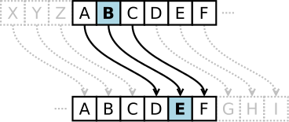

## Cifrado César

En criptografía, el [cifrado César](https://es.wikipedia.org/wiki/Cifrado_C%C3%A9sar) es una de
las técnicas de cifrado más simples y más usadas.

Es un tipo de cifrado en el que una letra en el texto original es reemplazada por otra letra que
se encuentra un número fijo de posiciones más adelante en el alfabeto.

Por ejemplo, con un desplazamiento de 3, la A sería sustituida por la D
(situada 3 lugares a la derecha de la A), la B sería reemplazada por la E, etc.

{width=400 fig-align="center"}

Escriba una función, y luego un _script_, que permita cifrar y descifrar cadenas usando el
cifrado César con un número arbitrario de posiciones.

Dos funciones incluidas con Python que pueden ser útiles para esta tarea son `ord()`,
que convierte caracteres numéricos a números, y `chr()`, que realiza la operación inversa.

::: {.callout-tip collapse="true"}

## Ayuda

Para el cifrado de un único caracter:

* Definir un `desplazamiento`, por ejemplo `3`.
* Convertir el caracter a número usando `ord()`.
* Sumarle `desplazamiento`.
* Finalmente, convertirlo a caracter nuevamente utilizando `chr()`.

Y para el descifrado:

* Convertir el caracter a número.
* Restarle `desplazamiento`.
* Convertirlo a caracter nuevamente utilizando `chr()`.

Así, se debería recuperar el caracter definido al principio.

:::

## Números aleatorios

Construya un programa en Python que genere una cantidad determinada de números aleatorios
uniformes dentro de un rango definido por el usuario. El programa debe:

* Solicitar al usuario la cantidad de números a generar y los valores mínimo y máximo del rango.
* Generar los números aleatorios
* Guardar los números en un archivo de texto, uno por línea.
* Ofrecer la opción de mostrar un resumen estadístico con mínimo, máximo, media y desvío estándar,
solo si el usuario lo solicita.

Para resolver este problema utilice el módulo `random` y las funciones desarrolladas en el
ejercicio **Resúmenes estadísticos** guardadas en un módulo llamado `estadistica.py`.

## Mensaje al descubierto

Resulta que Franco, un amigo que estudia Ciencias de la Computación en la FCEIA, te envía por
WhatsApp un archivo de texto plano con mensajes "encriptados" usando caracteres sobrantes y
símbolos extraños:

```
    !!!,.,  aY??/u/DAM**e,, se =m!!e
&&M&&e v!o!?LV...I.O /L/*oC/*o
        __?e_?l//+ T++**e/*Cl!?aD==*O**
```

Tiene sentido pensar que está experimentando con nuevos algoritmos de cifrado y, de paso, te
lanza el reto de descifrarlo.

Tu misión es escribir un programa que:

1. Lea un archivo de texto plano cualquiera.
1. Muestre en pantalla su contenido original (tal cual llega).
1. Aplique un proceso de limpieza basado en las siguientes reglas:
    i. Eliminar todos los caracteres `+`, `*`, `-`, `/`, `=`, `!`, `?`, `&` y `_`.
    i. Reemplazar cualquier secuencia de espacios múltiples por un solo espacio.
    i. Homogeinizar la capitalización de los caracteres.
    i. Conservar los saltos de línea tal cual aparecen en el archivo original.
1. Muestre en pantalla la versión desencriptada del texto.
1. Guarde la versión limpia en un nuevo archivo de texto.
    * El usuario debe poder especificar el nombre del archivo de salida.
    * Si no lo hace, se generará uno con el sufijo `_limpio` antes de la extensión original
    (por ejemplo, `secreto.txt` → `secreto_limpio.txt`).

## Código Morse

El código Morse es un sistema utilizado para representar letras mediante combinaciones específicas
de señales cortas y largas, denominadas puntos (`.`) y rayas (`-`).
A continuación se muestra un diccionario con el mapeo de caracteres alfabéticos,
dígitos del 0 al 9 y algunos símbolos de puntuación comunes:

```python
mapeo_morse = {
    "A": ".-",
    "B": "-...",
    "C": "-.-.",
    "D": "-..",
    "E": ".",
    "F": "..-.",
    "G": "--.",
    "H": "....",
    "I": "..",
    "J": ".---",
    "K": "-.-",
    "L": ".-..",
    "M": "--",
    "N": "-.",
    "O": "---",
    "P": ".--.",
    "Q": "--.-",
    "R": ".-.",
    "S": "...",
    "T": "-",
    "U": "..-",
    "V": "...-",
    "W": ".--",
    "X": "-..-",
    "Y": "-.--",
    "Z": "--..",
    "1": ".----",
    "2": "..---",
    "3": "...--",
    "4": "....-",
    "5": ".....",
    "6": "-....",
    "7": "--...",
    "8": "---..",
    "9": "----.",
    "0": "-----",
    ", ": "--..--",
    ".": ".-.-.-",
}
```

Escriba una función en Python que permita convertir cualquier palabra a código Morse utilizando
este diccionario. Luego, escriba otra función que haga exactamente lo contrario:
dada una secuencia en código Morse, debe recuperar la palabra original. Finalmente, incorpore
ambas funciones en un _script_ principal que combine ambas funciones y permita encriptar o
desencriptar texto desde un archivo de texto plano. El programa debe recibir:

* El nombre del archivo de entrada.
* El nombre del archivo de salida.
* La operación a realizar (encriptar o desencriptar).

**Ayuda**: Para indicar espacios en código Morse utilice `/`. 