## Introducción

En esta unidad empezamos a estudiar estructuras de datos y algoritmos.

Puede que estos términos suenen un tanto abstractos, pero como veremos a lo largo de estos apuntes,
dominarlos nos ayudará a escribir código más eficiente, que corre más rápido y consume menos memoria.

En pocas palabras, podemos decir que una estructura de datos es una forma sistemática de organizar y
acceder a datos, mientras que un algoritmo es un procedimiento paso a paso para realizar una tarea
en tiempo finito.

### Ejemplo disparador

A lo largo de este curso hemos ido adquiriendo experiencia en la programación con Python y probablemente
hayamos empezado a desarrollar un instinto u olfato que nos permite juzgar la calidad de un programa.
Al enfrentarnos con dos programas que realizan la misma tarea, podemos determinar si uno es mejor que otro.

No hay un único aspecto que determina la calidad de un programa. Uno de ellos, por ejemplo, es la mantenibilidad.
Una base de código legible, organizada y modular es más fácil de mantener que otra poco legible, desorganizada y monolítica.

La eficiencia es otro aspecto que determina la calidad de un programa.
Por ejemplo, podemos contar con dos funciones que resuelven el mismo problema,
pero una de ellas es más rápida que la otra.

Las dos funciones debajo resuelven exactamente el mismo problema: imprimir los números pares entre 2 y 100.

```python
def imprimir_numeros_1():
    numero = 2
    while numero <= 100:
        if numero % 2 == 0:
            print(numero)
        numero += 1

def imprimir_numeros_2():
    numero = 2
    while numero <= 100:
        print(numero)
        numero += 2
```

Sin embargo, cabe preguntarse: ¿cuál de las dos funciones es más rápida?

La respuesta correcta es la segunda.
La primera función realiza 99 iteraciones, mientras que la segunda solo realiza 50.
Por lo tanto, la primera función realiza **aproximadamente el doble de iteraciones** que la segunda para resolver el mismo problema.

## Estructuras de datos

La palabra **datos** es sencilla y amplia a la vez.
Puede referirse tanto a valores elementales, como el número `1`, como a estructuras más complejas, por ejemplo, los datos contenidos en un diccionario anidado.

Cuando realizamos una operación como `3 + 5`, los valores 3 y 5 son los datos con los que trabajamos.
En particular, las estructuras de datos se refieren al **cómo** se organizan los datos.

Observemos el siguiente bloque de código:

```python
x = "¡Hola! "
y = "¿Cómo estás? "
z = "¿Todo bien?"

print(x + y + z)
```

```text
¡Hola! ¿Cómo estás? ¿Todo bien?
```

En este programa sencillo se cuenta con tres datos, todos ellos cadenas de texto, que al combinarse forman un mensaje coherente.

Si tuviéramos que describir la organización de los datos en este bloque de código,
diríamos que se tienen tres cadenas de texto independientes,
cada una representada por una variable distinta.

Pero esta no es la única forma de organizar estos datos.
Otra alternativa consiste en agrupar las cadenas de texto en un arreglo, del inglés _array_, que en Python se implementa mediante listas.

```python
arreglo = ["¡Hola! ", "¿Cómo estás? ", "¿Todo bien?"]

print(arreglo[0] + arreglo[1] + arreglo[2])
```

```text
¡Hola! ¿Cómo estás? ¿Todo bien?
```

El resultado de ambos bloques es el mismo: se obtiene un único mensaje como resultado de concatenar todas las cadenas de texto, formando un mensaje coherente.

Ahora, si nos preguntamos cuál de los dos programas es mejor, no existe una única respuesta correcta,
ya que dependerá del criterio con el cual se comparan los bloques de código.

El objetivo de este ejemplo es mostrar que no existe una única forma de organizar los datos de un programa.
Más adelante veremos que la forma en que los organizamos no solo afecta cómo se ve un programa, sino también su velocidad de ejecución.
Dependiendo de cómo decidamos representar los datos, un programa puede llegar a ser varios órdenes de magnitud más rápido o más lento que otro.

Pero antes de correr, hay que aprender a caminar.
Empecemos por una estructura de datos con la que estamos más que familiarizados: los arreglos.

### Arreglos

El arreglo es una de las estructuras de datos más básicas en la computación.
En Python, la estructura _built-in_ que representa al arreglo es la lista, con la que ya hemos trabajado extensamente.
Gracias a ello, aprendimos que el arreglo es una estructura de datos muy versátil, que nos puede ayudar en una gran variedad de situaciones.

Si tuviéramos que describir al arreglo en pocas palabras, diríamos que es una colección de datos en un orden determinado.

Para lo que sigue, consideremos al siguiente arreglo que contiene diferentes tipos de frutos secos:

```python
array = ["nueces", "almendras", "pistachos", "maníes", "castañas"]
```

Rápidamente, podríamos decir que trabajamos con un arreglo que contiene 5 cadenas de texto, y que cada una representa un fruto seco distinto.

Pero los arreglos, al igual que otras estructuras de datos, cargan con vocabulario técnico propio para describirlos:

* El tamaño (_size_) del arreglo indica cuántos elementos contiene. En nuestro ejemplo, `array` es un arreglo de tamaño 5.
* El índice (_index_) es el número que identifica la posición de cada elemento dentro de él.

Como en Python el índice comienza en 0, decimos que `"nueces"` está en el índice 0, `"almendras"` en el índice 1 y que `"castañas"` está en el índice 4.

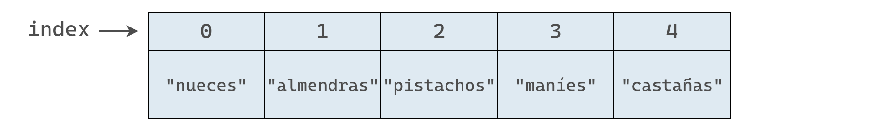{fig-align="center" width="800px"}

#### ¿Qué tan buena es una estructura de datos?

Una forma de determinar qué tan buena es una estructura de datos es midiendo su desempeño para realizar diferentes operaciones.
Para ello, se suelen considerar cuatro operaciones básicas que se utilizan para interactuar con la estructura:

* Lectura (_read_): acceder a un valor en una posición específica dentro de la estructura.
En un arreglo, significa obtener el elemento que se encuentra en un índice determinado.
* Búsqueda (_search_): verificar si un valor existe dentro de la estructura y, de ser así, obtener en qué posición se encuentra.
* Inserción (_insert_): agregar un nuevo valor a la estructura. En un arreglo, sería añadir un elemento en una posición determinada.
* Eliminación (_delete_): quitar un valor existente de la estructura.

En las próximas secciones analizaremos la eficiencia de cada una de estas operaciones cuando se aplican a un arreglo.

::: {.callout-note}

##### Viejos conocidos

Ya sabemos cómo realizar operaciones de lectura, búsqueda, inserción y eliminación con listas de Python. 
De hecho, para cada una de ellas disponemos de un método específico:

```python
# Lectura
array[indice]

# Búsqueda
array.index(valor)

# Inserción
array.insert(indice, valor)

# Eliminación
array.pop(indice) # Por índice
array.remove(valor) # Por valor
```

Sin embargo, el propósito de esta unidad es comprender cómo funcionan internamente estas operaciones,
para así entender las fortalezas y limitaciones de cada estructura de datos.

:::

#### ¿Cómo se mide la velocidad de una operación?

Cuando hablamos de qué tan "rápida" es una operación no nos referimos al tiempo en segundos,
sino a la **cantidad de pasos** que requiere.

Esto se debe a que el tiempo real depende del _hardware_ donde se ejecuta la operación.
Un mismo programa puede tardar más en una computadora antigua y menos en una moderna.
En cambio, contar los pasos nos permite comparar operaciones independientemente del equipo donde se ejecuten.

Por ejemplo, si una operación A necesita 5 pasos y otra B requiere 500, podemos afirmar que A es una operación más rápida que B.

Para analizar la complejidad temporal (_time complexity_) de una operación, estudiamos cómo crece esa cantidad de pasos al aumentar el tamaño del problema.

A continuación, veremos cuántos pasos requiere cada una de las cuatro operaciones básicas de un arreglo.

#### Lectura

La primera operación que analizaremos es la lectura, que consiste en acceder al valor almacenado en una posición específica del arreglo.
En Python, esto se realiza simplemente con el índice:

```python
array[indice]
```

Por ejemplo:

```python
array = [30, 10, 15, 25, 85]
array[4]  # Devuelve 85
```

Gracias al diseño de la memoria RAM (_Random Access Memory_),
que permite acceder directamente a cualquier posición sin recorrer otras,
la computadora puede leer un elemento de un arreglo en un solo paso.

Por ejemplo, en el arreglo `["nueces", "almendras", "pistachos", "maníes", "castañas"]`,
si pedimos el valor en el índice `2`, el procesador accede "de inmediato" a la posición correspondiente y devuelve `"pistachos"`.

##### ¿Por qué esto es posible?

De manera simplificada, podemos imaginar la memoria como una gran colección de celdas numeradas (algunas vacías, otras con datos).

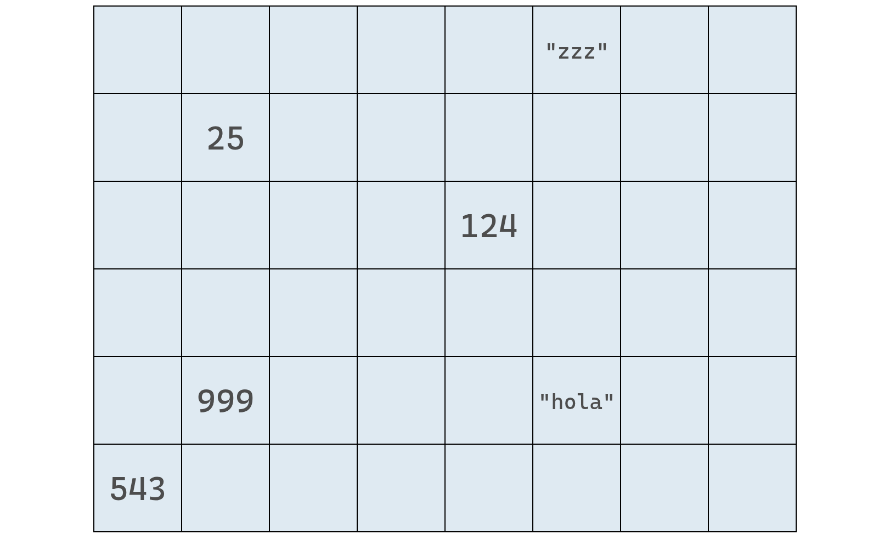{fig-align="center" width="700px"}

Cada celda tiene una dirección única.

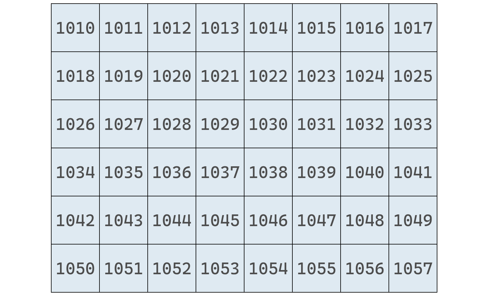{fig-align="center" width="700px"}

Y cuando declaramos un arreglo, la computadora reserva un bloque contiguo de celdas para almacenarlo.

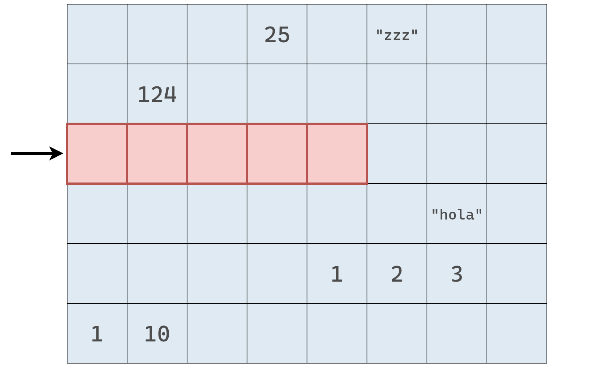{fig-align="center" width="700px"}

Así, si el arreglo ocupa cinco posiciones, el sistema reserva cinco celdas consecutivas.

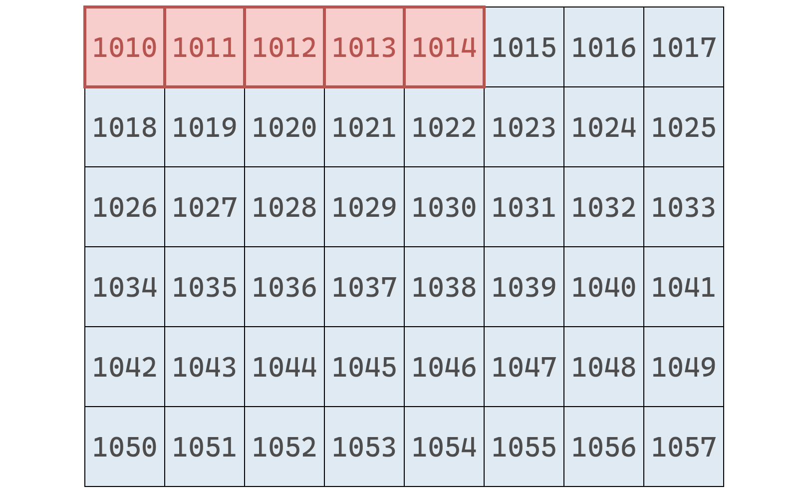{fig-align="center" width="700px"}

En este modelo simplificado, el procesador puede calcular la dirección correspondiente al índice `i` mediante una operación aritmética simple:

```cmd
dirección_base + i
```

Esto explica el nombre memoria de acceso aleatorio:
cualquier celda puede leerse o modificarse en el mismo tiempo, sin importar su posición,
a diferencia de medios secuenciales (como los discos duros), donde hay que desplazarse físicamente hasta el dato.

En el siguiente diagrama se muestra nuestro arreglo de frutos secos junto con sus índices y direcciones de memoria:

Cada índice indica la posición lógica del elemento dentro del arreglo,
mientras que cada dirección representa la ubicación física de ese dato en la memoria RAM.

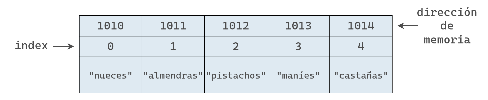{fig-align="center" width="800px"}

Por ejemplo, si queremos leer el valor en el índice 3, la computadora toma la dirección inicial (índice 0) y le suma 3,
ya que en nuestro modelo las direcciones de las celdas son consecutivas.

Aplicado a nuestro arreglo de frutos secos, que comienza en la dirección 1010:

1. El índice 0 está en la dirección 1010.
2. El índice 3 está tres posiciones después.
3. Por lo tanto, su dirección es 1013 (1010 + 3).

Así, la computadora puede saltar directamente a la dirección 1013 y acceder al valor `"maníes"`.

Leer desde un arreglo es, por tanto, una operación muy eficiente, porque permite acceder a cualquier elemento en un solo paso.

::: {.callout-note}
##### El tamaño de cada elemento

En los diagramas usamos celdas con direcciones consecutivas para simplificar la explicación.
En la memoria real, las direcciones se miden en bytes y cada elemento del arreglo puede ocupar varios bytes.
Por eso, para calcular la dirección de un elemento, hay que tener en cuenta su tamaño:

```text
dirección_base + i * tamaño_del_elemento
```

Por ejemplo, si cada elemento ocupa 8 bytes y el arreglo comienza en la dirección 1000, las posiciones siguientes comienzan en 1008, 1016, 1024, etc.
Para llegar al índice 3, avanzamos $3 \times 8 = 24$ bytes desde el inicio y obtenemos la dirección 1024.

En una lista de Python, ese tamaño corresponde a la referencia al objeto.
Por ejemplo, en CPython de 64 bits cada referencia ocupa 8 bytes.
El tamaño de los objetos a los que apuntan esas referencias puede variar.

En todos estos casos, la dirección se obtiene mediante un cálculo directo, por lo que el costo de la lectura sigue siendo constante.
:::

Ahora bien, ¿qué ocurre si en lugar de preguntar "qué valor hay en el índice 3" queremos saber "en qué índice se encuentra 'pistachos'"?

Esa es la operación de búsqueda, y será la próxima que analizaremos.

#### Búsqueda

Buscar en un arreglo consiste en comprobar si un valor existe y, de ser así, obtener en qué índice se encuentra.

A la búsqueda se la puede pensar como la operación inversa a la lectura.
Mientras que leer implica dar un índice y obtener un valor, buscar implica dar un valor y obtener su índice.

Aunque parezcan operaciones similares, su eficiencia difiere muchísimo.

La lectura es rápida porque la computadora puede saltar directo a cualquier dirección de la memoria.
En cambio, la búsqueda es más lenta, ya que la computadora no puede saltar a un valor específico, sino que debe revisar las celdas una por una hasta encontrarlo.

Si retomamos nuestro arreglo de frutos secos, la computadora no "ve" los nombres de los elementos, solo una secuencia de celdas con direcciones.
Al comenzar la búsqueda, para la computadora, el arreglo podría verse de la siguiente manera.

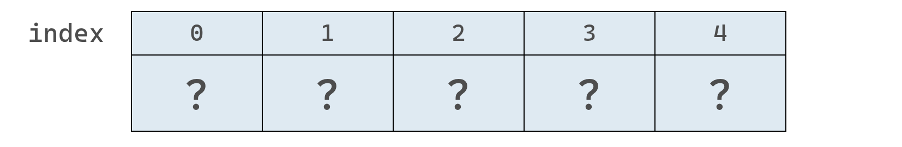{fig-align="center" width="700px"}

Por lo tanto, para buscar un valor dentro del arreglo, la computadora no tiene otra opción que inspeccionar cada celda de la memoria, una por una.

En los diagramas siguientes se muestra el proceso que seguiría para buscar `"pistachos"` en nuestro arreglo.

Primero, la computadora revisa el índice 0:

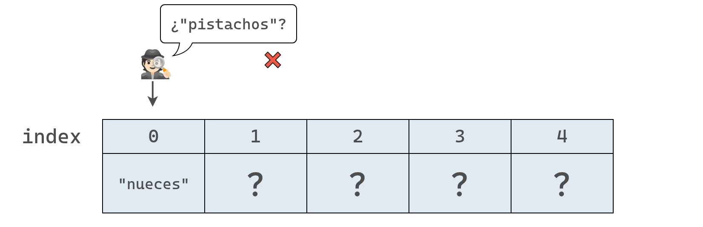{fig-align="center" width="700px"}

Como el valor en el índice 0 es "nueces" y no "pistachos", la computadora avanza al siguiente índice, tal como se muestra a continuación.

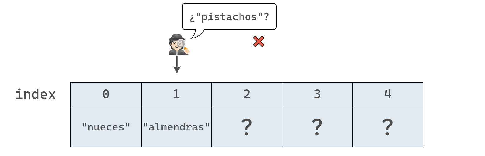{fig-align="center" width="700px"}


Hasta que al fin encontramos los tan buscados `"pistachos"` y ahora sabemos que se encuentran en el índice 2.

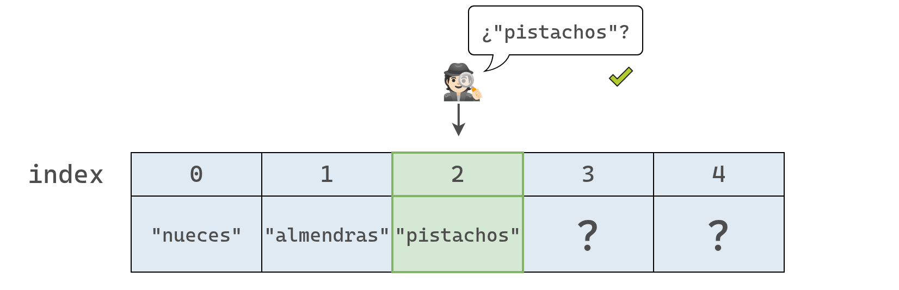{fig-align="center" width="700px"}

En este punto, la computadora ya no necesita seguir revisando el resto del arreglo, porque encontró el valor que buscaba.

En este ejemplo, como la computadora tuvo que inspeccionar tres celdas hasta dar con el resultado, decimos que la operación tomó tres pasos en total.

Esta forma de búsqueda, en la que la computadora revisa cada celda una por una, se llama **búsqueda lineal**.

Si el valor buscado está en la última celda, o no se encuentra en absoluto, la computadora deberá recorrer todo el arreglo.

Así, en un arreglo de 5 elementos, la búsqueda lineal puede requerir hasta 5 pasos; en uno de 500, hasta 500.
En general, para un arreglo de N elementos, el número máximo de pasos es N.

Esto demuestra que la búsqueda es menos eficiente que la lectura: leer siempre toma una cantidad constante de pasos (1), mientras que buscar puede requerir muchos.

A continuación veremos la operación de inserción.

#### Inserción

La eficiencia de insertar un nuevo dato en un arreglo depende del lugar donde se realice la inserción.

Si queremos agregar `"pasas"` al final de nuestra lista de frutos secos, la operación toma un solo paso.
Esto es posible porque la computadora conoce tanto la dirección de memoria inicial del arreglo como su tamaño.

Por ejemplo, si el arreglo comienza en la dirección 1010 y tiene 5 elementos, el último se encuentra en 1014.
Insertar uno nuevo implica ocupar la siguiente posición, 1015, si hay capacidad disponible.

Una vez calculada esa posición, la computadora puede realizar la inserción en un único paso.

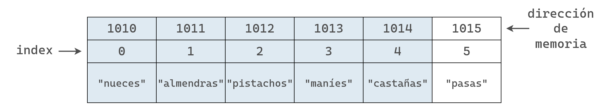{fig-align="center" width="800px"}

Si el bloque reservado para el arreglo solo tiene cinco celdas, agregar un sexto elemento requiere ampliar su capacidad.

Insertar al final es simple, pero hacerlo al inicio o en el medio requiere desplazar los elementos para dejar espacio, lo que añade pasos adicionales.

Por ejemplo, si queremos insertar `"pasas"` en el índice 2, el proceso sería así:

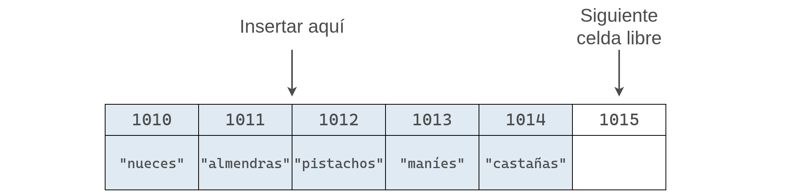{fig-align="center" width="800px"}

Para hacerlo, debemos mover `"pistachos"`,  `"maníes"` y `"castañas"` una posición a la derecha para hacer espacio a `"pasas"`.

Esto requiere varios pasos: primero se mueve `"castañas"` una celda a la derecha, lo que libera un espacio a la derecha de `"maníes"`.

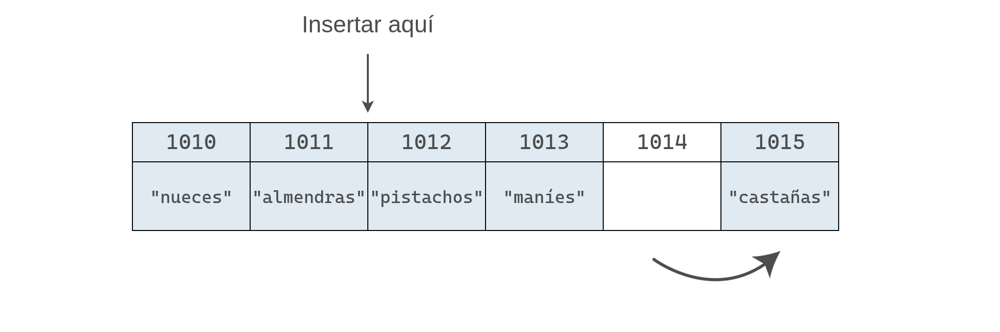{fig-align="center" width="800px"}

Luego, se mueve `"maníes"` a la derecha, dejando un espacio a la derecha de `"pistachos"`.

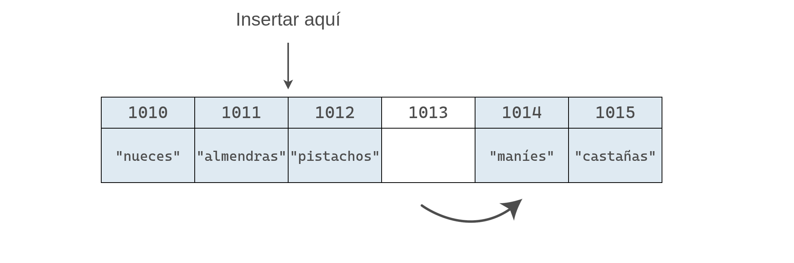{fig-align="center" width="800px"}

Por último, se mueve `"pistachos"` a la derecha y se genera el hueco donde se inserta el valor de `"pasas"`.

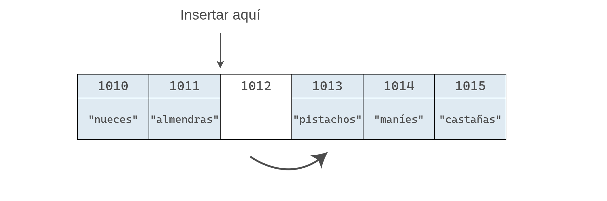{fig-align="center" width="800px"}

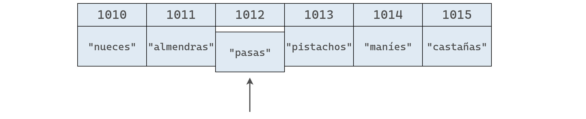{fig-align="center" width="800px"}

Al final, se cuenta con un arreglo de longitud 6, donde `"pasas"` ocupa el índice 2.

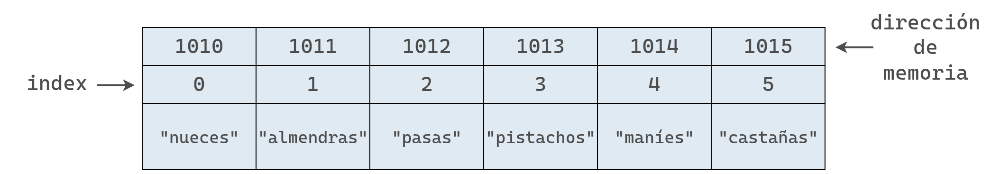{fig-align="center" width="800px"}

En este ejemplo la inserción tomó cuatro pasos: tres para mover datos y uno para agregar el nuevo valor.

El peor caso ocurre al insertar al inicio del arreglo, ya que hay que desplazar todos los elementos una posición a la derecha.
En general, una inserción en el peor escenario requiere N + 1 pasos para un arreglo de N elementos.

::: {.callout-note}
##### Una dosis de precisión 🎯

Los diagramas muestran un modelo simplificado de almacenamiento.
En Python una lista es un **arreglo dinámico de referencias a objetos**.
Las referencias ocupan posiciones contiguas en memoria, mientras que los objetos a los que apuntan pueden estar en otras ubicaciones.
Por eso, en nuestro ejemplo, cada celda representa una referencia a una cadena de texto.

Además, una lista puede reservar espacio para más elementos de los que contiene.
Mientras haya capacidad disponible, agregar un elemento al final requiere una cantidad constante de operaciones.
Cuando esa capacidad se agota, ampliar el almacenamiento puede requerir copiar las referencias a un bloque más grande, con un costo proporcional al tamaño de la lista.

Como se reserva espacio adicional para futuras inserciones, el costo por agregado, repartido entre una secuencia de agregados, es constante.
A esto se lo llama **costo constante amortizado**.
:::


Ahora pasemos a la última operación: la eliminación.

#### Eliminación

Eliminar un elemento de un arreglo consiste en quitar el valor ubicado en un índice determinado.

Volviendo a nuestro ejemplo original, eliminemos el valor del índice 1, que corresponde a `"almendras"`.

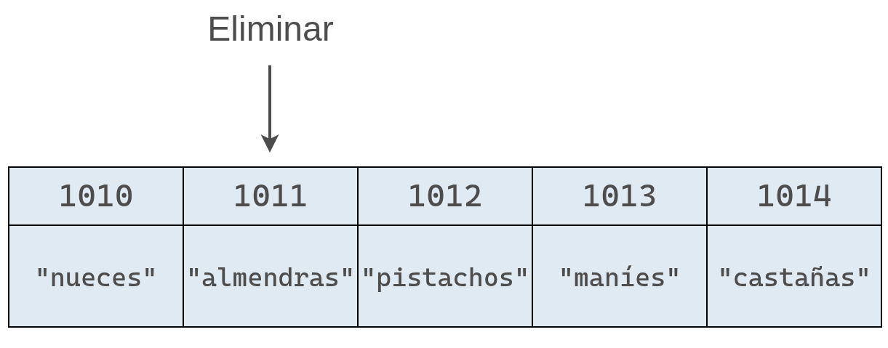{fig-align="center" width="600px"}

Aunque la eliminación en sí toma solo un paso, deja una celda vacía en el medio del arreglo.
Como un arreglo no puede tener huecos, es necesario mover los elementos `"pistachos"`, `"maníes"` y `"castañas"` una posición a la izquierda, lo que agrega pasos adicionales al proceso.

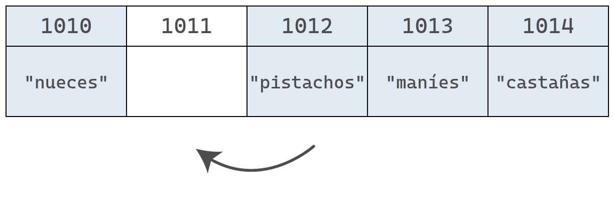{fig-align="center" width="600px"}

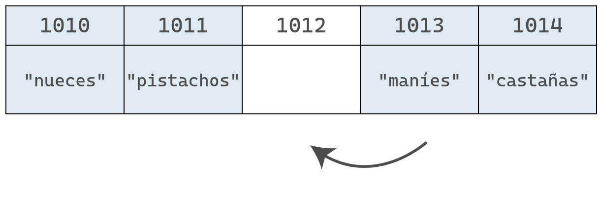{fig-align="center" width="600px"}

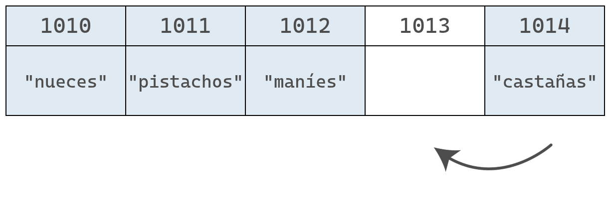{fig-align="center" width="600px"}

Finalmente, el arreglo se encoge y pasa de tener 5 elementos a tener 4.

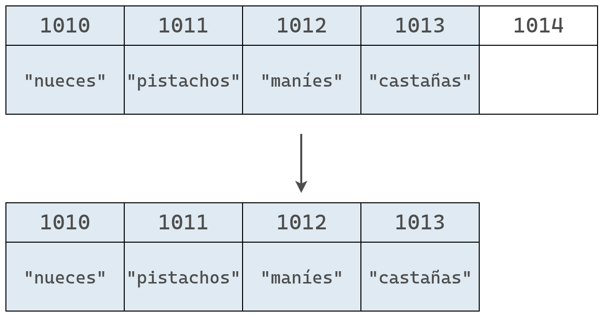{fig-align="center" width="600px"}

En este ejemplo la eliminación toma cuatro pasos: uno para borrar el valor y tres para mover los datos y cerrar el espacio vacío.

Al igual que con la inserción, el peor caso ocurre al eliminar el primer elemento del arreglo,
ya que el índice 0 queda vacío y es necesario desplazar todos los demás elementos una posición a la izquierda.

En un arreglo de 5 elementos, eso implica 1 paso para eliminar y 4 para mover; en uno de 500, 1 para eliminar y 499 para desplazar.
En general, para un arreglo con N elementos, la eliminación puede requerir hasta N pasos.

Con esto concluimos el análisis de la complejidad temporal de nuestro primer tipo de estructura de datos.

Ahora que comprendemos cómo evaluar la eficiencia de las operaciones sobre un arreglo, podemos comparar este comportamiento con el de otras estructuras.

La siguiente que estudiaremos es el conjunto (*set*), que a primera vista puede parecer similar a un arreglo, pero veremos que sus operaciones se comportan de manera muy diferente en términos de eficiencia.

### Conjuntos

En esta breve sección trabajaremos con otra estructura de datos: el conjunto.

El conjunto puede ser implementado de diferentes maneras.
En Python, por ejemplo, el conjunto es una estructura donde el orden de los elementos no importa.

Podemos también suponer un conjunto basado en arreglos.
Es decir, la estructura consiste en un arreglo que no permite valores duplicados.

En un conjunto basado en un arreglo, las operaciones de lectura, búsqueda y eliminación funcionan igual que en los arreglos.
Leer un elemento toma un solo paso y buscar o eliminar puede requerir hasta N pasos.
La diferencia aparece en la inserción.

Dada la condición de que no se pueden repetir elementos en un conjunto, antes de agregar un valor,
la computadora debe verificar que este no exista ya en el conjunto.

Esta pequeña modificación implica que para cada inserción primero hay que hacer una búsqueda previa y,
solo si el valor no está presente, efectuar la inserción.

Por ejemplo, si un conjunto con nombres de alumnos contiene `["Ana", "Bruno", "Carla", "Diego", "Elena"]` y queremos agregar `"Francisco"`,
la computadora primero comprobará que `"Francisco"` no esté ya inscripto antes de añadirlo.

Se inspeccionan los elementos del conjunto uno a uno, hasta que se encuentra el elemento a insertar o se termina de recorrer el arreglo.
Las siguientes imágenes representan el proceso en nuestro ejemplo:

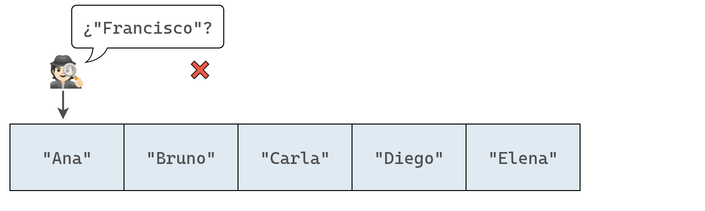{fig-align="center" width="700px"}

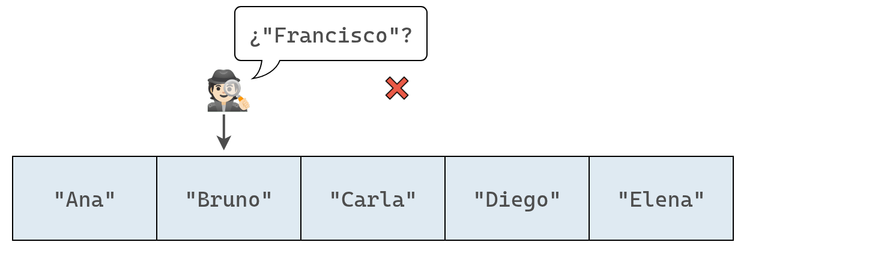{fig-align="center" width="700px"}

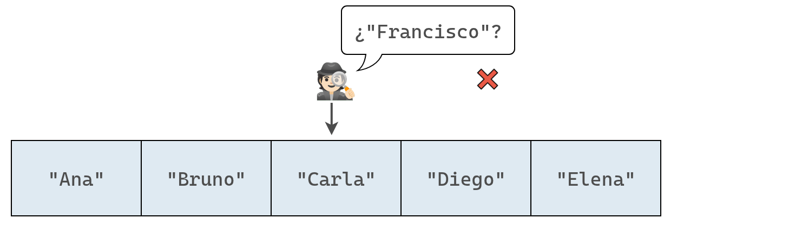{fig-align="center" width="700px"}

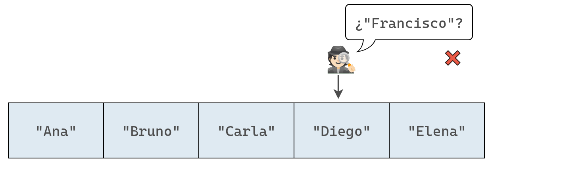{fig-align="center" width="700px"}

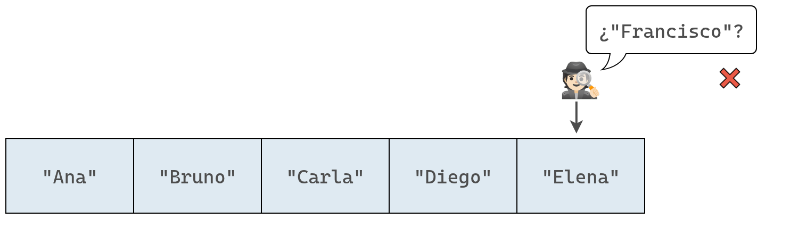{fig-align="center" width="700px"}

Ahora que hemos buscado en todo el conjunto, sabemos con certeza que no contiene a `"Francisco"`.

En este punto, podemos realizar la inserción sin problema. Y con eso llegamos al paso final:

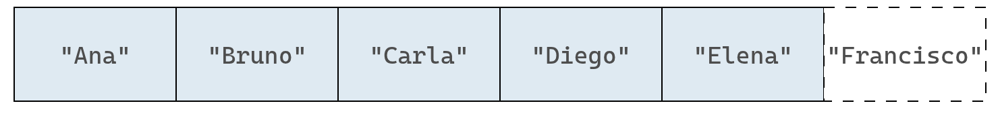{fig-align="center" width="700px"}

Insertar un valor al final de un conjunto es el mejor caso posible, pero aun así requiere más pasos que en un arreglo.

En un conjunto con N elementos, hay que buscar entre los N valores antes de insertar, lo que implica N + 1 pasos, mientras que en un arreglo basta con uno.

En el peor caso, al insertar al inicio, el conjunto requiere 2N + 1 pasos (N para buscar, N para mover y uno para insertar), frente a los N + 1 de un arreglo.

::: {.callout-note}

#### Contando pasos 👣

Analizar cuántos pasos requiere una operación es clave para entender el rendimiento de una estructura de datos.
Elegir la estructura correcta puede marcar la diferencia entre un programa ágil y uno ineficiente.
:::

::: {.callout-note}
##### Más dosis de precisión 🎯

En esta sección analizamos un **conjunto implementado sobre un arreglo**, para estudiar cómo la condición de unicidad afecta las operaciones.

El tipo `set` de Python usa una **tabla _hash_**, una organización que permite buscar, agregar y eliminar elementos con costo constante en promedio.
Algunas operaciones pueden tener un costo proporcional a la cantidad de elementos, por ejemplo, cuando es necesario ampliar la tabla.
:::


## Algoritmos

En la sección anterior vimos cómo la elección de una estructura de datos puede afectar el rendimiento del código.
Incluso dos estructuras que parecen similares, como los arreglos y los conjuntos, pueden tener eficiencias muy distintas según la operación.

En esta sección vamos a descubrir que, además de la estructura de datos, otro factor clave influye en la eficiencia: el algoritmo que usamos.

Aunque la palabra pueda sonar compleja, un algoritmo no es más que un conjunto de pasos definidos para realizar una tarea.
Por ejemplo, preparar un mate puede describirse con estos pasos:

1. Calentar el agua.
2. Colocar la yerba en el mate.
3. Insertar la bombilla.
4. Servir el agua con cuidado.

Si cambiamos el orden y, por ejemplo, echamos el agua antes de la yerba, el resultado es un mal mate o, aún peor, un enchastre total.

En computación, un algoritmo es el conjunto de instrucciones que le damos a la computadora para cumplir una tarea.
Cada vez que escribimos código, estamos creando algoritmos que la computadora sigue al pie de la letra para obtener un resultado.

A veces, distintos algoritmos pueden resolver el mismo problema, pero con eficiencias distintas.
Ya vimos un ejemplo al imprimir números pares, donde un algoritmo realizaba aproximadamente el doble de iteraciones que otro.
En esta sección veremos otro caso similar, en el que una solución resulta mucho más rápida que la otra,
y para analizarlo presentaremos una nueva estructura de datos.

### Arreglos ordenados

El arreglo ordenado es casi idéntico al arreglo clásico que vimos antes.

La única diferencia es que en un arreglo ordenado los valores deben mantenerse siempre en orden.
Cada vez que se agrega un nuevo valor, este se coloca en la posición correcta para conservar ese orden.

Supongamos que tenemos el arreglo `[6, 21, 38, 95]` y queremos insertar el valor `30`.
En un arreglo común podríamos agregarlo simplemente al final y tomaría un solo paso.

Con un arreglo ordenado no podemos insertar al final en un solo paso,
ya que podría resultar en un arreglo que no cumple el requisito de que los valores estén ordenados.

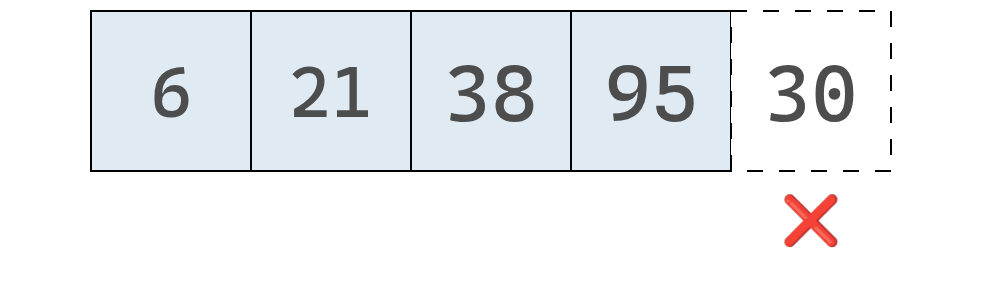{fig-align="center" width="500px"}

En un arreglo ordenado debemos insertar el `30` en el lugar correspondiente para que los valores sigan en orden ascendente, como se muestra debajo:

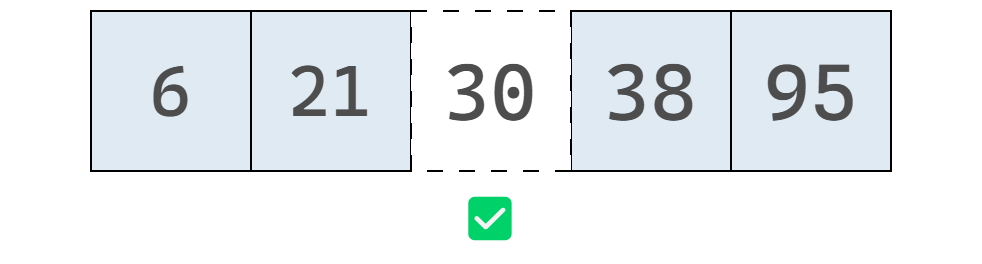{fig-align="center" width="500px"}

En la práctica, llevar a cabo esta inserción es más complejo que su simple enunciación.
La computadora no puede "poner" el 30 en el lugar correcto en un solo paso.
Primero debe encontrar dónde insertarlo y luego desplazar los demás valores para crear el espacio necesario.

Veamos el proceso paso a paso, partiendo del arreglo ordenado original:

{fig-align="center" width="500px"}

Primero verificamos el valor en el índice 0 para decidir si el número que queremos insertar, el 30, debe ubicarse a su izquierda o a su derecha.

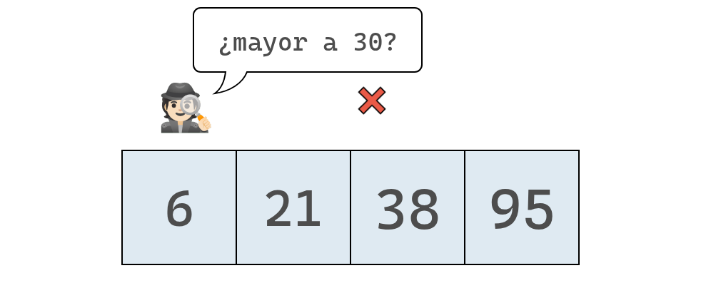{fig-align="center" width="500px"}

Como el 30 es mayor que 6, sabemos que deberá insertarse en alguna posición a su derecha.
Como aún no sabemos en cuál posición exactamente, debemos revisar la siguiente celda.

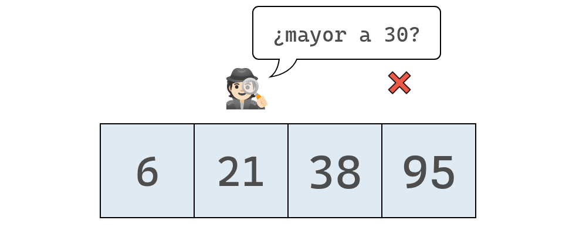{fig-align="center" width="500px"}

Como el 30 también es mayor que el valor en la segunda posición, seguimos avanzando hacia la derecha.

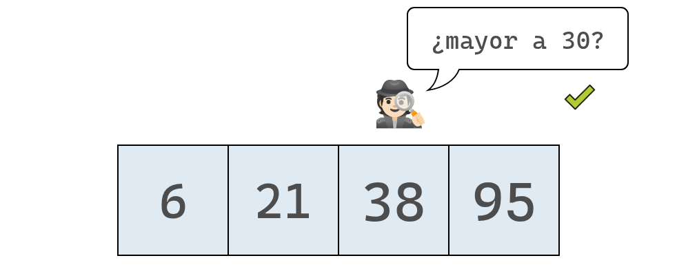{fig-align="center" width="500px"}

En este punto, encontramos el valor 38, que es mayor que el 30 y, por lo tanto, sabemos que debemos insertar el 30 a su izquierda.

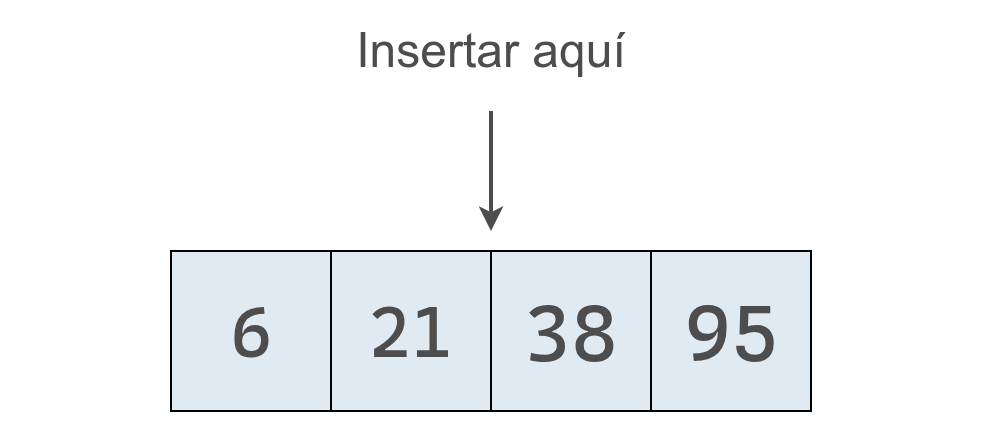{fig-align="center" width="500px"}

Para hacerlo, necesitamos desplazar los datos y dejar espacio para insertar el 30.

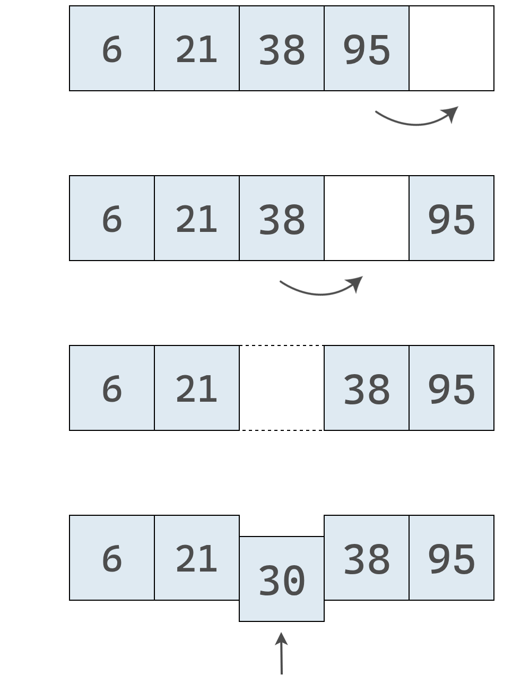{fig-align="center" width="500px"}

Cuando insertamos en un arreglo ordenado, siempre debemos buscar primero la posición correcta antes de hacer la inserción.
Esa búsqueda previa marca una diferencia importante respecto al arreglo clásico.

En el ejemplo, con cuatro elementos, la inserción tomó 6 pasos. En términos generales, para un arreglo con N elementos, la inserción requiere N + 2 pasos.

El número total de pasos varía poco según la posición del nuevo valor: si se inserta cerca del inicio, hay menos comparaciones y más desplazamientos.
Si se inserta al final, hay más comparaciones y menos movimientos.
El caso más rápido ocurre cuando el nuevo valor se agrega al final, ya que no hay que mover nada: se necesitan N pasos de comparación y uno de inserción, es decir, N + 1 pasos.

Aunque insertar en un arreglo ordenado es menos eficiente que en uno clásico, esta estructura tiene una gran ventaja cuando se trata de buscar valores, como veremos a continuación.

### Búsqueda en arreglos ordenados

En un arreglo clásico, buscar un valor implica revisar las celdas una por una, de izquierda a derecha, hasta encontrarlo o llegar al final. Este proceso se conoce como búsqueda lineal.

Por ejemplo, si tenemos el arreglo `[67, 25, 13, 6, 132]` y buscamos el valor `21`,
debemos recorrer todos los elementos, ya que podría estar en cualquier posición.
Solo podríamos detenernos temprano si encontráramos el valor `21`.

En cambio, en un arreglo ordenado podemos detener la búsqueda antes, incluso si el valor no está presente.
Si el arreglo es `[6, 13, 25, 67, 132]` y buscamos `21`, podemos detenernos al llegar al `25`, porque todos los valores posteriores son mayores o iguales a `25` y, por lo tanto, mayores a `21`.

```python
def busqueda_lineal(array, valor):
    for indice, elemento in enumerate(array):
        if elemento == valor:
            return indice
        elif elemento > valor:
            break
    return None
```

Este método recibe dos argumentos: `array`, que es el arreglo ordenado en el que buscamos, y `valor`, que es el valor que queremos encontrar.
Así es como usaríamos esta función para buscar el número `21` en nuestro arreglo de ejemplo:

```python
print(busqueda_lineal([6, 13, 25, 67, 132], 21))
```

```text
None
```

La función `busqueda_lineal` inspecciona cada elemento del arreglo en busca del valor indicado.
La búsqueda se detiene en el momento en que el elemento actual es mayor que el valor buscado,
ya que sabemos que este no puede encontrarse más adelante en el arreglo.

En ciertos casos, la búsqueda lineal puede requerir menos pasos en un arreglo ordenado que en uno clásico.
Sin embargo, si el valor buscado está al final o no se encuentra en el arreglo, igualmente habrá que revisar todos los valores.

A simple vista, los arreglos clásicos y los ordenados no muestran grandes diferencias en eficiencia, al menos en los peores casos: en ambos, una búsqueda lineal puede requerir hasta N pasos.

Pero existe un algoritmo mucho más eficiente que invalida nuestra temprana conclusión.
Aunque la búsqueda lineal es una opción para recorrer un arreglo ordenado, no es la única.
La gran ventaja de los arreglos ordenados es que permiten aplicar otro tipo de búsqueda:
la búsqueda binaria, un algoritmo considerablemente más rápido que la búsqueda lineal.

### Búsqueda binaria

Seguro alguna vez jugaste a esto: alguien piensa un número entre 1 y 100, y vos tenés que adivinarlo.
Después de cada intento, te dicen si el número buscado es mayor o menor.

La estrategia intuitiva no es empezar por el 1, sino por la mitad (por ejemplo, el 50).
Así, sin importar la respuesta, se eliminan de una vez la mitad de las posibilidades.

Si te dicen que el número es mayor, se puede probar con 75; si es menor, con 25.
En cada paso, se vuelve a elegir el punto medio y se reduce el conjunto de números a la mitad.

Ese es exactamente el principio detrás de la búsqueda binaria.

Veamos ahora cómo se aplica la búsqueda binaria sobre un arreglo ordenado.

Supongamos que tenemos un arreglo con nueve elementos y que estamos buscando el valor `15`.

La computadora no sabe de antemano qué valor hay en cada posición, así que podemos representarlo de esta forma:

{fig-align="center" width="700px"}

Se inspecciona el valor en la posición central:

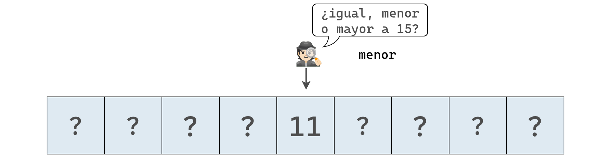{fig-align="center" width="700px"}

Como el valor encontrado es 11, podemos concluir que el 15 está a su derecha.

Así eliminamos la mitad del arreglo: todas las casillas a la izquierda del 11 (incluida la del 11).

{fig-align="center" width="700px"}

A continuación se inspecciona el centro de la mitad que puede contener al valor buscado.

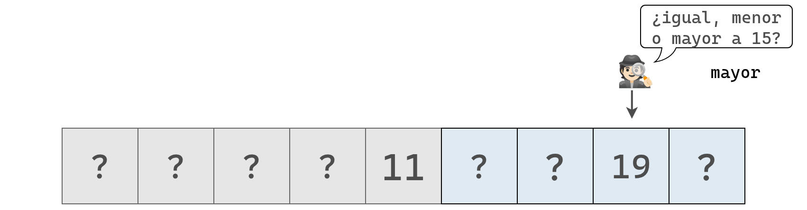{fig-align="center" width="700px"}

Como el valor hallado es mayor a 15, inspeccionamos los valores a su izquierda.

En este punto quedan dos valores posibles y elegimos arbitrariamente el de la derecha:

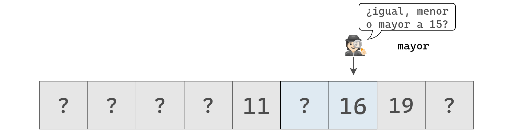{fig-align="center" width="700px"}

Nuevamente el valor hallado es mayor a 15, por lo que inspeccionamos la última celda posible.
Si el valor `15` no se encuentra allí, entonces no está en el arreglo.

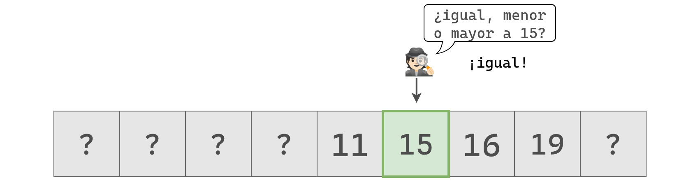{fig-align="center" width="700px"}

Esta vez, lo encontramos y podemos concluir que el 15 está en el arreglo y devolver su posición.

Con el algoritmo de búsqueda binaria nos llevó cuatro pasos encontrar el valor de interés.
Si hubiéramos usado búsqueda lineal, nos hubiera llevado 6 pasos.

En términos generales la búsqueda binaria será más rápida que la búsqueda lineal, aunque pueden existir ejemplos donde esto no suceda.
La gran desventaja de la búsqueda binaria es que solo funciona en arreglos ordenados: en uno desordenado no sabríamos hacia qué lado seguir buscando.

A continuación, una implementación del algoritmo de búsqueda binaria en Python:

```python
def busqueda_binaria(array, valor):
    limite_inferior = 0
    limite_superior = len(array) - 1

    while limite_inferior <= limite_superior:
        punto_medio = (limite_inferior + limite_superior) // 2
        valor_en_punto_medio = array[punto_medio]

        if valor == valor_en_punto_medio:
            return punto_medio
        elif valor < valor_en_punto_medio:
            limite_superior = punto_medio - 1
        elif valor > valor_en_punto_medio:
            limite_inferior = punto_medio + 1

    return None
```

```python
print(busqueda_binaria([3, 17, 75, 80, 202], 22))
```

```text
None
```

### Búsqueda lineal vs. búsqueda binaria

Con arreglos pequeños, la búsqueda binaria no tiene mucha ventaja frente a la lineal. Pero al aumentar el tamaño del arreglo, la diferencia se vuelve notable.

En un arreglo de 100 elementos, la búsqueda lineal puede requerir hasta 100 pasos, mientras que la binaria necesita solo 7.
Con la búsqueda lineal, si el valor buscado está al final, hay que revisar cada elemento.
En cambio, la búsqueda binaria descarta la mitad de las opciones en cada intento: el primer paso ya elimina 50 valores.

Si el arreglo tiene 3 elementos, la búsqueda binaria requiere 2 pasos; con 7 elementos, 3 pasos; con 15, 4 pasos.
Cada vez que se duplica el tamaño del arreglo, solo se suma un paso más.
En cambio, la búsqueda lineal duplica su número de pasos cada vez que se duplica el tamaño.

Por eso, con 10000 elementos la búsqueda binaria necesita como máximo 14 pasos, y con un millón, solo 20.
Esta eficiencia explica por qué la búsqueda binaria es tan poderosa en arreglos ordenados.

La siguiente figura ilustra el crecimiento lineal y logarítmico de las búsquedas a medida que aumenta la cantidad de elementos.

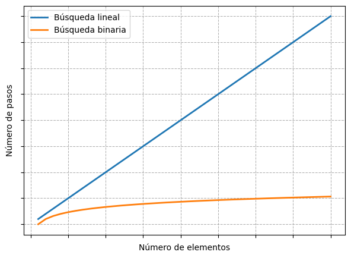{fig-align="center" width="700px"}

En el eje horizontal se representa la cantidad de elementos del arreglo: hacia la derecha, el tamaño de los datos aumenta.
En el eje vertical se representa la cantidad de pasos: cuanto más arriba, más pasos.
La curva de la búsqueda binaria usa $\log_2 N$ para ilustrar su crecimiento logarítmico. El máximo de intentos de la implementación presentada es $\lfloor \log_2 N \rfloor + 1$ para $N \geq 1$, donde $\lfloor x \rfloor$ indica la parte entera de $x$.

La línea de la búsqueda lineal crece de forma proporcional: cada nuevo elemento implica un paso adicional, por eso la gráfica forma una línea diagonal ascendente.

En cambio, la búsqueda binaria apenas aumenta su número de pasos al crecer los datos.
Para duplicar la cantidad de elementos, solo suma un paso más, lo que produce una curva que crece muy lentamente.

Conviene recordar que los arreglos ordenados no son más rápidos en todo: insertar nuevos valores es más lento que en un arreglo común.
El beneficio está en la búsqueda. Por eso, antes de elegir una estructura, hay que considerar el uso: ¿harás muchas inserciones o muchas búsquedas?

## _Big_ O

Hasta ahora vimos que la eficiencia de un algoritmo depende, principalmente, de la cantidad de pasos que realiza.

Pero no podemos decir simplemente que un algoritmo tiene "35 pasos" y otro "200 pasos", porque ese número en realidad depende del tamaño del problema.
Por ejemplo, una búsqueda lineal necesita, en el peor de los casos, tantos pasos como elementos haya en el arreglo: si hay 35 elementos, toma 35 pasos; si hay 200, toma 200.

En lugar de hablar de un número fijo de pasos, decimos que la búsqueda lineal requiere N pasos para N elementos.
Para expresar esto de forma más clara y general, la informática usa una herramienta tomada de las matemáticas: la notación _Big_ O.

La notación _Big_ O permite describir y comparar la eficiencia de los algoritmos con un lenguaje conciso y consistente.
Gracias a esta, describiremos algoritmos con $O(1)$, $O(N)$, $O(\log N)$, etc. Veamos qué significa.

### _Big_ O: es relativo

La notación _Big_ O permite comparar algoritmos de forma consistente al centrarse en cómo crece la cantidad de pasos que requieren a medida que aumenta la cantidad de elementos $N$.

Volvamos al ejemplo de la búsqueda lineal.
Si el arreglo tiene $N$ elementos, la búsqueda puede requerir hasta $N$ pasos y decimos que es un algoritmo de complejidad $O(N)$ o "de orden N".
A este tipo de comportamiento también se lo llama tiempo lineal, porque el número de pasos crece de forma proporcional al tamaño del arreglo.


Ahora comparemos esto con la operación de lectura en un arreglo común.
Como ya vimos, leer un elemento lleva siempre un solo paso, sin importar cuántos elementos haya.
Si nos hacemos la misma pregunta, si hay N elementos, ¿cuántos pasos toma leer uno?, la respuesta es siempre la misma: uno.
En notación _Big_ O, esto se expresa como $O(1)$, que se pronuncia "O de uno".

$O(1)$ es un caso especial: aunque la pregunta se formula en función de $N$, la respuesta no depende de $N$.
No importa si el arreglo tiene 10, 100 o un millón de elementos: leer el valor en una posición siempre lleva un paso.
Por eso, los algoritmos $O(1)$ se consideran los más rápidos posibles: su tiempo de ejecución es constante, sin importar el tamaño de los datos.

### _Big_ O: lo que realmente importa

Ya vimos ejemplos de $O(N)$ y $O(1)$.
A esta altura, podemos notar que la notación Big _O_ no se trata solo de contar pasos, sino de responder una pregunta clave:

> ¿Cómo crece la cantidad de pasos del algoritmo a medida que aumenta la cantidad de elementos $N$?

Imaginemos, por ejemplo, un algoritmo que siempre ejecuta tres pasos, sin importar el tamaño del conjunto de datos.
Podríamos pensar que este algoritmo es $O(3)$, pero en realidad se escribe como $O(1)$.

¿Por qué? Porque _Big_ O no mide el número exacto de operaciones, sino cómo cambia el tiempo de ejecución cuando el tamaño del problema aumenta.

Por eso no diferenciamos entre $O(1)$ y $O(3)$, ambos representan algoritmos de tiempo constante, cuyo desempeño no depende de N.
En cambio, un algoritmo $O(N)$ es distinto: su tiempo crece proporcionalmente al tamaño de los datos.

En resumen, la notación _Big_ O cuenta la historia de cómo aumenta el número de pasos que requiere un algoritmo a medida que la cantidad de datos crece.

Debajo, se observa cómo crece la cantidad de pasos de un algoritmo $O(n)$ versus otro $O(1)$.

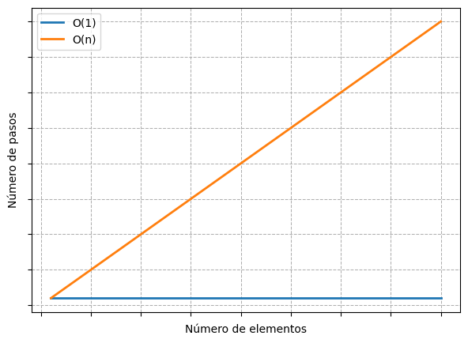{fig-align="center" width="700px"}

En este gráfico representamos un algoritmo que realiza un paso por elemento, por eso obtenemos una línea recta. Cada vez que se agrega un dato nuevo, el algoritmo necesita un paso más. Cuantos más datos haya, más pasos se requerirán.

En cambio, la curva para $O(1)$ es una línea horizontal: sin importar la cantidad de datos, el número de pasos se mantiene constante.

Para entender en profundidad el propósito de la notación _Big_ O, vayamos un poco más allá.
Imaginemos un algoritmo de tiempo constante que siempre toma 20 pasos, sin importar el tamaño de los datos.

¿Podríamos decir que es más o menos eficiente que un algoritmo $O(N)$?

Podemos visualizar la relación entre cantidad de elementos y número de pasos debajo.

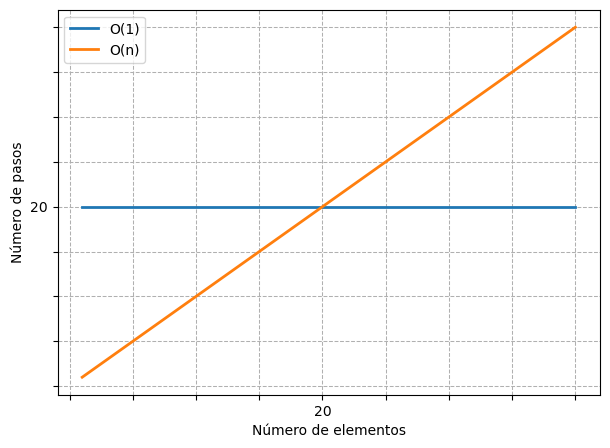{fig-align="center" width="700px"}

Con menos de 20 elementos el algoritmo $O(N)$ realiza menos pasos que el algoritmo $O(1)$, que siempre toma 20.
En 20 elementos, ambas líneas se cruzan, los dos algoritmos tardan lo mismo.
Pero a partir de ese punto, el $O(N)$ comienza a necesitar más pasos, y la diferencia sigue creciendo a medida que aumenta el tamaño de los datos.

Siempre existe un punto a partir del cual $O(N)$ se vuelve menos eficiente, sin importar cuántos pasos fijos tenga el $O(1)$.
Incluso si un algoritmo $O(1)$ tomara un millón de pasos constantes, llegaría un tamaño de datos lo suficientemente grande donde el $O(N)$ sería más lento, y seguiría siéndolo hasta el infinito.

::: {.callout-note}

#### _Big_ O pesimista

El costo de la búsqueda lineal depende de dónde se encuentra el valor buscado.
En el mejor caso, cuando está en la primera posición, se encuentra en tiempo $O(1)$.
En el peor caso, cuando está al final o no se encuentra en absoluto, se recorren los $N$ elementos y el costo es $O(N)$.

La notación _Big_ O expresa una cota superior del crecimiento y puede aplicarse al mejor caso, al caso promedio o al peor caso.
En este apunte analizaremos el peor caso, a menos que se indique lo contrario.
Este enfoque pesimista resulta útil porque permite anticipar el rendimiento más ineficiente y tomar decisiones informadas sobre qué algoritmo usar.

:::

### Un tercer tipo

Previamente, vimos que la búsqueda binaria en un arreglo ordenado es, en general, mucho más rápida que la búsqueda lineal.

Ahora veamos cómo se expresa eso en términos de notación _Big_ O.

En el peor caso, la búsqueda binaria no tiene un costo $O(1)$, porque el número de pasos aumenta cuando crecen los datos.
Sin embargo, ese crecimiento es mucho más lento que el lineal: con 100 elementos requiere como máximo 7 intentos.

Aunque $O(N)$ también es una cota superior válida, una cota más ajustada es $O(\log N)$.
Se lee "O de log N" y describe un algoritmo de tiempo logarítmico.

En la búsqueda binaria, duplicar la cantidad de datos agrega como máximo un intento al peor caso.
Este comportamiento permite entender su crecimiento logarítmico.

El siguiente gráfico muestra la evolución del número de pasos para las tres complejidades algorítmicas mencionadas.

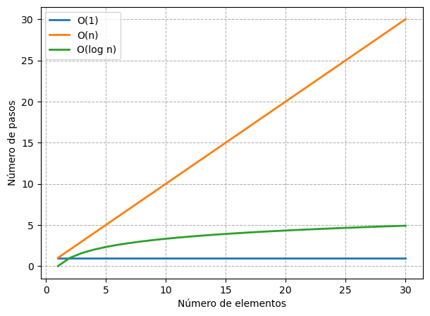{fig-align="center" width="700px"}

Se puede observar que la curva $O(\log N)$ se eleva apenas, lo que la hace un poco menos eficiente que $O(1)$, pero muchísimo más eficiente que $O(N)$.

::: {.callout-note}

##### Intuición detrás de $O(\log N)$

La intuición del crecimiento logarítmico está en reducir el problema a la mitad en cada paso.
En la búsqueda binaria, cada intento permite continuar con aproximadamente la mitad de los elementos restantes.

Por ejemplo, para reducir un grupo de 8 elementos a uno hacen falta 3 divisiones: $8 \to 4 \to 2 \to 1$.
Con 16 elementos hace falta una división más y con 32 hace falta otra más.
El logaritmo en base 2 cuenta esas divisiones: $\log_2 8 = 3$, $\log_2 16 = 4$ y $\log_2 32 = 5$.

Así, cada vez que se duplica el tamaño del problema, se agrega una etapa de reducción.
Por eso la cantidad de intentos de la búsqueda binaria crece lentamente con $N$ y su costo en el peor caso es $O(\log N)$.

:::

La siguiente tabla muestra la diferencia entre las eficiencias de $O(N)$ y $O(\log N)$:

| Elementos (N)    | $O(N)$   | $O(\log N)$ |
|:----------------:|:--------:|:-----------:|
| 8                | 8        | 3           |
| 16               | 16       | 4           |
| 32               | 32       | 5           |
| 64               | 64       | 6           |
| 128              | 128      | 7           |
| 256              | 256      | 8           |
| 512              | 512      | 9           |
| 1024             | 1024     | 10          |

Mientras que un algoritmo $O(N)$ puede realizar tantas operaciones como elementos hay en los datos, un algoritmo $O(\log N)$ agrega solo un paso adicional cada vez que se duplica la cantidad de datos.

### Complejidad cuadrática

Para finalizar, exploraremos un ejemplo que nos presentará otro tipo de complejidad algorítmica.

Supongamos que queremos implementar una función que verifica si un arreglo de números enteros contiene valores repetidos.
Los valores pueden ser números enteros cualesquiera.

Por ejemplo, el arreglo `[1, 5, 3, 9, 1, 4]` tiene dos valores iguales a 1, por lo que la función debería devolver `True`.

Una primera idea podría ser usar bucles anidados, como se muestra a continuación:

```python
def contiene_duplicados(array):
    for i in range(len(array)):
        for j in range(len(array)):
            if (i != j) and (array[i] == array[j]):
                return True
    return False
```

```python
contiene_duplicados([1, 5, 3, 9, 4, 6])
```

```text
False
```

```python
contiene_duplicados([1, 5, 3, 9, 1, 4, 6])
```

```text
True
```

En esta función recorremos cada posición del arreglo con la variable `i`.
En cada posición `i`, ejecutamos un segundo bucle que recorre nuevamente todos los valores con la variable `j`, comparando si `array[i]` y `array[j]` son iguales.
Si encontramos dos valores iguales, devolvemos `True`, mientras que si completamos todos los bucles sin hallar coincidencias, devolvemos `False`, ya que no hay duplicados.

Este algoritmo para buscar duplicados funciona, pero ¿es eficiente?
Podemos analizarlo con lo que ya sabemos sobre notación _Big_ O.

_Big_ O permite expresar una cota de cómo crece la cantidad de pasos en función de la cantidad de elementos $N$.
Entonces, para nuestro caso, debemos preguntarnos:
si el arreglo tiene N valores, ¿cuántos pasos realiza la función en el peor escenario?

El peor caso ocurre cuando no hay duplicados, ya que el código debe realizar todas las comparaciones posibles antes de terminar.
Cada iteración externa del bucle se ejecuta N veces, y dentro de cada una se ejecuta otro bucle N veces más.
Por lo tanto, el número total de comparaciones es $N \times N = N^2$.

Decimos entonces que el algoritmo tiene una complejidad $O(N^2)$, también conocida como tiempo cuadrático.

::: {.callout-note}

##### Bucles anidados

Con frecuencia (aunque no siempre), cuando un algoritmo tiene un bucle dentro de otro, su complejidad es $O(N^2)$.
Así que, cada vez que veas bucles anidados, deberían sonar las alarmas de la complejidad cuadrática

:::

#### Solución lineal

El hecho de que nuestra función original tenga complejidad $O(N^2)$ debería hacernos reflexionar: este tipo de algoritmos se consideran relativamente lentos.
Siempre que nos enfrentemos a uno, conviene preguntarnos si existe una alternativa más eficiente. Puede que no la haya, pero vale la pena analizarlo.

Ahora consideremos un caso particular: una aplicación que analiza calificaciones enteras de productos, de 0 a 10.
Conocer de antemano los valores posibles permite usar un arreglo auxiliar con una posición para cada calificación.
A continuación se muestra una versión que aprovecha esa información y realiza como máximo un recorrido de la entrada.

```python
def contiene_duplicados_lineal(array):
    valores_existentes = [0] * 11
    for i in range(len(array)):
        if valores_existentes[array[i]] == 1:
            return True
        else:
            valores_existentes[array[i]] = 1
    return False
```

```python
contiene_duplicados_lineal([1, 5, 3, 9, 4, 6])
```

```text
False
```

```python
contiene_duplicados_lineal([1, 5, 3, 9, 1, 4, 6])
```

```text
True
```

Esta función crea un arreglo llamado `valores_existentes`, que comienza con once ceros, uno para cada valor posible en el arreglo.

Luego usamos un bucle para revisar cada número del arreglo original.
A medida que encontramos cada número, colocamos un valor arbitrario (elegimos usar un `1`) en `valores_existentes`, en la posición correspondiente a ese número.

Por ejemplo, si el arreglo de entrada es `[3, 5, 8]`:

* Al encontrar el 3, colocamos un `1` en el índice 3 de `valores_existentes`:
  * `[0, 0, 0, 1, 0, 0, 0, 0, 0, 0, 0]`
* Luego, al encontrar el 5, colocamos un `1` en el índice 5:
  * `[0, 0, 0, 1, 0, 1, 0, 0, 0, 0, 0]`
* Finalmente, al llegar al 8, el arreglo queda así:
  * `[0, 0, 0, 1, 0, 1, 0, 0, 1, 0, 0]`

En esencia, estamos usando los índices de `valores_existentes` para recordar qué números del arreglo ya hemos encontrado.

Ahora viene el punto clave: antes de guardar un `1` en un índice, el código revisa si ese índice ya tiene un `1`.
Si lo tiene, significa que ya encontramos ese número antes, es decir, que hay un duplicado.
En ese caso, la función devuelve `True` y termina de inmediato.
Si completa el recorrido sin encontrar duplicados, devuelve `False`.

Para analizar la eficiencia de este nuevo algoritmo en términos de _Big_ O, podemos establecer una cota superior para la cantidad de pasos que realiza.

El paso importante es revisar cada número y comprobar si el valor en el índice correspondiente de `valores_existentes` es un `1`:

```python
if valores_existentes[array[i]] == 1:
```

Cada iteración realiza una cantidad constante de operaciones: consulta el arreglo auxiliar y devuelve `True` o marca la calificación como existente.
Inicializar el arreglo auxiliar también tiene un costo constante, porque siempre contiene once posiciones.

La función termina cuando encuentra un duplicado o cuando completa el recorrido.
En consecuencia, para $N$ elementos realiza **hasta $N$ iteraciones**.

Por lo tanto, $O(N)$ es una cota superior de su complejidad temporal.

::: {.callout-note}

##### Letra chica

Esta implementación supone que los valores son enteros entre 0 y 10.
Mientras que la primera función admite enteros cualesquiera, esta versión aprovecha la restricción del dominio para usar un arreglo auxiliar de tamaño fijo.

Con once calificaciones posibles, toda entrada de más de once elementos contiene duplicados.
Por eso, en este dominio particular, la función revisa como máximo doce elementos.
La cota $O(N)$ sigue siendo válida, aunque la restricción permite establecer una cota más ajustada de $O(1)$.

Finalmente, otra desventaja de esta nueva implementación es que consume más memoria que la primera debido a `valores_existentes`.

:::

#### Resumen de complejidades

En este apunte vimos ejemplos de complejidad constante, lineal, logarítmica o cuadrática. Pero estas no son las únicas disponibles.
Otros ejemplos son la complejidad lineal-logarítmica ($O(N \log N)$), cúbica ($O(N ^3)$), exponencial ($O(2 ^ N)$) o incluso factorial ($O(N!)$).

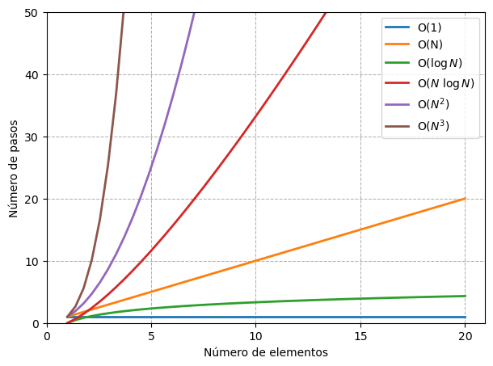{fig-align="center" width="700px"}

