## Introducción

En el apunte anterior exploramos algunas estructuras de datos basadas en arreglos y analizamos su desempeño al realizar distintas operaciones.

Sin embargo, el desempeño no es el único factor a considerar al elegir una estructura de datos.
En muchos casos, se eligen ciertas estructuras porque permiten escribir un código más simple y fácil de leer.

En este apunte nos enfocaremos en las siguientes estructuras:

* Pilas
* Colas
* Listas enlazadas
* Listas doblemente enlazadas

Estas estructuras pertenecen a la categoría de **estructuras lineales**.
Las estructuras de datos lineales son aquellas en las que los elementos están organizados uno detrás de otro, formando una secuencia.
Cada elemento (excepto el primero y el último) tiene un predecesor y un sucesor.

Además, aprenderemos a distinguir entre un **tipo de dato abstracto** y una **estructura de datos concreta**.

## Pilas

Una pila es una colección de objetos con ciertas restricciones para su inserción y eliminación.
Para entender su funcionamiento, podemos imaginar una pila de cajas como la siguiente:

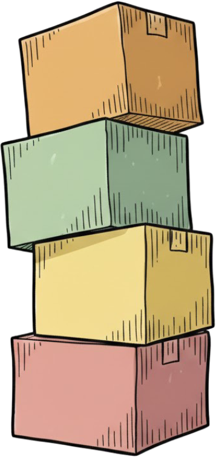{fig-align="center" width="150px"}

La primera caja que se colocó en la pila es la roja, luego la amarilla, la verde y finalmente la naranja.
Si quisiéramos leer el contenido de una caja o extraer una de ellas, no podríamos elegir una cualquiera:
habría que empezar desde la parte superior, con la que fue agregada más recientemente.
Del mismo modo, si quisiéramos insertar una nueva caja, también deberíamos hacerlo en la cima de la pila.

En computación, se dice que la pila es una colección de objetos que se insertan y extraen siguiendo el principio _last-in_, _first-out_ (LIFO),
que significa que "el último en entrar es el primero en salir".

Podemos imaginar un brazo mecánico que permite leer, quitar o agregar cajas en la pila:

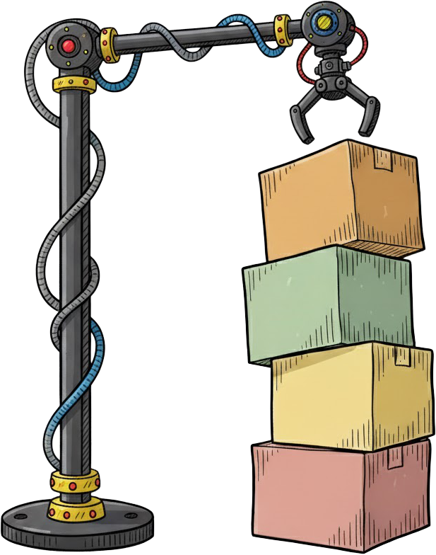{fig-align="center" width="300px"}

En la computadora, podríamos representar una pila de la siguiente manera:

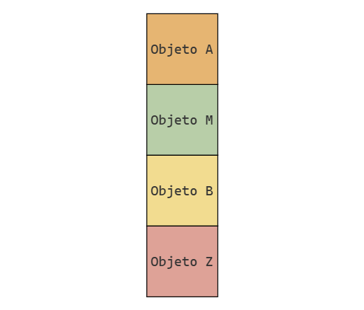{fig-align="center"}

donde cada caja representa un objeto en memoria.
Como ninguna celda tiene propiedades especiales, utilizamos el mismo color para todas:

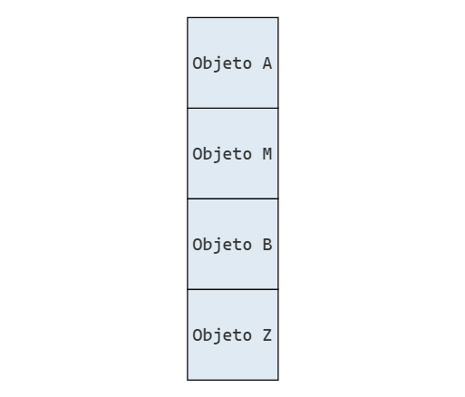{fig-align="center"}

### Lectura

Como ya adelantamos, solo es posible interactuar con el objeto en la cima de la pila.
Por lo tanto, solo es posible leer el valor al inicio de la pila, independientemente de que se extraiga o no.
Si quisieramos leer un valor posterior, primero deberíamos extraer los valores que están por encima de el.

### Inserción

Para insertar un valor en la pila, también tenemos que respetar la restricción de que solo podemos modificarla desde la cima.
Por lo tanto, si queremos agregar un elemento, tenemos que hacerlo encima de todos los otros elementos.

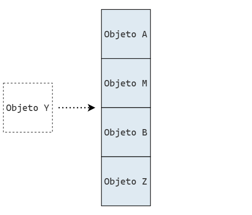{fig-align="center"}

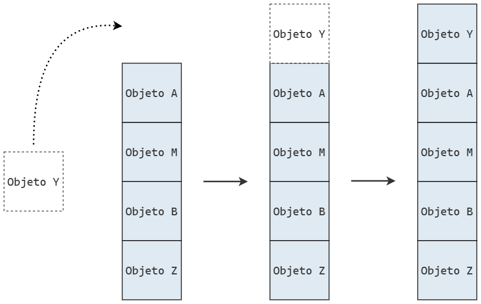{fig-align="center"}

### Eliminación

La eliminación de elementos de la pila también tiene que seguir su orden natural:
solo podemos eliminar elementos en la cima.

La siguiente figura representa la eliminación de `Objeto Y` de la pila.

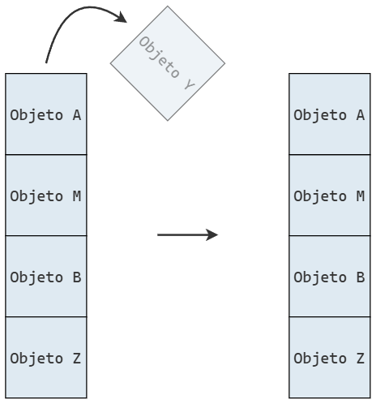{fig-align="center"}

Y a continuación se representa la eliminación de múltiples elementos:

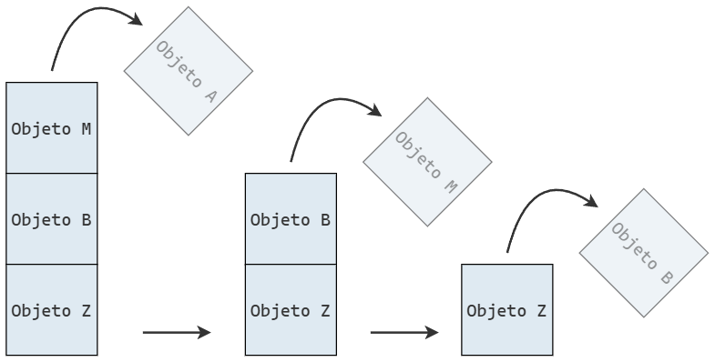{fig-align="center"}

### Implementación

En la práctica, no existe una pila de celdas de memoria con la que trabajemos directamente.
Formalmente, una pila es un tipo de dato abstracto que define un método para insertar objetos en la cima y otro para extraerlos desde la cima.

Para utilizar una pila en un programa, necesitamos una implementación concreta de la misma, la cual se apoya en otras estructuras de datos.

Una forma de implementar una pila es a partir de un arreglo al que se le imponen ciertas restricciones.
Por ejemplo, podemos crear una clase `Pila` que, internamente, almacene los valores utilizando una lista de Python.

Para entender la relación entre la pila y el arreglo subyacente, se puede imaginar que la pila se rota o se tumba horizontalmente.
El elemento en la cima de la pila corresponderá al último elemento del arreglo, y la base de la pila al primer elemento del arreglo.

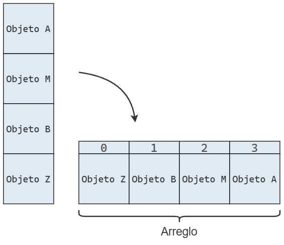{fig-align="center"}

Que solo interactuemos con la cima de pila implica que solo interactuamos con la cola del arreglo.

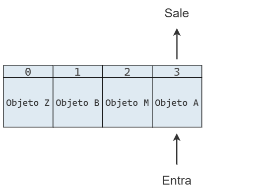{fig-align="center"}

Cuando insertamos un elemento, lo hacemos al final del arreglo, extendiendo su longitud:

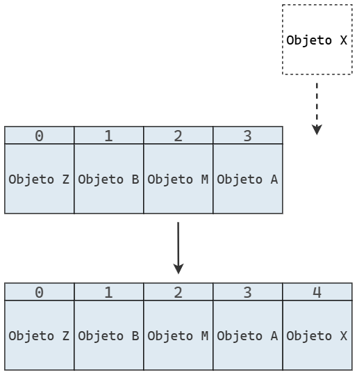{fig-align="center"}

Y cuando se elimina un elemento, también lo hacemos al final del arreglo, lo que reduce su longitud:

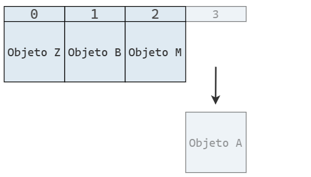{fig-align="center"}

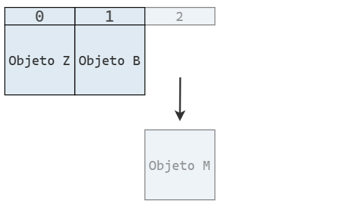{fig-align="center"}

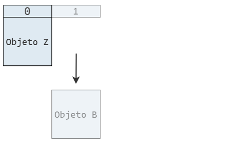{fig-align="center"}

Finalmente, tenemos nuestra implementación en Python:

```python
class Pila:
    def __init__(self):
        self._datos = [] # <1>

    def insertar(self, element): # <2>
        self._datos.append(element) # <2>

    def extraer(self): # <3>
        if len(self._datos) > 0: # <3>
            return self._datos.pop() # <3>
        return None # <3>

    def leer(self): # <4>
        if len(self._datos) > 0: # <4>
            return self._datos[-1] # <4>
        return None # <4>

    @property
    def vacia(self):
        return len(self._datos) == 0
```

1. Internamente, las pilas utilizan un arreglo “protegido” para almacenar los datos.
2. Para insertar un elemento, solo se necesita el valor a agregar, no su posición, ya que siempre se incorpora en la cima de la pila (es decir, al final del arreglo interno).
3. Al extraer un elemento, tampoco se requiere indicar la posición, ya que siempre se remueve el último elemento ingresado, el que se encuentra en la cima de la pila.
4. El método `leer` permite consultar el valor en la cima sin retirarlo.

### Aplicaciones

#### Invertir orden

Gracias al protocolo LIFO, una pila puede servir para invertir el orden de los datos.

Por ejemplo, si apilamos los valores 1, 2 y 3 en ese orden, al desapilarlos los obtendremos en orden inverso: 3, 2 y 1.

Esta idea se puede usar en muchos casos.
Por ejemplo, podríamos querer imprimir las líneas de un archivo en orden inverso para mostrar un
conjunto de datos en orden descendente en lugar de ascendente.

Para hacerlo, basta con leer cada línea, apilarla en la pila y luego imprimirlas en el orden en que se van desapilando.

```python
def invertir_archivo(origen, destino):
    pila = Pila()

    with open(origen) as archivo_origen:
        for linea in archivo_origen:
            pila.insertar(linea.rstrip("\n"))

    with open(destino, "w") as archivo_destino:
        while not pila.vacia:
            archivo_destino.write(pila.extraer() + "\n")
```

Si tenemos el siguiente archivo con un extracto de la letra de Tu misterioso alguien de Miranda!:

```{.txt filename="original.txt"}
¿Quién es tu nuevo amor?
¿Tu nueva ocupación?
¿Tu misterioso alguien?
```

y ejecutamos la función de esta manera:

```python
invertir_archivo("original.txt", "invertido.txt")
```

Luego tenemos:

```{.txt filename="original.txt"}
¿Tu misterioso alguien?
¿Tu nueva ocupación?
¿Quién es tu nuevo amor?
```

#### Verificar de paréntesis y corchetes

Otra aplicación de las pilas está relacionada con la verificación de paréntesis y corchetes en expresiones matemáticas.
Estos símbolos se utilizan para agrupar partes de una expresión y, por lo general, para modificar el orden en que se evalúan los operadores.

Para que una expresión sea válida, cada paréntesis (o corchete) que abre un grupo `(` debe tener su correspondiente cierre `)`.
Sin embargo, un simple conteo de paréntesis no es suficiente: la siguiente expresión contiene la misma cantidad de paréntesis de apertura y de cierre, y aun así es incorrecta.

```cmd
1 +) (3 * 5()
```

La función `verificar_agrupamientos` se vale de una pila para verificar que los paréntesis y corchetes se utilizan correctamente.

```python
def verificar_agrupamientos(expr):
    apertura = "(["
    cierre = ")]"

    pila = Pila()

    for caracter in expr:
        if caracter in apertura:
            pila.insertar(caracter)
        elif caracter in cierre:
            if pila.vacia: # Nada con que emparejarlo
                return False

            if cierre.index(caracter) != apertura.index(pila.extraer()): # Mismatch
                return False

    return pila.vacia
```

La función recorre la secuencia original de izquierda a derecha utilizando una pila `pila` para facilitar la verificación de los símbolos de agrupación.

Cada vez que se encuentra un símbolo de apertura, lo apilamos en `pila`.
Y cuando se encuentra un símbolo de cierre, desapilamos un elemento de `pila` (si no está vacía) y verificamos que ambos símbolos formen un par válido.

Si al llegar al final de la expresión la pila está vacía, significa que la expresión está correctamente balanceada.
De lo contrario, debe haber quedado en la pila un símbolo de apertura sin su correspondiente cierre.

```python
verificar_agrupamientos("(3 + (4 * 5))")
```

```text
True
```

```python
verificar_agrupamientos("[3 + (4 * 5)]")
```

```text
True
```

```python
verificar_agrupamientos("(3 + (4 * 5)")
```

```text
False
```

```python
verificar_agrupamientos("(3 + [(4 * 5)")
```

```text
False
```

## Colas

La cola es otra estructura de datos fundamental, un pariente cercano de la pila.
Al igual que ella, la cola es una colección ordenada de objetos.
Sin embargo, los objetos se insertan y se extraen siguiendo el principio _first in, first out_ (FIFO), es decir, el primero en entrar es el primero en salir.

Para familiarizarnos con esta estructura, podemos imaginar una fila de personas esperando para entrar a un banco, como se muestra en la imagen:

{fig-align="center" width="700px"}

Los primeros en haber llegado son los primeros en entrar al banco, mientras que quienes llegan después se ubican al final de la cola y deben esperar a que ingresen quienes estan delante suyo para ingresar.

Esta estructura tiene numerosas aplicaciones prácticas.
En la vida real, restaurantes, tiendas, plataformas de ventas de entradas y otros procesan solicitudes siguiendo el principio FIFO.
En los sistemas informáticos, como impresoras en red o servidores web, las peticiones también se atienden en orden de llegada.
En todos estos casos, utilizar una cola es una forma natural y lógica de organizar las solicitudes.

### Implementación

Las colas son un tipo de dato abstracto, ya que definen cómo deben comportarse, pero no cómo se implementan.
Para utilizarlas en un programa necesitamos una implementación concreta.

Una forma de hacerlo es mediante un arreglo restringido, donde solo se puede extraer el elemento del frente (índice 0)
y agregar nuevos elementos al final (índice n).

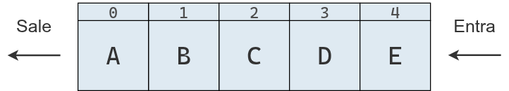{fig-align="center"}

Cuando se desea insertar un nuevo elemento en la estructura de datos, siempre se hace al final.

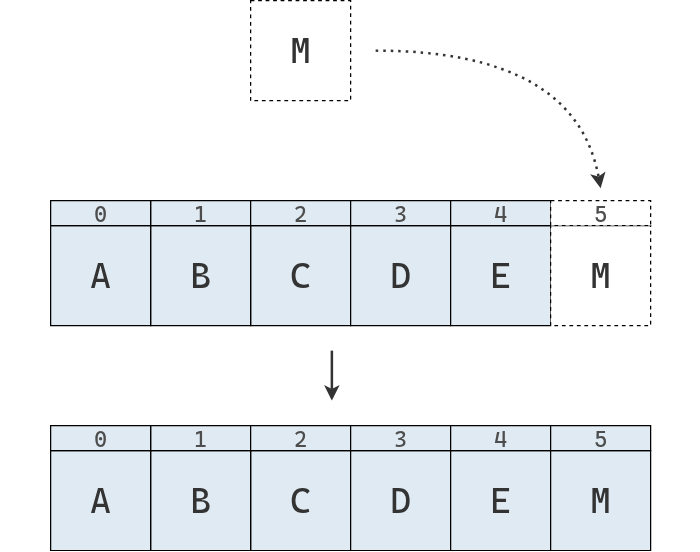{fig-align="center"}

Si luego se desea agregar otro elemento, simplemente se repite el proceso.

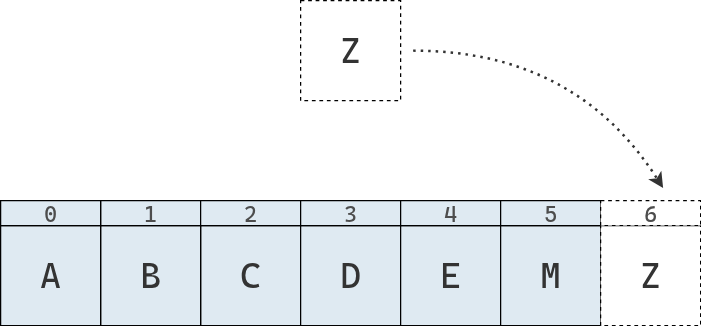{fig-align="center"}

Por el contrario, a la hora de extraer un elemento, solo se puede realizar desde el frente de la cola:

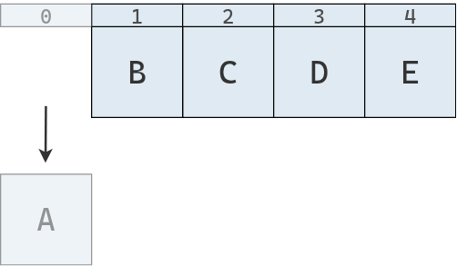{fig-align="center"}

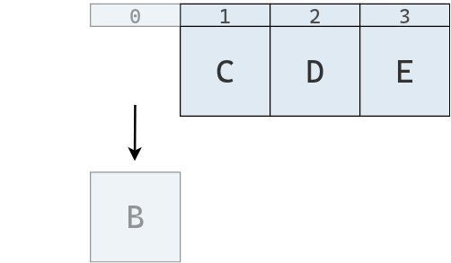{fig-align="center"}

Una implementación en Python de la cola basada en arreglos es la siguiente:

```python
class Cola:
    def __init__(self):
        self._datos = []

    def insertar(self, element): # enqueue
        self._datos.append(element)

    def extraer(self): # dequeue
        if len(self._datos) > 0:
            return self._datos.pop(0)
        return None

    def leer(self):
        if len(self._datos) > 0:
            return self._datos[0]
        return None

    @property
    def vacia(self):
        return len(self._datos) == 0
    
    def __len__(self):
        return len(self._datos)
```

Del mismo modo que la clase `Pila`, la clase `Cola` utiliza un arreglo interno llamado `_datos` para almacenar los valores.
También define métodos para insertar y extraer elementos, con la diferencia de que la extracción se realiza desde el frente y no desde la parte posterior, 
siguiendo el principio FIFO (_first in, first out_), es decir, el primero en entrar es el primero en salir.

### Aplicaciones

#### 

#### Cola de impresión

```python
cola_impresion = Cola()
cola_impresion.insertar("documento1.pdf")
cola_impresion.insertar("documento2.docx")
cola_impresion.insertar("documento3.xlsx")

while not cola_impresion.vacia:
    print(f"Imprimiendo {cola_impresion.extraer()}...")

cola_impresion.vacia
```

```text
Imprimiendo documento1.pdf...
Imprimiendo documento2.docx...
Imprimiendo documento3.xlsx...
True
```

#### Atención de llamadas 🧩

El siguiente programa contiene un ejemplo más realista donde se usa una cola como estructura de datos para una gestionar llamadas en espera.

```python
def simular_centro_de_llamadas(tiempo_total=15):
    cola = Cola()
    nombres = ["Ana", "Bruno", "Carla", "Damián", "Eva"]

    tiempo_inicial = time.time()

    while time.time() - tiempo_inicial < tiempo_total:
        accion = random.random()
        ahora = datetime.now().strftime("%H:%M:%S")

        # Simula la llegada de una llamada, con 50% de probabilidad
        if accion < 0.5:
            llamada = {"cliente": random.choice(nombres), "hora": ahora}
            cola.insertar(llamada)
            print(f"[{ahora}] Nueva llamada de {llamada['cliente']}")
            print(f"    → Llamadas en espera: {len(cola)}")
        # Simula la atención de una llamada, con 40% de probabilidad
        elif accion < 0.9 and not cola.vacia:
            llamada = cola.extraer()
            print(f"[{ahora}]  Atendiendo a {llamada['cliente']} (recibida a las {llamada['hora']})")
            print(f"    → Quedan {len(cola)} llamadas en espera")
        # Caso contrario, no se hace nada
        else:
            print(f"[{ahora}] Sin actividad...")
        
        # Controla la velocidad de la simulación
        time.sleep(random.uniform(1, 2))

    print("\nFin de la simulación.")

if __name__ == "__main__":
    simular_centro_de_llamadas()
```

<center>
<video controls width="700" preload="metadata" style="border-radius: 8px; max-width: 100%;">
  <source src="imgs/02/cola_llamadas.webm" type="video/webm" />
</video>
</center>

### Por qué usar estructuras de datos restringidas

Si para implementar una pila necesitamos restringir un arreglo, 
¿por qué no usamos directamente un arreglo en vez de una pila?, ¿tiene alguna ventaja usar la pila?

Las estructuras de datos restringidas, como la pila y la cola, son importantes por varias razones.

En primer lugar, usar estructuras de datos restringidas ayuda a evitar errores.
Por ejemplo, el algoritmo de verificación de paréntesis y corchetes solo funciona si los elementos se eliminan desde la cima.
Si utilizaramos una lista de Python, podríamos cometer variados errores.
En cambio, al usar una pila, que restringe las operaciones que podemos realizar, automáticamente se previenen usos incorrectos.

En segundo lugar, estas estructuras restringidas proporcionan un modelo mental claro para resolver ciertos problemas.
La pila introduce el principio _last in, first out_ (LIFO), "el último en entrar es el primero en salir", que puede
aplicarse para resolver una amplia variedad de problemas, como el del verificador mencionado antes.

Finalmente, la familiaridad con la naturaleza LIFO de las pilas hace que el código sea más legible y predecible para otros desarrolladores:
cuando alguien ve una pila, sabe que el proceso sigue una lógica LIFO.

## Listas enlazadas

En esta sección vamos a introducir una estructura de datos llamada lista enlazada (_linked list)_,
que constituye una alternativa a las secuencias basadas en arreglos, como la lista de Python.
Tanto las listas enlazadas como los arreglos mantienen los elementos en un cierto orden, pero lo hacen siguiendo distintas estrategias.

Por un lado, un arreglo almacena los datos en una región contigua de memoria, 
lo que permite acceder rápidamente a cualquier elemento mediante su índice y facilita operaciones matemáticas vectorizadas.
Sin embargo, este diseño puede volver poco eficientes tareas como la inserción o la eliminación de elementos.

Por el otro, una lista enlazada se apoya en una estructura llamada nodo, 
que le permite distribuir los distintos elementos de la secuencia en diferentes ubicaciones de la memoria y modificarlos o reorganizarlos con mayor flexibilidad.

### El nodo

En una lista enlazada, cada nodo representa un elemento de la lista.
Aunque los nodos no se almacenen en posiciones contiguas de memoria, la computadora puede reconstruir el orden de la secuencia porque cada nodo no solo guarda un valor, 
sino que también una referencia al siguiente.
Estos enlaces entre nodos son los que dan nombre a esta estructura de datos: lista enlazada.

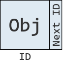{fig-align="center"}

Para representar estos nodos podemos crear una clase `Nodo`, que define objetos que contienen un atributo para el valor y otro para la referencia al siguiente nodo de la lista.

```python
class Nodo:
    def __init__(self, valor):
        self.valor = valor
        self.siguiente = None
    
    def __repr__(self):
        return f"Nodo({self.valor})"

Nodo(75)
```

```text
Nodo(75)
```

Podemos instanciar múltiples nodos y enlazarlos entre sí, para luego recorrerlos de la forma en que lo haría una lista enlazada.

```python
nodo1 = Nodo(1)
nodo2 = Nodo(2)
nodo3 = Nodo(3)
nodo4 = Nodo(4)

# Enlazar nodos
nodo1.siguiente = nodo2
nodo2.siguiente = nodo3
nodo3.siguiente = nodo4  

# Recorrer e imprimir la lista enlazada
actual = nodo1
while actual:
    print(actual, end=" -> ")
    actual = actual.siguiente
print("None")
```

```text
Nodo(1) -> Nodo(2) -> Nodo(3) -> Nodo(4) -> None
```

Como se puede observar, aunque los nodos sean independientes y puedan almacenarse en cualquier lugar de la memoria, los enlaces entre ellos permiten construir una secuencia ordenada.

### Implementación básica

Lo único que se necesita para implementar una lista enlazada a partir de un conjunto de nodos es la dirección de memoria donde comienza la lista enlazada, es decir, donde se ubica el primer nodo.
Como cada nodo guarda un enlace al nodo siguiente, basta con seguir esos enlaces uno a uno para reconstruir toda la secuencia.

```python
class ListaEnlazada:
    def __init__(self, primer_nodo=None):
        self.primer_nodo = primer_nodo

lista = ListaEnlazada(nodo1)
```

El diagrama de abajo representa la lista enlazada que acabamos de crear.
Cada nodo contiene un valor y una referencia al siguiente nodo en la secuencia.
Estas referencias son los enlaces que conectan los nodos y dan forma a la estructura.

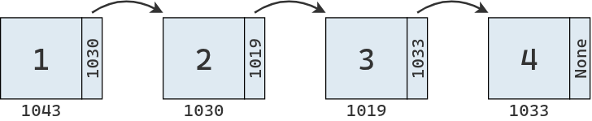{fig-align="center"}

El segundo diagrama muestra cómo se vería esa misma lista en la memoria.
Los valores resaltados en rojo representan los nodos, que, como puede observarse, se encuentran dispersos en distintas ubicaciones.

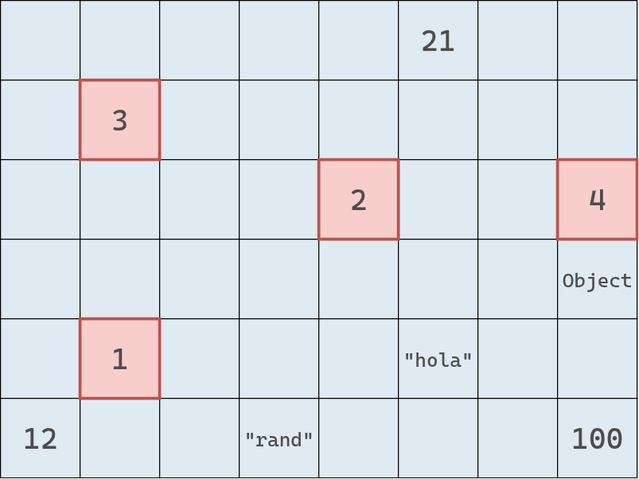{fig-align="center"}

### Lectura

Dada una dirección de memoria, la lectura es una operación de tiempo constante, $O(1)$.
No importa en qué lugar de la memoria se encuentre esa dirección, la lectura siempre tarda lo mismo.

Cuando trabajamos con un arreglo contiguo, vimos que podíamos determinar la dirección de cualquier elemento a partir de la dirección base y el índice solicitado.
En cambio, en una lista enlazada, los nodos no están almacenados contiguamente en memoria, por lo que ya no podemos usar esa estrategia.

Supongamos que queremos leer el valor en el índice 3 de una lista enlazada.
Nuestro programa solo conoce la dirección del primer nodo de la secuencia.
Para ubicar el nodo en el índice 3, debe recorrer la lista pasando por todos los nodos intermedios,
saltando de uno a otro a través de sus enlaces, hasta llegar al nodo correspondiente y devolver su valor.

Gráficamente, el proceso se ve de la siguiente manera:

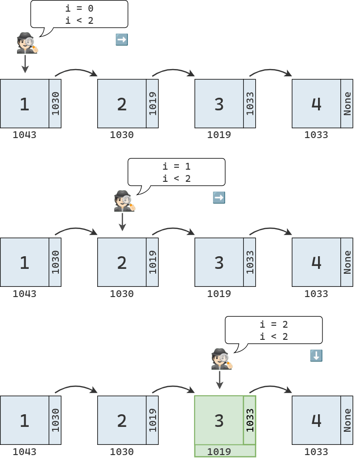{fig-align="center"}

Si tenemos una lista enlazada de $N$ elementos y queremos leer el elemento en la última posición, la operación nos llevará $N$ pasos.
Por lo tanto, a diferencia de la lectura en un arreglo contiguo, que es de orden $O(1)$, la lectura en una lista enlazada es de orden $O(N)$.

Pero no nos desmotivemos, no son todas pálidas con esta estructura de datos.
Así como presenta esta limitación, pronto descubriremos también sus puntos fuertes.

Mientras tanto, concluimos la sección con una implementación en Python del método de lectura.

```python
    def leer(self, indice):
        nodo_actual = self.primer_nodo # <1>
        indice_actual = 0 # <1>

        while indice_actual < indice: # <2>
            nodo_actual = nodo_actual.siguiente # <3>
            indice_actual += 1 # <3>

            if nodo_actual is None: # <4>
                return None         # <4>

        return nodo_actual.valor # <5>
```
1. Se comienza a recorrer la lista desde el primer nodo, que se encuentra en el índice 0.
2. Se recorre la lista enlazada hasta llegar al índice deseado.
3. En cada paso, se avanza nodo a nodo, accediendo al siguiente e incrementando el valor del índice.
4. Si en algún momento el nodo obtenido es `None`, significa que la lista no tiene tantos elementos como el índice solicitado. En ese caso se devuelve `None`, aunque también podría lanzarse un `IndexError`.
5. En este punto se sabe que se ha llegado al nodo del índice solicitado, y se devuelve su valor.

### Búsqueda

Ya sabemos que la búsqueda es una operación estrechamente relacionada con la lectura: en lugar de tomar un índice y devolver un valor, 
toma un valor y devuelve su índice (si es que el valor se encuentra en la secuencia).

Si trabajamos con un arreglo contiguo, la búsqueda lineal es de orden $O(N)$.
En una lista enlazada, la búsqueda también es de orden $O(N)$, ya que el proceso es similar al de la lectura.

La búsqueda se comienza explorando el primer nodo, con un acumulador de índice inicializado en 0.
En cada paso, se compara el valor del nodo con el valor buscado:

* Si son distintos, se avanza al siguiente nodo y se incrementa el acumulador.
* Si son iguales, se devuelve el valor del índice.

Si no existe un siguiente nodo, es decir, si se llega al final de la lista, significa que el valor buscado no se encuentra en la secuencia.

El proceso se puede representar de la siguiente manera:

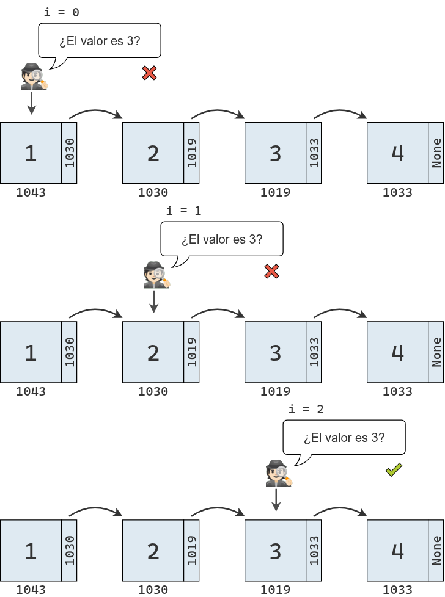{fig-align="center"}

Una implementación para el método de búsqueda en nuestra clase es la siguiente:

```python
    def buscar(self, valor):
        nodo_actual = self.primer_nodo # <1>
        indice_actual = 0 # <1>

        while True: # <2>
            if nodo_actual.valor == valor: # <3>
                return indice_actual # <3>
            nodo_actual = nodo_actual.siguiente # <3>

            if nodo_actual is None:  # <4>
                break  # <4>
            indice_actual += 1  # <4>

        return None  # <5>
```

1. Se inicia el recorrido desde el primer nodo de la lista, comenzando con el índice 0.
2. Se itera hasta que el bloque ejecute un `return` o un `break`
3. En cada iteración, se compara el valor almacenado en el nodo actual con el valor buscado. 
Si el valor coincide, se devuelve el índice correspondiente y la búsqueda termina.
Si no coincide, se avanza al siguiente nodo.
4. Si el siguiente nodo es `None`, significa que se llegó al final de la lista sin encontrar el valor, se termina el bucle.
Caso contrario, se incrementa el índice en 1 y se ejecuta el bucle desde el iniciio.
5. En este punto se sabe que el valor no se encuentra en la lista y se devuelve `None`. Podría lanzarse un `ValueError`.

### Inserción

Hasta ahora, el desempeño de las listas enlazadas es igual o peor que el de un arreglo contiguo.
Son menos eficientes para leer e igual de eficientes para buscar.

Sin embargo, cuando consideramos la inserción, nuestra percepción sobre esta estructura comienza a cambiar.
En un arreglo contiguo, el peor escenario ocurre al insertar al principio, ya que es necesario desplazar todos los elementos una celda a la derecha.
En cambio, en una lista enlazada, insertar un elemento al inicio requiere un solo paso, por lo que es una operación de orden $O(1)$.

Para insertar un elemento al inicio de una lista enlazada, solo es necesario crear un nuevo nodo y enlazarlo con el nodo que era el primero antes de la inserción.
Además, debemos actualizar la referencia al primer nodo dentro del objeto de tipo `ListaEnlazada` para que apunte al nuevo nodo.

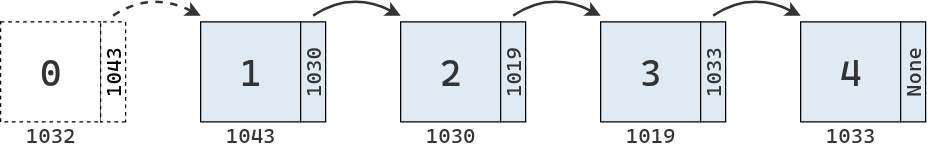{fig-align="center"}

Si se desea insertar un elemento en una posición interna de la lista, en teoría la operación de inserción en sí misma lleva solo un paso,
ya que no es necesario mover elementos, solo se requiere actualizar los enlaces entre nodos.

El siguiente diagrama muestra la inserción del valor 2.5 entre el 2 y el 3 en nuestra lista enlazada.
Se crea un nuevo nodo que apunta a la ubicación del tercer elemento y se modifica el enlace del segundo elemento para que apunte al nuevo nodo.

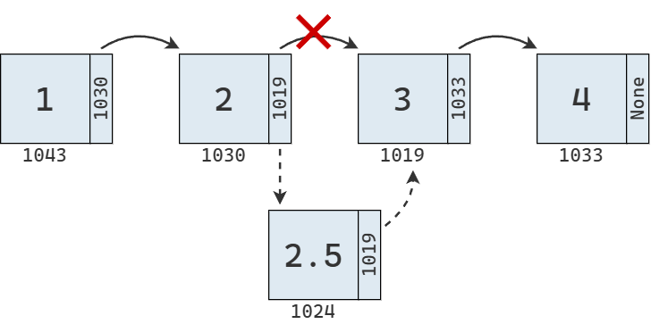{fig-align="center"}

Sin embargo, antes de poder realizar este cambio de enlaces, es necesario encontrar los nodos involucrados, lo que requiere recorrer la lista desde el inicio.
Si queremos insertar el valor 2.5 en el índice 2, es necesario realizar la búsqueda que describe el diagrama debajo.

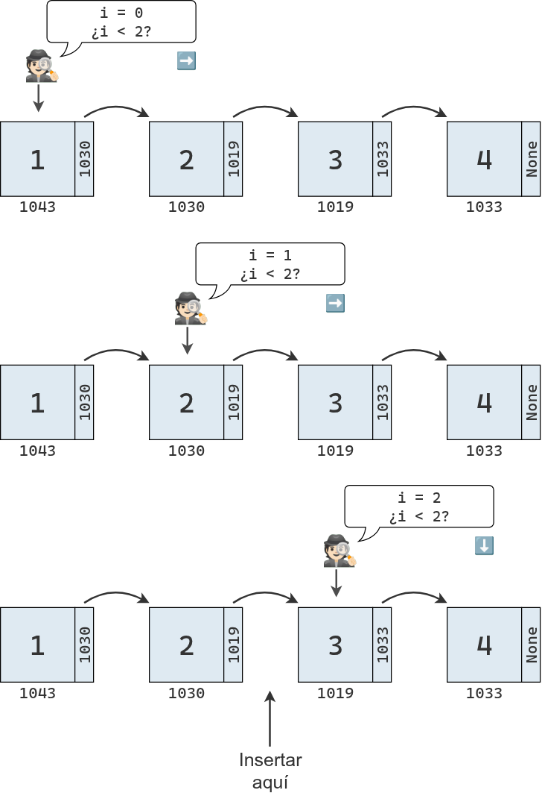{fig-align="center"}

Una vez identificados los nodos involucrados, se actualizan sus enlaces.
La inserción no requiere mover valores en memoria, pero sí es necesario recorrer la lista desde el principio para los nodos que deben ser actualizados.

Luego de la inserción, los elementos de la lista quedan distribuidos en memoria como se muestra en el siguiente diagrama:

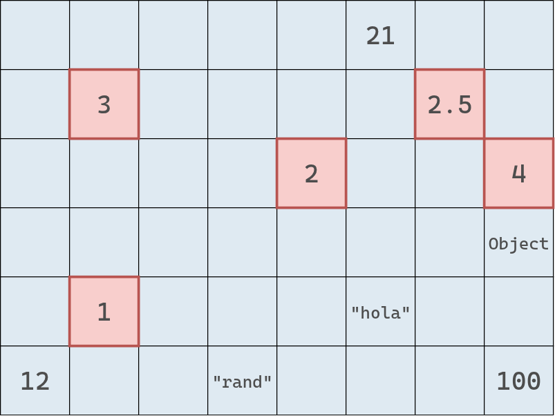{fig-align="center"}

Finalmente, el peor de los escenarios se da cuando se desea insertar un elemento al final de la lista.
Para ello hay que atravesar $N$ elementos hasta encontrar el último.
Una vez allí, se actualiza su enlace para que apunte a la dirección del nodo creado para el nuevo valor.

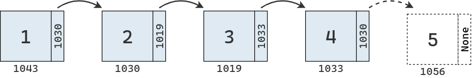{fig-align="center"}

El método de inserción para nuestra clase `ListaEnlazada` es el siguiente:

```python
def insertar(self, indice, valor):
    nodo_nuevo = Nodo(valor) # <1>

    if indice == 0: # <2>
        nodo_nuevo.siguiente = self.primer_nodo # <2>
        self.primer_nodo = nodo_nuevo # <2>
        return None # <2>

    nodo_actual = self.primer_nodo # <3>
    indice_actual = 0 # <3>

    while indice_actual < (indice - 1): # <4>
        nodo_actual = nodo_actual.siguiente # <4>
        indice_actual += 1 # <4>
        nodo_nuevo.siguiente = nodo_actual.siguiente # <4>
        nodo_actual.siguiente = nodo_nuevo # <4>
```

1. Se crea un nuevo nodo con el valor recibido.
2. Si el índice es 0, significa que el nuevo nodo debe insertarse al inicio de la lista. 
En ese caso, se enlaza el nuevo nodo al antiguo primer nodo y el nuevo nodo se convierte en el primer nodo de la lista
3. Si no se trata del primer nodo, se inicia un recorrido desde el comienzo de la lista, con el índice actual igual a 0.
4. Se avanza nodo a nodo hasta llegar al nodo anterior a la posición donde se desea insertar. 
Una vez allí, se ajustan las referencias: el nuevo nodo apunta al siguiente del nodo actual, y el nodo actual pasa a apuntar al nuevo nodo.

### Eliminación

En una lista enlazada, la eliminación tiene mucho en común con la inserción.
Primero, eliminar un elemento no requiere mover valores en memoria, sino simplemente actualizar los enlaces entre nodos.
Segundo, la eliminación al inicio de la lista es muy eficiente; basta con hacer que `primer_nodo` apunte al segundo nodo.
Por último, cuando la eliminación no ocurre al principio, es necesario recorrer la lista hasta encontrar los nodos cuyos enlaces deben modificarse.

El siguiente diagrama muestra la eliminación de un nodo intermedio en la secuencia.
Para realizarla se cambia el enlace del nodo anterior para que apunte al nodo siguiente.
Opcionalmente, puede eliminarse también el enlace del nodo que fue removido.

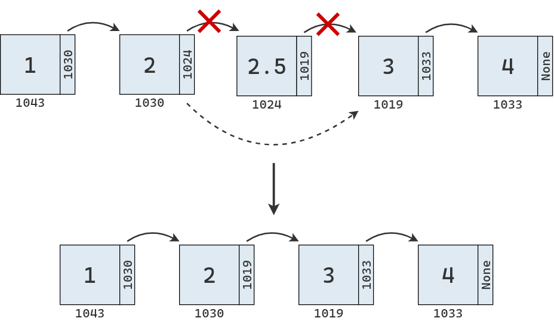{fig-align="center"}

En Python, tenemos:

```python
def eliminar(self, indice):
    if indice == 0: # <1>
        self.primer_nodo = self.primer_nodo.siguiente # <1>
        return None # <1>

    nodo_actual = self.primer_nodo # <2>
    indice_actual = 0 # <2>

    while indice_actual < (indice - 1): # <3>
        nodo_actual = nodo_actual.siguiente # <3>
        indice_actual += 1 # <3>

    nodo_siguiente_al_eliminado = nodo_actual.siguiente.siguiente # <4>
    nodo_actual.siguiente = nodo_siguiente_al_eliminado # <4>
```

1. Si el índice es 0, significa que se debe eliminar el primer nodo de la lista. 
En ese caso, solo es necesario actualizar la referencia `primer_nodo` para que apunte al segundo nodo, descartando así el primero.
2. Si no se trata del primer nodo, se inicia el recorrido desde el comienzo de la lista, con el índice actual igual a 0.
3. Se avanza nodo a nodo hasta llegar al nodo anterior al que se desea eliminar. 
4. Una vez allí, se actualizan las referencias para que el nodo actual apunte al nodo siguiente del que será eliminado, 
de modo que el nodo en la posición indicada quede desconectado de la lista.

### Enlazando las partes

Si juntamos todos los métodos definidos, podemos reimplementar nuestra lista enlazada junto a todas las funcionalidades necesarias.

```python
class ListaEnlazada:
    def __init__(self, primer_nodo=None):
        self.primer_nodo = primer_nodo

    def leer(self, indice):
        nodo_actual = self.primer_nodo
        indice_actual = 0

        while indice_actual < indice:
            nodo_actual = nodo_actual.siguiente
            indice_actual += 1

            if nodo_actual is None:
                return None

        return nodo_actual.valor

    def buscar(self, valor):
        nodo_actual = self.primer_nodo
        indice_actual = 0

        while True:
            if nodo_actual.valor == valor:
                return indice_actual

            nodo_actual = nodo_actual.siguiente
            if nodo_actual is None:# <3>
                break
            indice_actual += 1

        return None

    def insertar(self, indice, valor):
        nodo_nuevo = Nodo(valor)

        if indice == 0:
            nodo_nuevo.siguiente = self.primer_nodo
            self.primer_nodo = nodo_nuevo
            return None

        nodo_actual = self.primer_nodo
        indice_actual = 0

        while indice_actual < (indice - 1):
            nodo_actual = nodo_actual.siguiente
            indice_actual += 1
            nodo_nuevo.siguiente = nodo_actual.siguiente
            nodo_actual.siguiente = nodo_nuevo

    def eliminar(self, indice):
        if indice == 0:
            self.primer_nodo = self.primer_nodo.next_node
            return None

        nodo_actual = self.primer_nodo
        indice_actual = 0

        while indice_actual < (indice - 1):
            nodo_actual = nodo_actual.siguiente
            indice_actual += 1

        nodo_siguiente_al_eliminado = nodo_actual.siguiente.siguiente
        nodo_actual.siguiente = nodo_siguiente_al_eliminado
```

### Análisis de la eficiencia

La siguiente tabla resume la eficiencia de los arreglos y las listas enlazadas para realizar las operaciones analizadas:

| Operación   | Arreglo                  | Lista enlazada                 |
|-------------|--------------------------|--------------------------------|
| Lectura     | $O(1)$                   | $O(N)$                         |
| Búsqueda    | $O(N)$                   | $O(N)$                         |
| Inserción   | $O(N)$ ($O(1)$ al final) | $O(N)$ ($O(1)$ al inicio)      |
| Eliminación | $O(N)$ ($O(1)$ al final) | $O(N)$ ($O(1)$ al inicio)      |

A simple vista, las listas enlazadas no parecen ofrecer grandes ventajas en cuanto a complejidad temporal.
Tienen un rendimiento similar al de los arreglos en búsqueda, inserción y eliminación, y son más lentas para la lectura.
Entonces, ¿por qué las usariamos?

La clave está en que los pasos de inserción y eliminación en sí mismos son operaciones de orden $O(1)$.
Es cierto que esto solo ocurre cuando ya conocemos el nodo correcto, por ejemplo, al insertar o eliminar al comienzo,
pero hay situaciones en las que ese nodo ya está accesible por otro motivo dentro del programa.

Por ejemplo, si tenemos que eliminar elementos erróneos de una secuencia,
tendremos que recorrerla completa tanto si usamos un arreglo como una lista enlazada.
La diferencia está en el costo de cada eliminación. En una lista enlazada, basta con actualizar los enlaces, sin mover valores en memoria.
En cambio, en un arreglo, cada vez que se elimina un elemento es necesario desplazar todos los elementos posteriores, lo que hace el proceso más costoso.

## Listas doblemente enlazadas

Existen varios tipos de listas enlazadas.
La que vimos hasta ahora es la lista enlazada simple, o clásica, donde cada nodo tiene una referencia al nodo siguiente.

Otra variante es la lista doblemente enlazada, en la que cada nodo mantiene dos referencias: una al nodo anterior y otra al siguiente.
En este caso, el primer nodo tiene la referencia anterior vacía, y el último nodo tiene la referencia siguiente vacía.
A su vez, la clase mantiene referencias al primer y al último nodo de la lista.

```python
class Nodo:
    def __init__(self, valor):
        self.valor = valor
        self.anterior = None
        self.siguiente = None


class ListaDoblementeEnlazada:
    def __init__(self, primer_nodo=None, ultimo_nodo=None):
        self.primer_nodo = primer_nodo
        self.ultimo_nodo = ultimo_nodo
```

Como una lista doblemente enlazada siempre conoce la posición de su primer y último nodo, puede acceder a cualquiera de ellos en un solo paso.
Además, así como en una lista enlazada simple podemos leer, insertar o eliminar al inicio en tiempo constante,
en una lista doblemente enlazada podemos hacerlo también al final, con la misma eficiencia.

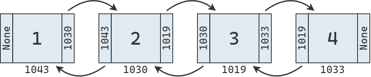{fig-align="center"}

### Aplicaciones

#### Pilas como una lista enlazada

Las pilas también pueden implementarse de forma muy eficiente utilizando una lista enlazada.
En este caso, basta con mantener una referencia al primer nodo de la lista, que representará la parte superior de la pila.
Tanto la inserción de un nuevo elemento, como la eliminación del elemento superior, pueden realizarse en tiempo constante, $O(1)$.

En principio, esta implementación no ofrece ventajas significativas respecto de la versión basada en un arreglo,
que también permite inserción y eliminación al final en tiempo constante.
Sin embargo, cuando el arreglo alcanza su capacidad máxima, es necesario reservar un nuevo bloque contiguo de memoria y copiar todos los elementos,
lo que implica un costo adicional.
En cambio, la versión basada en una lista enlazada no requiere realocación,
por lo que resulta más eficiente en escenarios donde el tamaño de la pila puede crecer considerablemente.

#### Colas con una lista doblemente enlazada

Si mantenemos referencias tanto al primer como al último nodo, una lista doblemente enlazada permite acceder de forma inmediata a ambos extremos de la secuencia.
Además, insertar o eliminar elementos en cualquiera de ellos es una operación de orden $O(1)$, lo que la hace una estructura muy adecuada para implementar una cola.

En comparación, cuando usamos un arreglo para almacenar los elementos, agregar un nuevo valor al final tiene un costo $O(1)$,
pero extraer desde el principio requiere mover los $N - 1$ elementos restantes, lo que implica un costo $O(N)$.

Por otro lado, si modificamos nuestra implementación de la lista simplemente enlazada para que mantenga una referencia al último nodo,
también podríamos implementar una cola con inserción y extracción en tiempo constante ($O(1)$).

