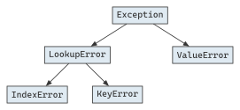
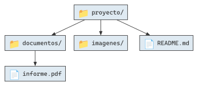
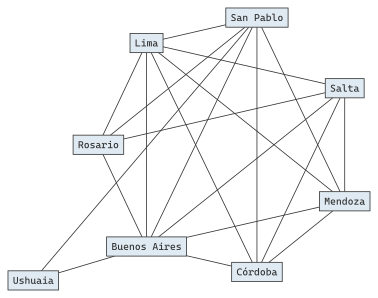

## Introducción

En la unidad anterior trabajamos con estructuras de datos lineales, en las que los elementos
se organizan formando una secuencia. En una lista enlazada, por ejemplo, cada nodo guarda
una referencia al siguiente, y podemos recorrer la lista siguiendo esos enlaces.

Sin embargo, algunas relaciones entre los datos requieren otra organización.
Para empezar, recuperemos algunos tipos de excepción que conocimos al estudiar
[excepciones en Python](../02_oop/05_excepciones.qmd):

```python
errores = ["Exception", "LookupError", "IndexError", "KeyError", "ValueError"]
```

Esta lista permite almacenar los nombres, consultar uno por su posición o recorrerlos con un `for`.
Sin embargo, esta secuencia no permite determinar relaciones de herencia entre clases.

Por ejemplo, `IndexError` y `KeyError` heredan de `LookupError`, que a su vez hereda de
`Exception`. Por otro lado, `ValueError` hereda directamente de `Exception`.
¿Cómo podemos guardar los errores de un modo tal que se representen esas relaciones?

Una posibilidad es usar listas anidadas. Para hacerlo, necesitamos acordar cómo interpretarlas.
Por ejemplo, podemos utilizar listas de longitud dos: una para el nombre y otra para la lista
de sus descendientes directos.

```python
jerarquia = [
    "Exception", [
        ["LookupError", [
            ["IndexError", []],
            ["KeyError", []]
        ]],
        ["ValueError", []]
    ]
]
```

La primera posición de `jerarquia` contiene `"Exception"`. La segunda contiene dos elementos:
las representaciones de `LookupError` y de `ValueError`.
Dentro de la representación de `LookupError` aparecen, a su vez, `IndexError` y `KeyError`.
Las listas vacías indican que no incluimos descendientes directos para esos tipos en este ejemplo.

Ahora podemos distinguir quién depende de quién, aunque los corchetes empiezan a hacer
un poco difícil la lectura. Dibujemos la misma información:

{fig-align="center" width="80%" fig-alt="Exception tiene como hijos LookupError y ValueError. LookupError tiene como hijos IndexError y KeyError."}

En este dibujo cada conexión va desde una clase hacia una de sus subclases directas.
Por ejemplo, desde `Exception` podemos seguir una conexión hasta `LookupError` y, desde allí,
otra hasta `KeyError`. Para llegar a `ValueError`, en cambio, alcanza con una conexión
desde `Exception`.

Esta organización es una **jerarquía** y podemos representarla mediante un **árbol**
(del inglés, _tree_). Cada elemento del árbol es un **nodo** (_node_) y los enlaces
permiten organizar sus relaciones. En nuestro ejemplo, los nodos representan tipos de excepción.

### Carpetas y archivos

También encontramos jerarquías cuando organizamos archivos en carpetas.
Supongamos que tenemos una carpeta `proyecto` con el siguiente contenido:

{fig-align="center" width="80%" fig-alt="La carpeta proyecto contiene documentos, imagenes y README.md. Documentos contiene informe.pdf e imagenes está vacía."}

Cada conexión indica que una carpeta contiene directamente un archivo u otra carpeta.
`proyecto` contiene `documentos`, `imagenes` y `README.md`. Dentro de `documentos` está `informe.pdf`.
La carpeta `imagenes` está vacía.

Los nodos que no tienen hijos se llaman **hojas** (_leaves_) o nodos terminales.
En este ejemplo, `README.md` y `informe.pdf` son hojas, pero también lo es la carpeta `imagenes`.
Ser una hoja depende de no tener hijos en el árbol que representamos, no de ser un archivo
o una carpeta. Los nodos `proyecto` y `documentos`, en cambio, sí tienen hijos y reciben el
nombre de nodos internos.

## Ciudades conectadas por vuelos

Consideremos ahora una situación diferente. Queremos representar conexiones aéreas entre
Rosario, Buenos Aires, Córdoba, Mendoza, Salta, San Pablo, Lima y Ushuaia.
Vamos a representar las conexiones directas entre estas ciudades disponibles en noviembre de 2026.
Agruparemos los aeropuertos de una misma ciudad en un único nodo y trataremos cada conexión
como un enlace en ambos sentidos, sin considerar horarios, precios ni distancias.

Podríamos empezar guardando los nombres de las ciudades en una lista o una tupla.
Pero volveríamos a tener el mismo problema: conocer los nombres no alcanza para saber
qué ciudades están conectadas. Para registrar esa información, podemos guardar pares:

```python
conexiones = [
    ("Rosario", "Buenos Aires"),
    ("Rosario", "Salta"),
    ("Rosario", "San Pablo"),
    ("Rosario", "Lima"),
    ("Buenos Aires", "Córdoba"),
    ("Buenos Aires", "Mendoza"),
    ("Buenos Aires", "Salta"),
    ("Buenos Aires", "San Pablo"),
    ("Buenos Aires", "Lima"),
    ("Córdoba", "Mendoza"),
    ("Córdoba", "Salta"),
    ("Córdoba", "San Pablo"),
    ("Córdoba", "Lima"),
    ("Mendoza", "Salta"),
    ("Mendoza", "San Pablo"),
    ("Mendoza", "Lima"),
    ("Salta", "Lima"),
    ("San Pablo", "Lima"),
    ("Buenos Aires", "Ushuaia"),
    ("San Pablo", "Ushuaia")
]
```

Cada tupla representa una conexión directa. Por ejemplo, el primer par indica que se puede
viajar de Rosario a Buenos Aires y también de Buenos Aires a Rosario.
Si dibujamos un nodo por ciudad y unimos las que tienen una conexión, obtenemos esta red:

{fig-align="center" width="100%" fig-alt="Grafo de ocho ciudades y veinte conexiones directas. Rosario conecta con Buenos Aires, Salta, San Pablo y Lima. No conecta directamente con Córdoba ni Mendoza. Ushuaia conecta con Buenos Aires y San Pablo."}

A esta estructura la llamamos **grafo** (_graph_). En un grafo, los nodos también reciben
el nombre de **vértices** (_vertices_), y sus conexiones se llaman **aristas** (_edges_).
Aquí los vértices representan ciudades y las aristas representan conexiones aéreas directas.

En esta red, Buenos Aires no es una categoría que contiene a Rosario, ni Córdoba depende de
Mendoza como una subclase depende de su clase base. Las conexiones representan la posibilidad
de viajar entre ciudades. No tenemos una jerarquía ni un orden predeterminado.

Podemos hacernos distintas preguntas sobre la red. ¿Qué destinos tienen conexión directa con
Rosario? ¿Podemos llegar de Rosario a Mendoza aunque no haya un vuelo directo?
¿Qué cambia si se agrega o se cancela una conexión?

Siguiendo el dibujo, desde Rosario podemos ir a Buenos Aires y luego a Mendoza.
Otra posibilidad es pasar por Salta antes de llegar a Mendoza.
La ciudad de destino es la misma, pero seguimos distintas conexiones para alcanzarla.
Más adelante estudiaremos cómo encontrar estas posibilidades con un programa.

## Representar y trabajar con las relaciones

En los ejemplos anteriores, los datos se organizan mediante ramificaciones o redes.
Estas organizaciones son **estructuras de datos no lineales**.
Un árbol permite representar una jerarquía. Un grafo permite representar relaciones más generales.

Aunque las relaciones sean no lineales, podemos usar listas o tuplas para guardarlas,
como hicimos con las excepciones y las conexiones aéreas. También podemos usar diccionarios
u objetos con referencias a otros objetos. La organización de las relaciones y los recursos
de Python que elegimos para representarlas son dos aspectos distintos.

La representación que elijamos influye en cómo escribimos las operaciones.
Por ejemplo, con la lista de pares tendríamos que revisar las conexiones para encontrar
todos los destinos directos de Rosario. Si guardáramos una lista de vecinos para cada ciudad,
podríamos consultar directamente la que corresponde a Rosario.

En los próximos apuntes vamos a estudiar árboles y grafos, sus representaciones y las
operaciones que podemos realizar sobre ellos. Retomaremos los nodos y las referencias de
las listas enlazadas, y también herramientas que ya conocemos, como recursión, pilas y colas.

Las preguntas que nos van a guiar son: **¿cómo representamos estas relaciones en Python?
¿Cómo consultamos sus elementos, agregamos o quitamos datos y recorremos la estructura?**
