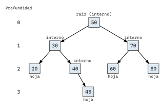
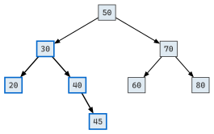
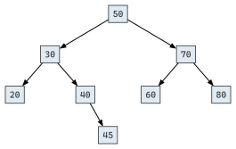
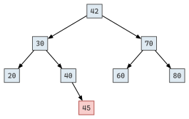
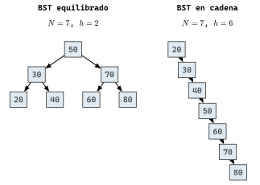
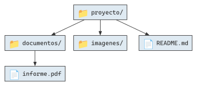

## Introducción

En el apunte anterior representamos la jerarquía de excepciones y la organización de carpetas
mediante árboles. En ambos casos había elementos que dependían de otros y podían tener,
a su vez, sus propios descendientes.

En este apunte vamos a estudiar las partes de un árbol y cómo representarlo con nodos en Python.
Después usaremos un árbol binario de búsqueda para consultar, agregar y eliminar valores,
y veremos distintas formas de recorrer todos sus nodos.

## Descripción de un árbol

Un **árbol** (_tree_) organiza un conjunto de nodos mediante relaciones entre padres e hijos.
Tiene un nodo inicial llamado **raíz** (_root_).
Cada uno de los demás nodos tiene un único padre, aunque un padre puede tener varios hijos.
Si seguimos las conexiones de padres a hijos, nos alejamos de la raíz sin volver a un nodo anterior.

Consideremos el siguiente árbol. Por ahora, los números solamente sirven para identificar los nodos:

{fig-align="center" width="90%" fig-alt="La raíz es 50. Sus hijos son 30 y 70. Los hijos de 30 son 20 y 40, y los de 70 son 60 y 80. El hijo derecho de 40 es 45. Los nodos internos son 50, 30, 70 y 40. Las hojas son 20, 60, 80 y 45."}

::::{.callout-note}
##### Patas para arriba 🌳
En computación, un árbol tiene la raíz arriba de todo y sus ramas y hojas crecen para abajo 😅.
:::


### Terminología

Podemos describir las relaciones del dibujo de la siguiente manera:

| Término                          | Qué indica                                                          | Ejemplo                      |
|----------------------------------|---------------------------------------------------------------------|------------------------------|
| Raíz                             | El nodo que no tiene padre                                          | `50`                         |
| Padre e hijo (_parent_, _child_) | Una relación directa entre dos nodos                                | `30` es padre de `20`        |
| Hermanos (_siblings_)            | Nodos con el mismo padre                                            | `20` y `40`                  |
| Hoja (_leaf_)                    | Un nodo que no tiene hijos                                          | `20`, `60`, `80` y `45`      |
| Nodo interno                     | Un nodo que tiene al menos un hijo                                  | `50`, `30`, `70` y `40`      |
| Ancestro                         | Un nodo que aparece antes en el camino desde la raíz                | `50` es ancestro de `40`     |
| Descendiente                     | Un nodo al que llegamos siguiendo uno o más enlaces hacia los hijos | `40` es descendiente de `50` |


La **profundidad** (_depth_) de un nodo es la cantidad de enlaces que lo separan de la raíz.
En el ejemplo, `50` tiene profundidad 0, `30` tiene profundidad 1, `20` tiene profundidad 2
y `45` tiene profundidad 3.
Podemos agrupar los nodos de igual profundidad en un mismo **nivel** (_level_).

La **altura** (_height_) de un nodo es la mayor cantidad de enlaces que podemos seguir desde él
hasta una hoja. La altura del árbol es la altura de su raíz: en este caso es 3.
Una hoja tiene altura 0. En este apunte contamos enlaces, de modo que un árbol con un único nodo
tiene altura 0 y un solo nivel.

Las hojas no tienen por qué estar a la misma profundidad. `20`, `60` y `80` están en el nivel 2,
mientras que `45` está en el nivel 3. El nodo `40` es interno porque tiene un hijo, aunque no tenga dos.
La raíz también es un nodo interno en este árbol.

### Subárboles

Si tomamos el nodo `30` junto con todos sus descendientes, obtenemos otro árbol.
Esta parte de la estructura es un **subárbol** (_subtree_):

{fig-align="center" width="85%" fig-alt="Se destacan 30, sus hijos 20 y 40 y su descendiente 45 dentro del árbol original."}

El nodo `30` es un hijo de `50`, pero también es la raíz de su propio subárbol.
Esta observación nos va a resultar útil al programar: muchas operaciones sobre un árbol pueden
resolverse repitiendo la misma operación sobre un subárbol más pequeño.

## Árboles binarios

En un árbol general, un nodo puede tener cualquier cantidad de hijos.
Por ejemplo, una carpeta puede contener tres subcarpetas y varios archivos.

Un **árbol binario** (_binary tree_) limita esa cantidad: cada nodo puede tener, como máximo,
dos hijos. Además, distinguimos un hijo izquierdo de un hijo derecho.
Un nodo puede tener ambos, solamente uno de ellos o ninguno.
El árbol de números que venimos usando es binario.

### Árboles binarios de búsqueda

En la Unidad 4 vimos que un arreglo ordenado permite usar búsqueda binaria, pero insertar un elemento
puede requerir desplazar muchos valores para conservar el orden.
¿Podemos organizar los datos de otra manera para facilitar también las inserciones?

Un **árbol binario de búsqueda** (_binary search tree_, BST) agrega una regla al árbol binario:
para cada nodo, todos los valores de su subárbol izquierdo son menores que su valor,
y todos los del subárbol derecho son mayores.
En nuestros ejemplos vamos a guardar números y no vamos a agregar valores repetidos.

{fig-align="center" width="85%" fig-alt="Árbol con raíz 50, subárbol izquierdo 30 con hijos 20 y 40, y subárbol derecho 70 con hijos 60 y 80. El nodo 40 tiene como hijo derecho a 45."}

En la raíz, `20`, `30`, `40` y `45` son menores que `50`, mientras que `60`, `70` y `80` son mayores.
La regla también se cumple dentro de cada subárbol: `20 < 30 < 40 < 45` y `60 < 70 < 80`.
El nodo `45` queda a la derecha de `40`, pero sigue perteneciendo al subárbol izquierdo de `50`.

La regla debe cumplirse para todos los descendientes, no solamente para los hijos directos.
Veamos qué ocurre si reemplazamos el valor de la raíz, `50`, por `42`:

{fig-align="center" width="85%" fig-alt="El nodo 45 aparece en el subárbol izquierdo de la nueva raíz 42, aunque su valor es mayor que 42."}

`45` sigue siendo mayor que su padre `40`, por lo que esa relación directa parece correcta.
Sin embargo, pertenece al subárbol izquierdo de la nueva raíz `42`.
Como `45 > 42`, rompe la regla. Sigue siendo un árbol binario, pero no es un árbol binario de búsqueda.

## Representación de los nodos

En una lista enlazada, cada nodo guardaba un valor y una referencia al siguiente.
Para representar un árbol binario podemos conservar el valor y reemplazar esa referencia por dos:
una al hijo izquierdo y otra al derecho.

```python
class Nodo:
    def __init__(self, valor):
        self.valor = valor
        self.izquierdo = None
        self.derecho = None
```

El valor `None` indica que no hay un hijo en esa posición.
Por ejemplo, podemos construir el árbol que venimos dibujando de esta manera:

```python
n50 = Nodo(50)
n30 = Nodo(30)
n70 = Nodo(70)
n20 = Nodo(20)
n40 = Nodo(40)
n60 = Nodo(60)
n80 = Nodo(80)
n45 = Nodo(45)

n50.izquierdo = n30
n50.derecho = n70
n30.izquierdo = n20
n30.derecho = n40
n70.izquierdo = n60
n70.derecho = n80
n40.derecho = n45

raiz = n50
```

Primero creamos los ocho nodos y después los conectamos.
Por ejemplo, `n30.derecho = n40` hace que el hijo derecho del nodo `30` sea el nodo `40`.
Luego, `n40.derecho = n45` conecta ese nodo con su hijo derecho, `45`.

La asignación `raiz = n50` hace que ambas variables referencien al mismo objeto, sin crear otro nodo.
Desde `raiz` podemos seguir los enlaces para llegar a los demás nodos.
Por ejemplo, `raiz.izquierdo.derecho` referencia al mismo objeto que `n40`.
Para leer su valor, podemos usar `raiz.izquierdo.derecho.valor` o `n40.valor`: en ambos casos obtenemos `40`.
Al igual que en las listas enlazadas, los enlaces entre objetos son los que organizan la estructura.

Como en las listas enlazadas de la Unidad 4, vamos a trabajar con estos nodos y
modificar sus enlaces para agregar o quitar valores.

## Operaciones sobre un árbol binario de búsqueda

Las operaciones de esta sección aprovechan la regla que acabamos de describir.
En un árbol general, sin esa regla de orden, tendríamos que usar otras estrategias.

Para analizar la eficiencia, nos vamos a concentrar en cuántos nodos visitamos.
Vamos a llamar $N$ a la cantidad de nodos del árbol.

### Búsqueda

Supongamos que queremos determinar si el árbol contiene el valor `40`.
Empezamos en la raíz y comparamos el valor buscado con el del nodo actual.
Si son iguales, terminamos. Si el valor es menor, seguimos por el hijo izquierdo.
Si es mayor, seguimos por el derecho.
Si llegamos a `None`, sabemos que el valor no está en el árbol.

:::: {.carousel .dark autoplay="false" id="arboles-busqueda" image-height="300px"}

::: {.item image="imgs/02/busqueda-1.svg" caption="40 es menor que 50. Seguimos por el hijo izquierdo."}
:::

::: {.item image="imgs/02/busqueda-2.svg" caption="40 es mayor que 30. Seguimos por el hijo derecho."}
:::

::: {.item image="imgs/02/busqueda-3.svg" caption="El nodo actual contiene 40. La búsqueda termina."}
:::

::::

Para encontrar `40` seguimos el camino `50`, `30`, `40`.
La regla de orden nos permite descartar el subárbol de `70` desde la primera comparación.

Una implementación es la siguiente:

```python
def buscar(raiz, valor):
    actual = raiz
    while actual is not None:
        if valor == actual.valor:
            # Si el valor buscado coincide con el del nodo, lo encontramos
            return actual

        if valor < actual.valor:
            # Si el valor buscado es menor, seguimos por el hijo izquierdo
            actual = actual.izquierdo
        else:
            # Si el valor buscado es mayor, seguimos por el hijo derecho
            actual = actual.derecho

    # Llegamos a una referencia vacía sin encontrar el valor
    return None
```

```python
buscar(raiz, 40).valor
```
```cmd
40
```
```python
print(buscar(raiz, 47))
```
```cmd
None
```

La función devuelve el nodo encontrado o `None` si no existe.
Por ejemplo, `buscar(raiz, 40).valor` devuelve `40`, mientras que `buscar(raiz, 47)` devuelve `None`.
En la segunda búsqueda seguimos `50`, `30`, `40` y `45`. Como `47 > 45`,
intentamos avanzar hacia la derecha y nos encontramos con `None`.

En la búsqueda binaria de la Unidad 4 reducíamos un intervalo de índices dentro de un arreglo.
Aquí también descartamos una parte de los valores en cada paso, pero lo hacemos siguiendo
los enlaces del árbol.

La regla de un BST permite decidir por qué hijo continuar, pero no garantiza que el árbol esté equilibrado.
Si está equilibrado, sus ramas tienen alturas parecidas y su altura es aproximadamente $\log_2 N$.
Como en cada paso bajamos un nivel, la búsqueda requiere a lo sumo una cantidad de visitas
del orden de $\log N$. Por eso su costo es $O(\log N)$.

En cambio, si insertamos los valores de menor a mayor, cada nuevo nodo queda como hijo derecho
del anterior. Si los insertamos de mayor a menor, ocurre lo mismo hacia la izquierda.
Así podemos obtener una cadena de $N$ nodos, con altura $N - 1$.
Buscar el último valor de esa cadena puede requerir visitar todos los nodos y costar $O(N)$.

{fig-align="center" width="90%" fig-alt="A la izquierda, un BST equilibrado de altura 2, con raíz 50, hijos 30 y 70, y hojas 20, 40, 60 y 80. A la derecha, los mismos siete valores forman una cadena hacia la derecha, desde 20 hasta 80, de altura 6."}

En el árbol de la izquierda, buscar `80` requiere visitar `50`, `70` y `80`.
En el de la derecha, tenemos que pasar por los siete nodos para llegar al mismo valor.
Ambos cumplen la regla de un BST, pero la forma del árbol cambia el costo de la búsqueda.

### Inserción

Ahora queremos insertar `35`. Para encontrar su lugar usamos las mismas comparaciones
que en una búsqueda. Cuando encontramos una referencia vacía, la reemplazamos por un nuevo nodo.

:::: {.carousel .dark autoplay="false" id="arboles-insercion" image-height="300px"}

::: {.item image="imgs/02/insercion-1.svg" caption="35 es menor que 50. Seguimos hacia 30."}
:::

::: {.item image="imgs/02/insercion-2.svg" caption="35 es mayor que 30. Seguimos hacia 40."}
:::

::: {.item image="imgs/02/insercion-3.svg" caption="35 es menor que 40.<br>Su referencia izquierda está vacía."}
:::

::: {.item image="imgs/02/insercion-4.svg" caption="Creamos el nodo 35.<br>Lo enlazamos como hijo izquierdo de 40."}
:::

::::

El lugar de `35` está a la izquierda de `40`, cuyo enlace izquierdo es `None`.
Para insertarlo cambiamos ese enlace, sin desplazar los demás valores como ocurría en un arreglo.

Podemos expresar la inserción de forma recursiva:

```python
def insertar(raiz, valor):
    # Si llegamos a una referencia vacía, creamos el nuevo nodo
    if raiz is None:
        return Nodo(valor)

    if valor < raiz.valor:
        # Si el valor es menor, insertamos en el subárbol izquierdo
        raiz.izquierdo = insertar(raiz.izquierdo, valor)
    elif valor > raiz.valor:
        # Si el valor es mayor, insertamos en el subárbol derecho
        raiz.derecho = insertar(raiz.derecho, valor)

    # Devolvemos la raíz del subárbol para que la llamada anterior guarde el enlace
    # Si el valor ya existía, no agregamos otro nodo
    return raiz
```

Cada llamada devuelve la raíz del subárbol después de la inserción.
Cuando `insertar(None, 35)` crea el nodo, su resultado queda guardado en el enlace izquierdo de `40`.
Las llamadas anteriores devuelven los nodos `40`, `30` y `50`, que siguen siendo las raíces de sus subárboles.
Si el valor ya existe, la función devuelve el mismo nodo sin agregar otro.

Por eso usamos la función de esta manera:

```python
raiz = insertar(raiz, 35)
```

Guardar el resultado también permite empezar con un árbol vacío, representado por `None`.
En ese caso, la función crea el primer nodo y pasa a ser la raíz.

Para insertar primero buscamos el lugar y después conectamos el nuevo nodo.
Por eso, como en la búsqueda, el costo es $O(\log N)$ si el árbol está equilibrado
y puede llegar a $O(N)$ si forma una cadena.

### Eliminación

Supongamos que queremos eliminar un valor del árbol.
Como en la búsqueda, primero tenemos que localizar el nodo que lo contiene.
Empezamos en la raíz y seguimos por el hijo izquierdo o derecho según el resultado de cada comparación.
Si llegamos a `None`, el valor no existe y no hay nada que eliminar.

Una vez encontrado el nodo, ¿alcanza con cambiar por `None` el enlace que llega a él?
Si es una hoja, sí. Pero si tiene hijos, ese cambio también dejaría desconectados a todos sus descendientes.
Para conservarlos tenemos que distinguir tres casos: un nodo sin hijos, con un hijo o con dos hijos.

Vamos a analizar cada caso sobre el árbol original, sin el `35` que insertamos antes.
Antes de probar cada ejemplo, volvemos a construirlo:

```python
raiz = None
for valor in [50, 30, 70, 20, 40, 60, 80, 45]:
    raiz = insertar(raiz, valor)
```

#### Nodo sin hijos

Empecemos por eliminar `20`.
Primero lo buscamos: como `20 < 50`, seguimos hacia `30`. Como `20 < 30`, seguimos hacia su hijo izquierdo.
Allí encontramos `20` y comprobamos que sus dos referencias son `None`.
Recién entonces podemos quitar el enlace que llega a esa hoja.

:::: {.carousel .dark autoplay="false" id="arboles-eliminacion" image-height="300px"}

::: {.item image="imgs/02/eliminacion-1.svg" caption="Buscamos 20.<br>20 es menor que 50: seguimos por el hijo izquierdo."}
:::

::: {.item image="imgs/02/eliminacion-2.svg" caption="20 es menor que 30. Seguimos por el hijo izquierdo."}
:::

::: {.item image="imgs/02/eliminacion-3.svg" caption="Encontramos 20.<br>No tiene hijos, por lo que es una hoja."}
:::

::: {.item image="imgs/02/eliminacion-4.svg" caption="La referencia izquierda de 30 pasa a ser None.<br>Los demás enlaces se conservan."}
:::

::::

El cambio concreto es que el atributo `izquierdo` del nodo `30` deja de referenciar al nodo `20` y pasa a ser `None`.
En el código, la llamada que recibe el nodo `20` devuelve `None` y la llamada anterior guarda
ese resultado en `raiz.izquierdo`, donde `raiz` es el nodo `30`.

#### Nodo con un hijo

Ahora volvemos al árbol original y queremos eliminar `40`.
Seguimos el camino `50`, `30`, `40`, igual que en la búsqueda que vimos antes.
Esta vez el nodo tiene un hijo derecho, `45`, y no tiene hijo izquierdo.
Si reemplazáramos el enlace por `None`, también perderíamos el acceso a `45`.
Para conservarlo, hacemos que el enlace derecho de `30` apunte directamente al nodo `45`.

:::: {.carousel .dark autoplay="false" id="arboles-eliminacion-un-hijo" image-height="300px"}

::: {.item image="imgs/02/eliminacion-un-hijo-1.svg" caption="Buscamos 40.<br>40 es menor que 50: seguimos por el hijo izquierdo."}
:::

::: {.item image="imgs/02/eliminacion-un-hijo-2.svg" caption="40 es mayor que 30. Seguimos por el hijo derecho."}
:::

::: {.item image="imgs/02/eliminacion-un-hijo-3.svg" caption="Encontramos 40.<br>Tiene un hijo derecho y no tiene hijo izquierdo."}
:::

::: {.item image="imgs/02/eliminacion-un-hijo-4.svg" caption="El hijo 45 debe seguir conectado cuando quitemos 40."}
:::

::: {.item image="imgs/02/eliminacion-un-hijo-5.svg" caption="El enlace derecho de 30 pasa a apuntar a 45.<br>El nodo 40 queda fuera del árbol."}
:::

::::

La llamada que recibe el nodo `40` devuelve `raiz.derecho`, que referencia a `45`.
La llamada anterior guarda ese resultado en el atributo `derecho` del nodo `30`.
Si el único hijo fuera el izquierdo, devolveríamos `raiz.izquierdo`.
El mismo cambio sirve si ese hijo tiene descendientes, porque sus enlaces se conservan.

Una vez encontrado el nodo, alcanza con cambiar un enlace, incluso si el hijo tiene muchos descendientes.
Lo mismo ocurre al quitar una hoja. El trabajo principal está en localizar el nodo.

#### Nodo con dos hijos

Volvamos otra vez al árbol original y eliminemos `30`.
Después de comparar con `50`, encontramos `30` como su hijo izquierdo.
Este nodo tiene dos hijos, `20` y `40`.
No podemos reemplazarlo directamente por uno de ellos sin decidir qué hacer con el otro subárbol.

Necesitamos un valor que pueda ocupar el lugar de `30` y conserve la regla de orden.
Podemos usar el menor valor del subárbol derecho, llamado **sucesor inorden** (_inorder successor_).
En este caso es el menor valor del árbol que supera a `30`.
El nombre se relaciona con el recorrido inorden, que veremos más adelante.
Para encontrarlo, empezamos por el hijo derecho y seguimos por los hijos izquierdos hasta que no haya otro.
En este ejemplo, el hijo derecho es `40` y no tiene hijo izquierdo, por lo que `40` es el sucesor.

:::: {.carousel .dark autoplay="false" id="arboles-eliminacion-dos-hijos" image-height="300px"}

::: {.item image="imgs/02/eliminacion-dos-hijos-1.svg" caption="Buscamos 30.<br>30 es menor que 50: seguimos por el hijo izquierdo."}
:::

::: {.item image="imgs/02/eliminacion-dos-hijos-2.svg" caption="Encontramos 30. Tiene dos hijos, 20 y 40."}
:::

::: {.item image="imgs/02/eliminacion-dos-hijos-3.svg" caption="Para buscar el sucesor,<br>empezamos en el subárbol derecho, por el nodo 40."}
:::

::: {.item image="imgs/02/eliminacion-dos-hijos-4.svg" caption="40 no tiene hijo izquierdo: es el menor del subárbol.<br>Es el sucesor de 30."}
:::

::: {.item image="imgs/02/eliminacion-dos-hijos-5.svg" caption="Copiamos 40 en el nodo que contenía 30.<br>Falta quitar el nodo original del sucesor."}
:::

::: {.item image="imgs/02/eliminacion-dos-hijos-6.svg" caption="Quitamos el 40 original y enlazamos a su hijo 45.<br>El subárbol queda con raíz 40 e hijos 20 y 45."}
:::

::::

Primero copiamos `40` en el nodo que contenía `30`. Durante ese paso aparecen dos nodos con valor `40`.
Para completar la operación, eliminamos el nodo original del sucesor dentro del subárbol derecho.
Como ese nodo solo tiene un hijo, `45`, lo quitamos con el procedimiento del caso anterior.
Al terminar, el hijo izquierdo de `50` es el nodo cuyo valor ahora es `40`, con `20` a la izquierda y `45` a la derecha.

El reemplazo conserva la regla de búsqueda: `20` sigue siendo menor que `40`, y `45` es mayor.
En general, el sucesor es mayor que todos los valores del subárbol izquierdo y menor que
los valores que quedan en el derecho después de quitarlo.
Además, el sucesor nunca tiene hijo izquierdo. Si lo tuviera, no sería el menor de ese subárbol.
Por eso, quitarlo de su posición original siempre se reduce a uno de los dos casos anteriores.

En este caso también buscamos y quitamos el sucesor. Eso agrega pasos, pero seguimos recorriendo
caminos limitados por la altura del árbol. La eliminación cuesta $O(\log N)$ si el árbol
está equilibrado y puede llegar a $O(N)$ si forma una cadena.

#### Implementación

Podemos reunir los tres casos en una sola función.
Cada llamada devuelve la raíz del subárbol que queda después de eliminar el valor,
o `None` si ese subárbol queda vacío. Los enlaces se modifican sobre los mismos nodos:

```python
def eliminar(raiz, valor):
    # Si llegamos a una referencia vacía, el valor no está en el árbol
    if raiz is None:
        return None

    if valor < raiz.valor:
        # Si el valor es menor, lo buscamos en el subárbol izquierdo
        raiz.izquierdo = eliminar(raiz.izquierdo, valor)
    elif valor > raiz.valor:
        # Si el valor es mayor, lo buscamos en el subárbol derecho
        raiz.derecho = eliminar(raiz.derecho, valor)
    else:
        # Si es una hoja, devolvemos None para que el padre vacíe su enlace
        if raiz.izquierdo is None and raiz.derecho is None:
            return None

        # Si tiene un solo hijo, ese hijo ocupa su lugar
        if raiz.izquierdo is None:
            return raiz.derecho
        if raiz.derecho is None:
            return raiz.izquierdo

        # Si tiene dos hijos, buscamos el menor valor del subárbol derecho
        sucesor = raiz.derecho
        while sucesor.izquierdo is not None:
            sucesor = sucesor.izquierdo

        # Copiamos el valor y quitamos el sucesor de su posición original
        raiz.valor = sucesor.valor
        raiz.derecho = eliminar(raiz.derecho, sucesor.valor)

    # Devolvemos la raíz del subárbol, con los cambios realizados
    return raiz
```

Guardamos el resultado para conservar la raíz del árbol modificado:

```python
raiz = eliminar(raiz, 20)
```

En este ejemplo, la llamada que encuentra `20` devuelve `None` y la de `30` lo guarda
en su enlace izquierdo. La llamada principal devuelve el nodo `50`, que sigue siendo la raíz.

Si eliminamos la raíz, el resultado puede ser otro nodo o `None` si era el único del árbol.
Si el valor no existe, el árbol queda sin cambios.

## Recorridos

Buscar un valor nos permite seguir solamente una parte del árbol.
Pero si queremos mostrar todos sus elementos, necesitamos visitar cada nodo.
Ese proceso se llama **recorrido** (_traversal_).

Vamos a comparar tres recorridos sobre el mismo árbol de números: preorden, inorden y postorden.
Los implementaremos con **recursión**: como cada subárbol también es un árbol, la función
se llama a sí misma sobre el hijo izquierdo y el derecho. Si recibe `None`, devuelve `[]`: ese es el caso base.

Cada llamada combina las listas devueltas por sus hijos con `[nodo.valor]` y devuelve el resultado
a la llamada anterior, que continúa desde donde había quedado.
El orden de esas tres partes distingue los recorridos. Después veremos sus aplicaciones.

Para seguir los recorridos vamos a reconstruir el árbol original, sin las modificaciones anteriores:

```python
raiz = None
for valor in [50, 30, 70, 20, 40, 60, 80, 45]:
    raiz = insertar(raiz, valor)
```

### Preorden

En **preorden** (_preorder_) visitamos primero el nodo actual, después recorremos su subárbol
izquierdo y por último el derecho.
En nuestro árbol empezamos agregando `50` a la lista. Luego seguimos hacia `30`, que agregamos
antes de recorrer sus hijos `20` y `40`.

#### Preorden paso a paso

:::: {.carousel .dark autoplay="false" id="arboles-preorden" image-height="320px"}

::: {.item image="imgs/02/preorden-1.svg" caption="Empezamos en 50. La lista todavía está vacía."}
:::

::: {.item image="imgs/02/preorden-2.svg" caption="Visitamos 50.<br>Agregamos su valor antes de recorrer sus hijos."}
:::

::: {.item image="imgs/02/preorden-3.svg" caption="Seguimos hacia el hijo izquierdo, 30."}
:::

::: {.item image="imgs/02/preorden-4.svg" caption="Visitamos 30 y lo agregamos después de 50.<br>Sus hijos todavía están pendientes."}
:::

::: {.item image="imgs/02/preorden-5.svg" caption="Seguimos hacia el hijo izquierdo de 30: el nodo 20."}
:::

::: {.item image="imgs/02/preorden-6.svg" caption="Visitamos 20 y lo agregamos como tercer valor.<br>Como es una hoja, esta llamada termina."}
:::

::: {.item image="imgs/02/preorden-7.svg" caption="Volvemos a 30 y seguimos con su hijo derecho, 40."}
:::

::: {.item image="imgs/02/preorden-8.svg" caption="Visitamos 40 y agregamos el cuarto valor.<br>Su hijo derecho todavía está pendiente."}
:::

::: {.item image="imgs/02/preorden-9.svg" caption="Seguimos el enlace derecho de 40 y llegamos a 45."}
:::

::: {.item image="imgs/02/preorden-10.svg" caption="Visitamos 45 y agregamos el quinto valor.<br>Terminó el subárbol de 30."}
:::

::: {.item image="imgs/02/preorden-11.svg" caption="Volvemos a 50 y seguimos con su hijo derecho, 70."}
:::

::: {.item image="imgs/02/preorden-12.svg" caption="Visitamos 70 y agregamos el sexto valor.<br>Todavía faltan sus dos hijos."}
:::

::: {.item image="imgs/02/preorden-13.svg" caption="Seguimos hacia el hijo izquierdo de 70: el nodo 60."}
:::

::: {.item image="imgs/02/preorden-14.svg" caption="Visitamos 60 y agregamos el séptimo valor.<br>Como es una hoja, volvemos a 70."}
:::

::: {.item image="imgs/02/preorden-15.svg" caption="Seguimos con el hijo derecho de 70 y llegamos a 80."}
:::

::: {.item image="imgs/02/preorden-16.svg" caption="Visitamos 80 y agregamos el octavo valor.<br>Terminan las llamadas pendientes, recorrido completo."}
:::

::::

#### Implementación de preorden

En el código, la lista con el valor actual aparece antes que los resultados de sus subárboles:

```python
def preorden(nodo):
    # Un subárbol vacío no aporta valores
    if nodo is None:
        return []

    # Nodo actual, subárbol izquierdo y subárbol derecho
    return [nodo.valor] + preorden(nodo.izquierdo) + preorden(nodo.derecho)
```

Podemos comprobar el resultado llamando a la función con la raíz:

```python
print(preorden(raiz))
```

```text
[50, 30, 20, 40, 45, 70, 60, 80]
```

La llamada de `30` devuelve `[30, 20, 40, 45]` y la de `70` devuelve `[70, 60, 80]`.
La llamada inicial coloca `[50]` antes de esas dos listas.
Por eso cada nodo aparece antes que todos sus descendientes.

### Inorden

En **inorden** (_inorder_) recorremos primero el subárbol izquierdo, después visitamos el nodo
actual y por último recorremos el derecho.
A diferencia de preorden, al llegar a `50` todavía no agregamos su valor. Primero necesitamos
obtener los valores de su izquierda.

#### Inorden paso a paso

Empezamos en `50`, pero dejamos pendiente su valor para recorrer primero el subárbol izquierdo.
Llamamos a `inorden` con `30` y esa llamada necesita recorrer primero el subárbol de `20`.
A eso nos referimos con bajar: seguir un enlace hacia un hijo mediante una llamada recursiva.
En esos primeros pasos todavía no agregamos ningún valor a la lista de visitas.

:::: {.carousel .dark autoplay="false" id="arboles-inorden" image-height="320px"}

::: {.item image="imgs/02/inorden-1.svg" caption="Empezamos en 50. Su valor queda pendiente.<br>Primero recorremos el subárbol izquierdo."}
:::

::: {.item image="imgs/02/inorden-2.svg" caption="Seguimos el enlace izquierdo de 50 y llegamos a 30.<br>Su valor también queda pendiente."}
:::

::: {.item image="imgs/02/inorden-3.svg" caption="Seguimos el enlace izquierdo de 30 y llegamos a 20.<br>No tiene hijo izquierdo: ya podemos visitar 20."}
:::

::: {.item image="imgs/02/inorden-4.svg" caption="Visitamos 20: agregamos el primer valor.<br>Tampoco tiene hijo derecho, esta llamada termina."}
:::

::: {.item image="imgs/02/inorden-5.svg" caption="Volvemos a 30. Terminó su subárbol izquierdo.<br>Agregamos 30 como segundo valor."}
:::

::: {.item image="imgs/02/inorden-6.svg" caption="La llamada de 30 continúa con su hijo derecho, 40.<br>40 no tiene hijo izquierdo."}
:::

::: {.item image="imgs/02/inorden-7.svg" caption="Visitamos 40: agregamos el tercer valor.<br>Todavía falta recorrer su subárbol derecho."}
:::

::: {.item image="imgs/02/inorden-8.svg" caption="Seguimos el enlace derecho de 40 y llegamos a 45.<br>No tiene hijo izquierdo."}
:::

::: {.item image="imgs/02/inorden-9.svg" caption="Visitamos 45: agregamos el cuarto valor.<br>Sin hijo derecho, regresamos por 40 y 30."}
:::

::: {.item image="imgs/02/inorden-10.svg" caption="Terminó todo el subárbol izquierdo de 50.<br>Retomamos su llamada y agregamos 50 como quinto valor."}
:::

::: {.item image="imgs/02/inorden-11.svg" caption="La llamada de 50 continúa con su hijo derecho, 70.<br>Antes de visitar 70, recorremos su izquierda."}
:::

::: {.item image="imgs/02/inorden-12.svg" caption="Seguimos el enlace izquierdo de 70 y llegamos a 60.<br>No tiene hijo izquierdo."}
:::

::: {.item image="imgs/02/inorden-13.svg" caption="Visitamos 60: agregamos el sexto valor.<br>No tiene hijo derecho. Esta llamada termina."}
:::

::: {.item image="imgs/02/inorden-14.svg" caption="Volvemos a 70. Terminó su subárbol izquierdo.<br>Agregamos 70 como séptimo valor."}
:::

::: {.item image="imgs/02/inorden-15.svg" caption="La llamada de 70 continúa con su hijo derecho, 80.<br>No tiene hijo izquierdo."}
:::

::: {.item image="imgs/02/inorden-16.svg" caption="Visitamos 80: agregamos el octavo valor.<br>Terminan las llamadas de 80, 70 y 50."}
:::

::::

#### Implementación de inorden

La lista con el valor actual queda entre los resultados del subárbol izquierdo y el derecho:

```python
def inorden(nodo):
    # Un subárbol vacío no aporta valores
    if nodo is None:
        return []

    # Subárbol izquierdo, nodo actual y subárbol derecho
    return inorden(nodo.izquierdo) + [nodo.valor] + inorden(nodo.derecho)
```

Las primeras tres llamadas trabajan con `50`, `30` y `20`, pero todavía no procesan sus valores.
En `20`, la llamada con su hijo izquierdo recibe `None` y devuelve `[]`.
Después ubicamos `20` en el resultado y la llamada con su hijo derecho también devuelve `[]`.
La llamada de `20` combina esas partes y devuelve `[] + [20] + []`, es decir, `[20]`.

Volver a `30` significa retomar la llamada que esperaba el resultado de su subárbol izquierdo.
No hay un enlace desde `20` hacia su padre. Es la ejecución de las funciones la que regresa a la llamada anterior.
La llamada de `30` ya tiene `[20]` para su izquierda. Ubica su propio valor después y continúa con el subárbol de `40`.
Esa rama devuelve `[40, 45]`, por lo que el resultado de `30` es `[20] + [30] + [40, 45]`.

Recién cuando esa llamada devuelve `[20, 30, 40, 45]` podemos continuar con el valor de `50`
y después recorrer su subárbol derecho, que devuelve `[60, 70, 80]`.
La llamada inicial combina esas tres partes y devuelve la lista completa.

```python
print(inorden(raiz))
```

```text
[20, 30, 40, 45, 50, 60, 70, 80]
```

### Postorden

En **postorden** (_postorder_) recorremos primero el subárbol izquierdo, después el derecho
y por último visitamos el nodo actual.
Cuando llegamos a `50`, dejamos su valor pendiente hasta terminar las dos ramas.
Lo mismo ocurre en `30`: antes de agregarlo tenemos que procesar `20` y todo el subárbol de `40`.

#### Postorden paso a paso

:::: {.carousel .dark autoplay="false" id="arboles-postorden" image-height="320px"}

::: {.item image="imgs/02/postorden-1.svg" caption="Empezamos en 50 y dejamos su valor pendiente.<br>Primero debemos terminar ambos subárboles."}
:::

::: {.item image="imgs/02/postorden-2.svg" caption="Seguimos hacia 30 y dejamos su valor pendiente.<br>Primero recorremos sus hijos."}
:::

::: {.item image="imgs/02/postorden-3.svg" caption="Llegamos a 20.<br>Como es una hoja, no tiene subárboles pendientes."}
:::

::: {.item image="imgs/02/postorden-4.svg" caption="Visitamos 20 y agregamos el primer valor a la lista."}
:::

::: {.item image="imgs/02/postorden-5.svg" caption="Volvemos a 30. Terminó su subárbol izquierdo.<br>Todavía falta recorrer su subárbol derecho."}
:::

::: {.item image="imgs/02/postorden-6.svg" caption="Seguimos hacia 40.<br>Su valor queda pendiente porque tiene un hijo derecho."}
:::

::: {.item image="imgs/02/postorden-7.svg" caption="Llegamos a 45, que no tiene hijos."}
:::

::: {.item image="imgs/02/postorden-8.svg" caption="Visitamos 45 y agregamos el segundo valor."}
:::

::: {.item image="imgs/02/postorden-9.svg" caption="Volvemos a 40. Ya terminaron sus subárboles.<br>Agregamos 40 como tercer valor."}
:::

::: {.item image="imgs/02/postorden-10.svg" caption="Volvemos a 30. Ya terminaron sus dos subárboles.<br>Agregamos 30 como cuarto valor."}
:::

::: {.item image="imgs/02/postorden-11.svg" caption="Volvemos a 50 y dejamos su valor pendiente.<br>Todavía falta recorrer el subárbol derecho."}
:::

::: {.item image="imgs/02/postorden-12.svg" caption="Seguimos hacia 70 y dejamos su valor pendiente.<br>Primero recorremos sus hijos."}
:::

::: {.item image="imgs/02/postorden-13.svg" caption="Llegamos a 60, que no tiene hijos."}
:::

::: {.item image="imgs/02/postorden-14.svg" caption="Visitamos 60 y agregamos el quinto valor."}
:::

::: {.item image="imgs/02/postorden-15.svg" caption="Volvemos a 70.<br>Antes de agregarlo, falta recorrer su hijo derecho."}
:::

::: {.item image="imgs/02/postorden-16.svg" caption="Llegamos a 80, que tampoco tiene hijos."}
:::

::: {.item image="imgs/02/postorden-17.svg" caption="Visitamos 80 y agregamos el sexto valor."}
:::

::: {.item image="imgs/02/postorden-18.svg" caption="Volvemos a 70. Ya terminaron ambos subárboles.<br>Agregamos 70 como séptimo valor."}
:::

::: {.item image="imgs/02/postorden-19.svg" caption="Volvemos a 50 y agregamos su valor al final.<br>Ya visitamos a todos sus descendientes."}
:::

::::

#### Implementación de postorden

En el código, la lista con el valor actual aparece después de los resultados de ambos subárboles:

```python
def postorden(nodo):
    # Un subárbol vacío no aporta valores
    if nodo is None:
        return []

    # Subárbol izquierdo, subárbol derecho y nodo actual
    return postorden(nodo.izquierdo) + postorden(nodo.derecho) + [nodo.valor]
```

Veamos el resultado para el mismo árbol:

```python
print(postorden(raiz))
```

```text
[20, 45, 40, 30, 60, 80, 70, 50]
```

La llamada de `40` obtiene `[]` de su izquierda y `[45]` de su derecha.
Después agrega su propio valor y devuelve `[45, 40]`.
La de `30` combina `[20] + [45, 40] + [30]` y devuelve `[20, 45, 40, 30]`.
En la raíz, el resultado del subárbol izquierdo se combina con `[60, 80, 70]` y finalmente con `[50]`.
Por eso la raíz aparece al final de la lista.

### Comparación de los recorridos

En los tres recorridos hacemos las mismas tareas, pero cambiamos el momento de la visita.
En nuestro código, visitar significa ubicar el valor del nodo en el resultado.
Después vamos a usar esos mismos órdenes para realizar otras tareas en cada visita.

| Recorrido | Orden de las tareas | Resultado para el árbol del ejemplo |
| --- | --- | --- |
| Preorden | Nodo, izquierdo, derecho | `50, 30, 20, 40, 45, 70, 60, 80` |
| Inorden | Izquierdo, nodo, derecho | `20, 30, 40, 45, 50, 60, 70, 80` |
| Postorden | Izquierdo, derecho, nodo | `20, 45, 40, 30, 60, 80, 70, 50` |

: {tbl-colwidths="[15, 35, 50]"}

En las tres versiones visitamos cada nodo una vez.
Si contamos esas visitas, el recorrido completo requiere $O(N)$ pasos.
Cambiar el orden en que incorporamos los valores modifica el resultado, pero no la cantidad de nodos visitados.

::: {.callout-note}
##### Costo de las concatenaciones

Para simplificar el código, combinamos los resultados con `+`. Las concatenaciones agregan trabajo
que no estamos considerando al contar las visitas: el $O(N)$ describe esas visitas, no el costo total de estas funciones.
Podemos evitar las concatenaciones pasando una misma lista a todas las llamadas para acumular los valores,
o usando generadores.
:::

### Aplicaciones de los recorridos

Hasta acá usamos cada visita para ubicar un número en una lista.
Podemos conservar el orden de las visitas y cambiar qué hacemos con cada nodo.
Veamos cómo preorden permite mostrar una jerarquía y postorden permite evaluar una expresión.

En estas aplicaciones vamos a trabajar con distintos tipos de árboles.
El árbol de carpetas puede tener más de dos hijos por nodo.
Para evaluar la expresión usaremos un árbol binario cuyos nodos representan operaciones y operandos.

#### Mostrar una jerarquía con preorden

Retomemos las carpetas del apunte anterior.

{fig-align="center" width="80%" fig-alt="La carpeta proyecto contiene documentos, imagenes y README.md. Documentos contiene informe.pdf e imagenes está vacía."}

Este es un árbol general: una carpeta puede contener cualquier cantidad de archivos y subcarpetas.
Por ejemplo, `proyecto` tiene tres hijos: `documentos`, `imagenes` y `README.md`.
Por eso no podemos representarlo con nuestra clase `Nodo`, que solo tiene las referencias
`izquierdo` y `derecho`. En este caso necesitamos guardar una colección de hijos por nodo.

El comando `tree` muestra esta jerarquía en la terminal. Si ejecutamos `tree .` dentro de `proyecto`,
obtenemos una salida como esta:

```bash
tree .
```

```text
.
├── README.md
├── documentos
│   └── informe.pdf
└── imagenes

3 directories, 2 files
```

El punto representa la carpeta actual, `proyecto`. Cada carpeta aparece antes que su contenido,
y las líneas y la sangría permiten reconocer a qué carpeta pertenece cada elemento.
Vamos a construir un listado similar, usando solamente sangría y siguiendo el orden de los hijos del dibujo.

Podemos usar preorden para escribir cada nodo antes de recorrer sus hijos.
Primero escribimos `proyecto`, después `documentos` y todo su contenido.
Cuando terminamos esa rama, seguimos con `imagenes` y después con `README.md`.

##### Listado paso a paso

A la izquierda recorremos el árbol. A la derecha escribimos una línea por cada visita,
con dos espacios de sangría por cada nivel de profundidad.
Al volver de una llamada, continuamos con el siguiente hijo sin volver a escribir al padre.

:::: {.carousel .dark autoplay="false" id="arboles-aplicacion-directorios" image-width="100%"}

::: {.item image="imgs/02/aplicacion-directorios-1.svg" caption="Empezamos en proyecto/.<br>El listado de la derecha todavía está vacío."}
:::

::: {.item image="imgs/02/aplicacion-directorios-2.svg" caption="Escribimos proyecto/ sin sangría.<br>Después recorreremos su contenido."}
:::

::: {.item image="imgs/02/aplicacion-directorios-3.svg" caption="Seguimos hacia documentos/.<br>Es la primera carpeta hija de proyecto/."}
:::

::: {.item image="imgs/02/aplicacion-directorios-4.svg" caption="Escribimos documentos/ con dos espacios de sangría.<br>Está un nivel debajo de proyecto/."}
:::

::: {.item image="imgs/02/aplicacion-directorios-5.svg" caption="Entramos en documentos/ y llegamos a informe.pdf."}
:::

::: {.item image="imgs/02/aplicacion-directorios-6.svg" caption="Escribimos informe.pdf con cuatro espacios de sangría.<br>Terminó el contenido de documentos/."}
:::

::: {.item image="imgs/02/aplicacion-directorios-7.svg" caption="Volvemos a proyecto/.<br>Seguimos con su siguiente hija, imagenes/."}
:::

::: {.item image="imgs/02/aplicacion-directorios-8.svg" caption="Escribimos imagenes/ con dos espacios de sangría.<br>Como está vacía, volvemos a proyecto/."}
:::

::: {.item image="imgs/02/aplicacion-directorios-9.svg" caption="Seguimos con README.md, el último hijo de proyecto/."}
:::

::: {.item image="imgs/02/aplicacion-directorios-10.svg" caption="Escribimos README.md con dos espacios de sangría.<br>El listado conserva la jerarquía del árbol."}
:::

::::

Al terminar, `informe.pdf` queda debajo de `documentos/` y con un nivel más de sangría.
En cambio, `imagenes/` y `README.md` quedan alineados con `documentos/`, porque los tres son hijos de `proyecto/`.
La diferencia con nuestra función `preorden` está en que aquí recorremos una colección de hijos
y escribimos los nombres con sangría, en lugar de devolver una lista de números.

#### Evaluar una expresión con postorden {#sec-postorden}

Supongamos que un lenguaje de programación tiene que evaluar esta expresión:

```python
a = 15
b = 27
c = 2.5

a / (2 * b - c)
```

Podemos representarla con un árbol. La raíz es la división, su hijo izquierdo es `a`
y su hijo derecho es la resta `2 * b - c`.
Dentro de esa resta, el hijo izquierdo representa `2 * b` y el derecho representa `c`.
Las hojas contienen variables o constantes.

A esta representación la llamamos **árbol de sintaxis abstracta** (_abstract syntax tree_, AST).
Cuando escribimos expresiones en R o Python, estos lenguajes construyen internamente árboles
de este tipo para representar las operaciones y sus operandos.

Este árbol es binario porque cada operación del ejemplo tiene dos operandos.
Pero no es un árbol binario de búsqueda: la ubicación de los nodos indica qué operandos
corresponden a cada operación, sin seguir una regla de orden entre sus valores.

Para resolver una operación primero necesitamos los valores de sus operandos.
La división debe esperar a que se resuelva la resta y la resta necesita el resultado de la multiplicación.
Una forma de evaluar la expresión es recorrer el árbol en postorden: procesamos una operación
después de obtener los resultados de sus dos subárboles.

##### Evaluación paso a paso

A la izquierda, cada hoja consultada y cada operación resuelta queda en verde.
Cuando obtenemos el resultado de una operación, reemplazamos ese subárbol por su valor.
A la derecha mostramos la expresión como código y reemplazamos cada variable u operación cuando obtenemos su valor.

:::: {.carousel .dark autoplay="false" id="arboles-aplicacion-expresion" image-width="100%"}

::: {.item image="imgs/02/aplicacion-expresion-1.svg" caption="La raíz es la división.<br>Primero necesitamos los valores de sus dos operandos."}
:::

::: {.item image="imgs/02/aplicacion-expresion-2.svg" caption="Seguimos el hijo izquierdo de la división.<br>Llegamos a la variable a."}
:::

::: {.item image="imgs/02/aplicacion-expresion-3.svg" caption="Consultamos el valor de a y obtenemos 15.<br>La hoja pasa a ser 15: ya tenemos el numerador."}
:::

::: {.item image="imgs/02/aplicacion-expresion-4.svg" caption="Seguimos el hijo derecho de la división: la resta.<br>Sus operandos todavía están pendientes."}
:::

::: {.item image="imgs/02/aplicacion-expresion-5.svg" caption="Empezamos por el hijo izquierdo de la resta.<br>Es la multiplicación."}
:::

::: {.item image="imgs/02/aplicacion-expresion-6.svg" caption="Seguimos el hijo izquierdo de la multiplicación.<br>Llegamos a la constante 2."}
:::

::: {.item image="imgs/02/aplicacion-expresion-7.svg" caption="La constante ya tiene su valor, 2.<br>La marcamos como procesada."}
:::

::: {.item image="imgs/02/aplicacion-expresion-8.svg" caption="Seguimos el hijo derecho de la multiplicación.<br>Llegamos a b."}
:::

::: {.item image="imgs/02/aplicacion-expresion-9.svg" caption="Consultamos el valor de b y obtenemos 27.<br>La hoja pasa a ser 27: ya tenemos ambos factores."}
:::

::: {.item image="imgs/02/aplicacion-expresion-10.svg" caption="Volvemos a la multiplicación y calculamos 2 * 27 = 54.<br>Ese subárbol queda reemplazado por 54."}
:::

::: {.item image="imgs/02/aplicacion-expresion-11.svg" caption="Para completar la resta, seguimos su hijo derecho.<br>Llegamos a c."}
:::

::: {.item image="imgs/02/aplicacion-expresion-12.svg" caption="Consultamos el valor de c y obtenemos 2.5.<br>Reemplazamos la hoja por ese valor."}
:::

::: {.item image="imgs/02/aplicacion-expresion-13.svg" caption="Volvemos a la resta y calculamos 54 - 2.5 = 51.5.<br>El denominador queda resuelto."}
:::

::: {.item image="imgs/02/aplicacion-expresion-14.svg" caption="Calculamos 15 / 51.5.<br>Reemplazamos la raíz por el resultado ≈ 0.291262."}
:::

::::

El recorrido establece en qué orden podemos procesar los nodos.
Para evaluar la expresión, la tarea de cada visita consiste en consultar una variable,
leer una constante o aplicar una operación a los resultados de sus hijos.
La función `postorden` que escribimos antes devuelve una lista con los valores en ese orden.
Un evaluador usaría los resultados numéricos de los hijos para calcular el resultado de cada operación.

## Eficiencia

La cantidad de nodos que visitamos al buscar, insertar o eliminar depende de la forma del BST.
La siguiente tabla resume el costo en el peor caso para cada forma:

| Operación   | Árbol equilibrado | Árbol en cadena |
|-------------|-------------------|-----------------|
| Búsqueda    | $O(\log N)$       | $O(N)$          |
| Inserción   | $O(\log N)$       | $O(N)$          |
| Eliminación | $O(\log N)$       | $O(N)$          |

En cambio, los recorridos visitan los $N$ nodos, cualquiera sea la forma del árbol.
Contando esas visitas, su costo es $O(N)$, con la salvedad sobre las concatenaciones que mencionamos antes.

Un BST no garantiza que el árbol quede equilibrado. Existen árboles que se reorganizan
para mantener una altura pequeña, pero no los desarrollaremos aquí.

## Implementación completa

Podemos reunir las funciones anteriores en un mismo archivo.
`buscar`, `insertar` y `eliminar` suponen que se cumple la regla del árbol binario de búsqueda.
Los recorridos también sirven para otros árboles binarios, aunque en ese caso inorden no garantiza
que los valores queden ordenados.

Podés descargar el código en [arboles.py](arboles.py).

```python
class Nodo:
    def __init__(self, valor):
        self.valor = valor
        self.izquierdo = None
        self.derecho = None


def buscar(raiz, valor):
    actual = raiz
    while actual is not None:
        if valor == actual.valor:
            return actual
        if valor < actual.valor:
            actual = actual.izquierdo
        else:
            actual = actual.derecho
    return None


def insertar(raiz, valor):
    if raiz is None:
        return Nodo(valor)
    if valor < raiz.valor:
        raiz.izquierdo = insertar(raiz.izquierdo, valor)
    elif valor > raiz.valor:
        raiz.derecho = insertar(raiz.derecho, valor)
    return raiz


def eliminar(raiz, valor):
    # Si llegamos a una referencia vacía, el valor no está en el árbol
    if raiz is None:
        return None

    if valor < raiz.valor:
        # Si el valor es menor, lo buscamos en el subárbol izquierdo
        raiz.izquierdo = eliminar(raiz.izquierdo, valor)
    elif valor > raiz.valor:
        # Si el valor es mayor, lo buscamos en el subárbol derecho
        raiz.derecho = eliminar(raiz.derecho, valor)
    else:
        # Encontramos el valor. Si es una hoja, quitamos el enlace
        if raiz.izquierdo is None and raiz.derecho is None:
            return None

        # Si tiene un solo hijo, ese hijo ocupa su lugar
        if raiz.izquierdo is None:
            return raiz.derecho
        if raiz.derecho is None:
            return raiz.izquierdo

        # Si tiene dos hijos, buscamos el menor valor del subárbol derecho
        sucesor = raiz.derecho
        while sucesor.izquierdo is not None:
            sucesor = sucesor.izquierdo

        # Copiamos el valor y quitamos el sucesor de su posición original
        raiz.valor = sucesor.valor
        raiz.derecho = eliminar(raiz.derecho, sucesor.valor)

    # Devolvemos la raíz del subárbol, con los cambios realizados
    return raiz


def preorden(nodo):
    # Un subárbol vacío no aporta valores
    if nodo is None:
        return []

    # Nodo actual, subárbol izquierdo y subárbol derecho
    return [nodo.valor] + preorden(nodo.izquierdo) + preorden(nodo.derecho)


def inorden(nodo):
    # Un subárbol vacío no aporta valores
    if nodo is None:
        return []

    # Subárbol izquierdo, nodo actual y subárbol derecho
    return inorden(nodo.izquierdo) + [nodo.valor] + inorden(nodo.derecho)


def postorden(nodo):
    # Un subárbol vacío no aporta valores
    if nodo is None:
        return []

    # Subárbol izquierdo, subárbol derecho y nodo actual
    return postorden(nodo.izquierdo) + postorden(nodo.derecho) + [nodo.valor]
```

Para construir un árbol y usar las operaciones:

```python
raiz = None
for valor in [50, 30, 70, 20, 40, 60, 80, 45]:
    raiz = insertar(raiz, valor)

nodo = buscar(raiz, 40)
print(nodo.valor)

raiz = insertar(raiz, 35)
raiz = eliminar(raiz, 20)
codigos = inorden(raiz)
print(codigos)
```

```text
40
[30, 35, 40, 45, 50, 60, 70, 80]
```

El ejemplo empieza con el árbol original.
La inserción agrega `35` como hijo izquierdo de `40` y la eliminación quita la hoja `20`.
El recorrido inorden conserva el orden creciente de los valores.

## Siguientes pasos

Un árbol permite organizar datos mediante nodos que se ramifican.
Trabajamos con una variante, el árbol binario de búsqueda, cuya regla de orden nos permite
buscar, insertar y eliminar valores siguiendo una parte de sus enlaces.
También vimos tres recorridos: preorden para procesar un nodo antes que sus descendientes,
inorden para obtener los valores ordenados de un árbol de búsqueda y postorden para resolver
una operación después de conocer los resultados de sus operandos.

Aunque trabajamos con pocos números, estas mismas ideas aparecen en aplicaciones mucho más grandes:

- **Bases de datos.** Muchos índices usan variantes de árboles, como los árboles B y B+,
  para localizar registros y consultar rangos de valores sin recorrer toda una tabla.
  La organización de sus nodos también busca reducir los accesos al almacenamiento.
- **Compiladores e intérpretes.** El código de un programa puede representarse mediante un árbol de sintaxis.
  Ya usamos esta idea al [evaluar una expresión en postorden](#sec-postorden), resolviendo los operandos antes de cada operación.
- **Gráficos 3D y videojuegos.** Se usan árboles que agrupan objetos dentro de regiones del espacio.
  Para comprobar qué puede tocar un rayo o qué objetos podrían chocar, se descartan ramas completas
  cuyas regiones no participan de la consulta. Así se evitan muchas comprobaciones individuales.
- **Aprendizaje automático.** Los árboles de decisión también tienen nodos, ramas y hojas.
  Para predecir, seguimos desde la raíz las ramas indicadas por condiciones sobre los datos.
  La estructura resulta familiar, aunque las reglas para construir estos árboles son distintas de las de un BST.

En esas aplicaciones, un nodo guarda más información que los números de nuestro ejemplo
y las reglas para organizar los enlaces pueden ser distintas.
Para entenderlas sirven varias de las preguntas que ya trabajamos:
qué guarda cada nodo, por qué enlaces conviene seguir y en qué orden necesitamos procesar los datos.

En el próximo apunte vamos a trabajar con grafos.
Retomaremos la red de ciudades conectadas por vuelos, donde puede haber ciclos y distintos caminos
entre dos lugares. Nos servirán las ideas de nodos, enlaces y recorridos que empezamos a desarrollar acá.
