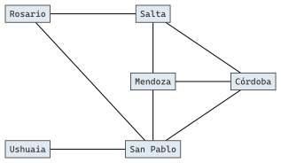
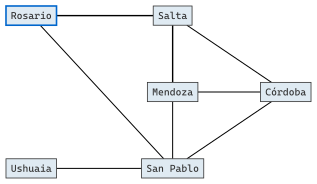
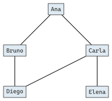

## Descripción de un grafo

En la introducción de la unidad representamos ciudades conectadas por vuelos.
Podíamos consultar destinos directos, pero también viajar a otra ciudad pasando por lugares intermedios.
Ahora vamos a guardar esas conexiones en Python y escribir operaciones para consultarlas,
modificarlas y recorrer la red.

Para seguir los ejemplos con más facilidad, vamos a conservar seis ciudades de aquella red:
Rosario, Salta, Córdoba, Mendoza, San Pablo y Ushuaia. Quitamos Buenos Aires y Lima junto con sus conexiones.
Trabajaremos con las conexiones que quedan entre las ciudades elegidas, tratadas en ambos sentidos.
Seguimos usando el modelo de la introducción, sin considerar horarios, precios ni distancias.

{fig-align="center" width="65%" fig-alt="Rosario conecta con Salta y San Pablo. Salta conecta también con Córdoba y Mendoza. Córdoba conecta con Mendoza y San Pablo. Mendoza conecta con San Pablo y San Pablo con Ushuaia. Las conexiones no tienen dirección."}

Un **grafo** (_graph_) está formado por **vértices** (_vertices_), también llamados nodos,
y **aristas** (_edges_) que los conectan. En este ejemplo, cada ciudad es un vértice
y cada conexión directa es una arista.

Podemos describir el dibujo con algunos términos:

| Término | Qué indica | Ejemplo |
| --- | --- | --- |
| Vecinos | Vértices unidos por una arista | Salta y San Pablo son vecinos de Rosario |
| Camino | Una sucesión de vértices unidos por aristas | Rosario, Salta, Mendoza |
| Ciclo | Un camino que vuelve al inicio sin repetir aristas ni los demás vértices | Rosario, Salta, Mendoza, San Pablo, Rosario |

En este grafo, un ciclo incluye al menos tres vértices distintos.
Ir de Rosario a Salta y volver por la misma arista no forma un ciclo.

No hay una conexión directa entre Rosario y Mendoza, pero podemos llegar pasando por Salta
o por San Pablo. Es decir, hay distintos caminos entre las mismas ciudades.

{fig-align="center" width="65%" fig-alt="Se destacan los enlaces Rosario–Salta y Salta–Mendoza dentro de la misma red."}

A diferencia de los árboles con raíz que estudiamos, esta red no tiene una raíz ni relaciones
de padres e hijos. Para recorrerla podemos elegir cualquier ciudad como origen.
También podemos volver a una ciudad por otro camino, algo que tendremos que considerar al programar.
Un árbol también puede verse como un grafo no dirigido: todos sus nodos están conectados y no tiene ciclos.

En este apunte usamos un grafo **no dirigido**, porque cada conexión se puede seguir en ambos sentidos.
En un grafo **dirigido**, una conexión de un vértice a otro no implica que exista la conexión inversa.
También podríamos asociar un **peso** a cada arista, como una distancia o un costo.
Nuestro ejemplo es **sin pesos**: solamente registra qué ciudades están conectadas.

## Representación en Python

En la introducción guardamos las conexiones como pares. Para esta red, la lista sería:

```python
conexiones = [
    ("Rosario", "Salta"),
    ("Rosario", "San Pablo"),
    ("Salta", "Córdoba"),
    ("Salta", "Mendoza"),
    ("Córdoba", "Mendoza"),
    ("Córdoba", "San Pablo"),
    ("Mendoza", "San Pablo"),
    ("San Pablo", "Ushuaia"),
]
```

Esta lista permite guardar las aristas, pero para encontrar todos los vecinos de una ciudad
tenemos que revisar los pares y comprobar en cuál de sus dos posiciones aparece.
Por ejemplo, San Pablo aparece como segundo elemento en varios pares y como primero en otro.

Podemos facilitar esa consulta con un diccionario. Cada clave será una ciudad y su valor será
una lista con sus vecinos. Esta representación se conoce como **listas de adyacencia** (_adjacency lists_):

```python
grafo = {
    "Rosario": ["Salta", "San Pablo"],
    "Salta": ["Rosario", "Córdoba", "Mendoza"],
    "Córdoba": ["Salta", "Mendoza", "San Pablo"],
    "Mendoza": ["Salta", "Córdoba", "San Pablo"],
    "San Pablo": ["Rosario", "Córdoba", "Mendoza", "Ushuaia"],
    "Ushuaia": ["San Pablo"],
}
```

Ahora `grafo["San Pablo"]` devuelve directamente `["Rosario", "Córdoba", "Mendoza", "Ushuaia"]`.
Cada conexión aparece en dos listas porque el grafo es no dirigido.
Por ejemplo, Salta está en la lista de Rosario y Rosario está en la de Salta.
Son dos referencias que representan una misma arista.

El orden de los vecinos no cambia qué conexiones existen, pero sí puede cambiar el orden de un recorrido.
Vamos a conservar el orden de estas listas para que el código y las figuras produzcan los mismos resultados.

### Matriz de adyacencia

También podemos representar las conexiones con una **matriz de adyacencia** (_adjacency matrix_).
Asignamos una fila y una columna a cada ciudad, en el mismo orden.
Un `1` indica que existe una arista desde la ciudad de la fila hacia la de la columna.
Un `0` indica que no existe esa conexión directa.

Usamos este orden para las filas y las columnas: Rosario, Salta, Córdoba, Mendoza, San Pablo y Ushuaia.
La matriz de adyacencia es:

$$
A = \begin{pmatrix}
0 & 1 & 0 & 0 & 1 & 0 \\
1 & 0 & 1 & 1 & 0 & 0 \\
0 & 1 & 0 & 1 & 1 & 0 \\
0 & 1 & 1 & 0 & 1 & 0 \\
1 & 0 & 1 & 1 & 0 & 1 \\
0 & 0 & 0 & 0 & 1 & 0
\end{pmatrix}
$$

En la primera fila, el `1` de la segunda columna representa la conexión Rosario–Salta.
La segunda fila también tiene un `1` en la primera columna porque la conexión se puede seguir en ambos sentidos.
Esto ocurre con todas las aristas: como el grafo es no dirigido, la matriz es **simétrica**
respecto de su diagonal principal. La diagonal tiene ceros porque no conectamos una ciudad consigo misma.

Los grafos dirigidos también se pueden representar con matrices.
En ese caso, un `1` en la primera fila y la segunda columna no obliga a tener un `1` en la segunda fila y la primera columna.
Si el grafo tuviera pesos, las celdas podrían guardar esos valores, acordando además cómo representar
la ausencia de una conexión.

La matriz permite comprobar una conexión consultando una sola celda, en $O(1)$,
pero reserva $V^2$ posiciones si hay $V$ vértices, aunque existan pocas aristas.
Las listas de adyacencia ocupan $O(V + E)$, donde $E$ es la cantidad de aristas,
y permiten recorrer directamente los vecinos de una ciudad. Para comprobar una conexión,
en cambio, hay que buscar el destino dentro de la lista de vecinos del origen.

En Python podríamos guardar la matriz con listas de listas o con un arreglo de NumPy.
Para las operaciones y los recorridos vamos a seguir usando el diccionario de vecinos.

## Operaciones básicas

Vamos a trabajar directamente con el diccionario y sus listas.
Las funciones modificarán el grafo que reciben, sin crear una copia.
Suponemos que las ciudades usadas en una consulta existen y que no conectamos una ciudad consigo misma.

### Consultar vecinos y conexiones

Para consultar vecinos usamos la clave de la ciudad. Para comprobar una conexión directa,
buscamos el destino en su lista:

```python
print(grafo["Rosario"])
print("Salta" in grafo["Rosario"])
print("Mendoza" in grafo["Rosario"])
```

```text
['Salta', 'San Pablo']
True
False
```

El último resultado solamente indica que no hay una arista entre Rosario y Mendoza.
Para saber si podemos llegar mediante conexiones intermedias necesitaremos recorrer el grafo.

### Agregar un vértice

Supongamos que incorporamos Paraná a la red y después agregamos una conexión con Rosario.

Agregar una ciudad consiste en crear una clave con una lista vacía:

```python
def agregar_vertice(grafo, vertice):
    # Un vértice nuevo empieza sin vecinos
    if vertice not in grafo:
        grafo[vertice] = []


agregar_vertice(grafo, "Paraná")
print(grafo["Paraná"])
```

```text
[]
```

Paraná ya es un vértice, pero todavía está aislado.
No podemos llegar desde Rosario porque ninguna arista lo conecta con el resto de la red.
Si la clave ya existía, la función conserva sus vecinos.

### Agregar y quitar una arista

Para conectar Rosario con Paraná tenemos que modificar las listas de ambas ciudades:

```python
def agregar_arista(grafo, origen, destino):
    # Los dos vértices deben existir. Guardamos la conexión en ambos sentidos
    if destino not in grafo[origen]:
        grafo[origen].append(destino)
    if origen not in grafo[destino]:
        grafo[destino].append(origen)


agregar_arista(grafo, "Rosario", "Paraná")
print(grafo["Rosario"])
print(grafo["Paraná"])
```

```text
['Salta', 'San Pablo', 'Paraná']
['Rosario']
```

El primer `append` agrega Paraná a los vecinos de Rosario y el segundo agrega Rosario a los de Paraná.
Las comprobaciones evitan guardar dos veces la misma conexión si repetimos la llamada.

Para quitarla hacemos el cambio inverso:

```python
def quitar_arista(grafo, origen, destino):
    # Quitamos las dos referencias de una conexión no dirigida
    if destino in grafo[origen]:
        grafo[origen].remove(destino)
    if origen in grafo[destino]:
        grafo[destino].remove(origen)


quitar_arista(grafo, "Rosario", "Paraná")
print(grafo["Rosario"])
print(grafo["Paraná"])
```

```text
['Salta', 'San Pablo']
[]
```

Paraná sigue existiendo en el diccionario, pero vuelve a quedar aislado.
Si borráramos una sola de las referencias, el diccionario dejaría de representar correctamente
una conexión no dirigida.

Para eliminar también un vértice, primero lo quitamos de las listas de sus vecinos y después borramos su clave:

```python
def quitar_vertice(grafo, vertice):
    # Antes de borrar la clave, lo quitamos de las listas de sus vecinos
    for vecino in grafo[vertice]:
        grafo[vecino].remove(vertice)
    del grafo[vertice]


agregar_arista(grafo, "Rosario", "Paraná")
quitar_vertice(grafo, "Paraná")
print("Paraná" in grafo)
print(grafo["Rosario"])
```

```text
False
['Salta', 'San Pablo']
```

Volvimos a conectar Paraná para mostrar ambos cambios: quitar su referencia de la lista de Rosario
y borrar la clave `"Paraná"`. El grafo queda como al principio.

## Recorridos

Supongamos que queremos listar todas las ciudades a las que podemos llegar desde Rosario,
incluida la ciudad de origen. Tenemos que seguir sus conexiones y las de sus vecinos.
Pero, a diferencia del árbol, seguir un enlace puede llevarnos a un vértice que ya visitamos.

Por ejemplo, desde Rosario podemos ir a Salta y desde Salta volver a Rosario.
Si llamáramos de nuevo a la función sin registrar las visitas, repetiríamos las mismas llamadas indefinidamente.
El ciclo Rosario–Salta–Mendoza–San Pablo–Rosario también permite volver al inicio por otra ruta.

Para evitarlo vamos a guardar los vértices descubiertos en un conjunto llamado `visitados`.
Antes de continuar hacia un vecino comprobaremos si ya está registrado.
Además, usaremos una lista `orden` para conservar el orden del resultado.
El conjunto permite consultar si una ciudad ya apareció y la lista permite recordar cuándo la incorporamos.

Vamos a comparar dos recorridos sobre el grafo original de seis ciudades.
En las figuras, el verde indica que una ciudad ya está registrada en `visitados`
y el borde verde oscuro marca la ciudad actual.
A la derecha aparecen el resultado y las llamadas activas o la cola de pendientes.

### Recorrido en profundidad

El **recorrido en profundidad** (_depth-first search_, DFS) avanza hacia un vecino nuevo
y continúa desde él antes de revisar los siguientes vecinos del vértice anterior.
Cuando no quedan vecinos nuevos, vuelve a la llamada anterior.
Podemos implementarlo con recursión, como hicimos con los árboles.

#### DFS paso a paso

Empezamos desde Rosario y agregamos cada ciudad al resultado al entrar a su llamada.
La columna de llamadas muestra el camino actual, con la llamada más reciente abajo.

:::: {.carousel .dark autoplay="false" id="grafos-dfs" image-width="100%"}

::: {.item image="imgs/03/dfs-1.svg" caption="Todavía no visitamos ninguna ciudad.<br>El resultado y las llamadas activas están vacíos."}
:::

::: {.item image="imgs/03/dfs-2.svg" caption="Visitamos Rosario y lo agregamos al resultado.<br>Su primer vecino es Salta."}
:::

::: {.item image="imgs/03/dfs-3.svg" caption="Seguimos Rosario–Salta y registramos Salta.<br>Rosario ya está visitado. Seguimos hacia Córdoba."}
:::

::: {.item image="imgs/03/dfs-4.svg" caption="Registramos Córdoba. Salta ya está visitada.<br>Seguimos hacia Mendoza."}
:::

::: {.item image="imgs/03/dfs-5.svg" caption="Registramos Mendoza. Salta y Córdoba ya se visitaron.<br>El siguiente vecino nuevo es San Pablo."}
:::

::: {.item image="imgs/03/dfs-6.svg" caption="Registramos San Pablo y seguimos hacia Ushuaia.<br>Rosario, Córdoba y Mendoza ya están visitados."}
:::

::: {.item image="imgs/03/dfs-7.svg" caption="Registramos Ushuaia. San Pablo ya está visitado.<br>Sin más vecinos, esta llamada termina."}
:::

::: {.item image="imgs/03/dfs-8.svg" caption="Volvemos a San Pablo.<br>No quedan vecinos pendientes en esta llamada."}
:::

::: {.item image="imgs/03/dfs-9.svg" caption="Volvemos a Mendoza.<br>Ya revisamos todos sus vecinos y su llamada termina."}
:::

::: {.item image="imgs/03/dfs-10.svg" caption="Volvemos a Córdoba. San Pablo ya está visitado.<br>No quedan vecinos pendientes. La llamada termina."}
:::

::: {.item image="imgs/03/dfs-11.svg" caption="Volvemos a Salta. Mendoza ya está visitado.<br>No quedan vecinos pendientes. La llamada termina."}
:::

::: {.item image="imgs/03/dfs-12.svg" caption="Volvemos a Rosario. San Pablo ya está visitado.<br>Su llamada termina."}
:::

::: {.item image="imgs/03/dfs-13.svg" caption="Ya no hay llamadas activas.<br>Devolvemos la lista completa."}
:::

::::

Al volver, la ejecución retoma cada llamada donde había quedado pendiente su `for`.
Por ejemplo, la llamada de Salta continúa con Mendoza después de volver de Córdoba.
Como Mendoza ya está registrado, no hace otra llamada.

#### Implementación de DFS

```python
def dfs(grafo, origen):
    visitados = set()
    orden = []

    def visitar(actual):
        # Registramos el vértice antes de seguir sus conexiones
        visitados.add(actual)
        orden.append(actual)

        for vecino in grafo[actual]:
            if vecino not in visitados:
                visitar(vecino)

    visitar(origen)
    return orden
```

La función interna `visitar` comparte `visitados` y `orden` entre todas las llamadas.
Cuando encuentra un vecino nuevo, la llamada recursiva se completa antes de que el `for`
continúe con el siguiente.

Si el recorrido requiere muchas llamadas anidadas, esta versión puede superar el límite de recursión
de Python y producir un `RecursionError`. Una implementación con una pila explícita evita ese límite.

```python
print(dfs(grafo, "Rosario"))
```

```text
['Rosario', 'Salta', 'Córdoba', 'Mendoza', 'San Pablo', 'Ushuaia']
```

El resultado depende del orden de las listas de vecinos, aunque las conexiones sean las mismas.

#### DFS desde San Pablo

Desde Rosario descubrimos todas las ciudades antes de que termine la primera llamada recursiva.
Para ver cómo una vuelta permite explorar otra rama, probemos desde San Pablo:

```python
print(dfs(grafo, "San Pablo"))
```

```text
['San Pablo', 'Rosario', 'Salta', 'Córdoba', 'Mendoza', 'Ushuaia']
```

San Pablo tiene como vecinos a Rosario, Córdoba, Mendoza y Ushuaia, en ese orden.
La ejecución sigue estos pasos:

| Momento | Qué ocurre |
| --- | --- |
| Entramos a San Pablo | Lo registramos y llamamos a `visitar("Rosario")` |
| Avanzamos desde Rosario | Descubrimos Salta, Córdoba y Mendoza mediante llamadas sucesivas |
| Llegamos a Mendoza | Todos sus vecinos están registrados; su llamada termina |
| Volvemos a San Pablo | Terminan las llamadas de Córdoba, Salta y Rosario. El `for` de San Pablo continúa: omite Córdoba y Mendoza y llama a `visitar("Ushuaia")` |
| Terminamos | Ushuaia no tiene vecinos nuevos; su llamada termina y luego termina la de San Pablo |

Por eso Ushuaia aparece después de Mendoza en el resultado, aunque no exista una arista
entre ellas: volvimos a San Pablo antes de continuar hacia Ushuaia.

### Recorrido en anchura

Ahora queremos procesar primero todos los vecinos directos de Rosario y después los que vamos
descubriendo desde ellos. Para lograrlo, en lugar de continuar inmediatamente desde cada vecino,
lo guardamos al final de una cola.

El **recorrido en anchura** (_breadth-first search_, BFS) usa esa cola para recordar los pendientes.
La primera ciudad que entra es la primera que sale.

#### BFS paso a paso

Empezamos registrando Rosario en `visitados` y agregándolo a la cola.
En cada paso sacamos una ciudad, la agregamos al resultado y revisamos sus vecinos.
Los vecinos nuevos se registran y se agregan al final de la cola.
En la figura, la próxima ciudad en salir está arriba.

:::: {.carousel .dark autoplay="false" id="grafos-bfs" image-width="100%"}

::: {.item image="imgs/03/bfs-1.svg" caption="Registramos Rosario y lo ponemos en la cola.<br>Todavía no hay ciudades en el resultado."}
:::

::: {.item image="imgs/03/bfs-2.svg" caption="Sacamos Rosario. Registramos Salta y San Pablo.<br>Los encolamos en ese orden."}
:::

::: {.item image="imgs/03/bfs-3.svg" caption="Sacamos Salta. Rosario ya está registrado.<br>Registramos y encolamos Córdoba y Mendoza."}
:::

::: {.item image="imgs/03/bfs-4.svg" caption="Sacamos San Pablo. Registramos y encolamos Ushuaia.<br>Rosario, Córdoba y Mendoza ya están registrados."}
:::

::: {.item image="imgs/03/bfs-5.svg" caption="Sacamos Córdoba. Sus vecinos ya están registrados.<br>No agregamos ciudades a la cola."}
:::

::: {.item image="imgs/03/bfs-6.svg" caption="Sacamos Mendoza. No tiene vecinos nuevos.<br>En la cola solo queda Ushuaia."}
:::

::: {.item image="imgs/03/bfs-7.svg" caption="Sacamos Ushuaia. San Pablo ya está registrado.<br>La cola queda vacía y el recorrido termina."}
:::

::::

En el paso de San Pablo, Córdoba y Mendoza ya están registrados aunque todavía no hayan salido de la cola.
Si esperáramos a registrarlos hasta sacarlos, podríamos encolarlos de nuevo desde San Pablo.
Por eso registramos cada vértice cuando lo agregamos a la cola.

#### Implementación de BFS

Podemos representar la cola con una lista y un índice `siguiente` que indique la posición
de la próxima ciudad a procesar. Agregamos los vecinos nuevos al final con `append`.
En lugar de borrar el primer elemento, avanzamos el índice:

```python
def bfs(grafo, origen):
    # Registramos cada vértice al agregarlo a la cola
    visitados = {origen}
    cola = [origen]
    siguiente = 0
    orden = []

    while siguiente < len(cola):
        actual = cola[siguiente]
        siguiente += 1
        orden.append(actual)

        for vecino in grafo[actual]:
            if vecino not in visitados:
                visitados.add(vecino)
                cola.append(vecino)

    return orden
```

Después de procesar Rosario, `cola` contiene `["Rosario", "Salta", "San Pablo"]`
y `siguiente` vale `1`: el próximo turno es de Salta. Al procesarla, Córdoba y Mendoza
se agregan al final y el índice avanza a `2`, donde está San Pablo.
La lista conserva las ciudades procesadas; las figuras muestran solamente las que siguen pendientes.
El recorrido termina cuando el índice alcanza el largo de la lista.
Así evitamos desplazar los demás elementos cada vez que procesamos una ciudad.

```python
print(bfs(grafo, "Rosario"))
```

```text
['Rosario', 'Salta', 'San Pablo', 'Córdoba', 'Mendoza', 'Ushuaia']
```

### Comparación de los recorridos

Los dos recorridos alcanzan las mismas ciudades desde un mismo origen:

| Recorrido | Cómo recuerda dónde continuar | Cómo avanza |
| --- | --- | --- |
| DFS | Llamadas recursivas | Continúa desde un vecino nuevo antes de revisar los demás |
| BFS | Cola | Procesa primero las ciudades a una arista del origen, después las que están a dos, y así sucesivamente |

: {tbl-colwidths="[15, 40, 45]"}

Desde Rosario, BFS procesa Salta y San Pablo, que están a un tramo, antes que Córdoba,
Mendoza y Ushuaia, cuya menor cantidad de tramos desde el origen es dos.
Ese orden permite encontrar caminos con la menor cantidad de aristas en un grafo sin pesos.

## Aplicaciones

En los dos recorridos construimos una lista de vértices alcanzables.
Podemos usar ese resultado para responder preguntas sobre viajes o sobre relaciones entre personas,
sin cambiar las funciones `dfs` y `bfs`.

### Viajar mediante conexiones

Podemos usar cualquiera de las listas para responder la pregunta que dejamos pendiente:
¿es posible llegar de Rosario a Mendoza aunque no tengan una conexión directa?

```python
alcanzables = bfs(grafo, "Rosario")
print("Mendoza" in alcanzables)
```

```text
True
```

Esto comprueba que existe algún camino. La lista de visitas no es un itinerario:
dos ciudades consecutivas en ella no tienen por qué estar conectadas directamente.
Por ejemplo, BFS devuelve Salta y San Pablo una después de la otra, pero no hay una arista entre ellas.

En nuestro ejemplo todas las ciudades están conectadas entre sí mediante algún camino.
Si agregamos otra ciudad sin aristas, el recorrido desde Rosario no la alcanzará:

```python
agregar_vertice(grafo, "Paraná")
print("Paraná" in bfs(grafo, "Rosario"))
quitar_vertice(grafo, "Paraná")
```

```text
False
```

Un recorrido desde un origen solamente alcanza la parte del grafo conectada con él.
No necesita visitar todos los vértices que guardamos en el diccionario.

### Encontrar contactos indirectos

Supongamos ahora que los vértices representan personas y una arista indica que dos personas
son contactos en una red. Queremos saber qué personas puede alcanzar Ana mediante sus contactos,
aunque todavía no tenga una conexión directa con ellas.

{fig-align="center" width="65%" fig-alt="Ana conecta con Bruno y Carla. Bruno conecta con Diego. Carla conecta con Diego y Elena. Todas las conexiones son mutuas."}

La forma de guardar las relaciones es la misma que usamos para las ciudades:

```python
red_contactos = {
    "Ana": ["Bruno", "Carla"],
    "Bruno": ["Ana", "Diego"],
    "Carla": ["Ana", "Diego", "Elena"],
    "Diego": ["Bruno", "Carla"],
    "Elena": ["Carla"],
}

print(bfs(red_contactos, "Ana"))
```

```text
['Ana', 'Bruno', 'Carla', 'Diego', 'Elena']
```

El recorrido empieza en Ana y registra a Bruno y Carla, sus contactos directos.
Al procesar Bruno descubre a Diego. Cuando llega el turno de Carla, Diego ya está registrado,
por lo que solamente agrega a Elena a la cola.

Para quedarnos con los contactos indirectos, podemos quitar del resultado a Ana y a quienes
ya aparecen en su lista de vecinos:

```python
alcanzables = bfs(red_contactos, "Ana")
directos = red_contactos["Ana"]
indirectos = [
    persona for persona in alcanzables
    if persona != "Ana" and persona not in directos
]
print(indirectos)
```

```text
['Diego', 'Elena']
```

Diego es alcanzable por Bruno o por Carla, mientras que Elena es alcanzable por Carla.
Si hubiera más personas conectadas a través de ellos, el recorrido también las alcanzaría.
La lista reúne candidatos para sugerir contactos, pero todavía no establece a quiénes conviene recomendar.

## Eficiencia de los recorridos

Si llamamos $V$ a la cantidad de vértices y $E$ a la de aristas, un recorrido que alcanza todo
el grafo requiere $O(V + E)$ de tiempo: registra cada vértice una vez y revisa las listas de vecinos.
En un grafo no dirigido, cada arista aparece dos veces, una en cada extremo.
Usamos un conjunto para `visitados` porque las consultas de pertenencia y las inserciones
cuestan $O(1)$ en promedio. La lista `orden`, en cambio, conserva la secuencia del resultado.
En BFS, leer la siguiente ciudad por su índice cuesta $O(1)$; los `append` de todo el recorrido
cuestan $O(V)$ en total.
El conjunto, el resultado y las llamadas o la cola necesitan $O(V)$ de memoria adicional.
Si hay partes desconectadas, el recorrido solo procesa los vértices y las aristas que alcanza.

## Implementación completa

Podés descargar el código reunido en [grafos.py](grafos.py).
La función `crear_red` devuelve un diccionario nuevo para empezar cada ejemplo con la red original.

```python
"""Ejemplos del apunte de grafos: red no dirigida y sin pesos."""

def agregar_vertice(grafo, vertice):
    # Un vértice nuevo empieza sin vecinos
    if vertice not in grafo:
        grafo[vertice] = []


def agregar_arista(grafo, origen, destino):
    # Los dos vértices deben existir. Guardamos la conexión en ambos sentidos
    if destino not in grafo[origen]:
        grafo[origen].append(destino)
    if origen not in grafo[destino]:
        grafo[destino].append(origen)


def quitar_arista(grafo, origen, destino):
    # Quitamos las dos referencias de una conexión no dirigida
    if destino in grafo[origen]:
        grafo[origen].remove(destino)
    if origen in grafo[destino]:
        grafo[destino].remove(origen)


def quitar_vertice(grafo, vertice):
    # Antes de borrar la clave, lo quitamos de las listas de sus vecinos
    for vecino in grafo[vertice]:
        grafo[vecino].remove(vertice)
    del grafo[vertice]


def dfs(grafo, origen):
    visitados = set()
    orden = []

    def visitar(actual):
        # Registramos el vértice antes de seguir sus conexiones
        visitados.add(actual)
        orden.append(actual)

        for vecino in grafo[actual]:
            if vecino not in visitados:
                visitar(vecino)

    visitar(origen)
    return orden


def bfs(grafo, origen):
    # Registramos cada vértice al agregarlo a la cola
    visitados = {origen}
    cola = [origen]
    siguiente = 0
    orden = []

    while siguiente < len(cola):
        actual = cola[siguiente]
        siguiente += 1
        orden.append(actual)

        for vecino in grafo[actual]:
            if vecino not in visitados:
                visitados.add(vecino)
                cola.append(vecino)

    return orden


def crear_red():
    """Devuelve una copia nueva de la selección de seis ciudades del apunte."""
    return {
        "Rosario": ["Salta", "San Pablo"],
        "Salta": ["Rosario", "Córdoba", "Mendoza"],
        "Córdoba": ["Salta", "Mendoza", "San Pablo"],
        "Mendoza": ["Salta", "Córdoba", "San Pablo"],
        "San Pablo": ["Rosario", "Córdoba", "Mendoza", "Ushuaia"],
        "Ushuaia": ["San Pablo"],
    }
```

Para probar los recorridos desde ese archivo:

```python
grafo = crear_red()
print(dfs(grafo, "Rosario"))
print(bfs(grafo, "Rosario"))
```

```text
['Rosario', 'Salta', 'Córdoba', 'Mendoza', 'San Pablo', 'Ushuaia']
['Rosario', 'Salta', 'San Pablo', 'Córdoba', 'Mendoza', 'Ushuaia']
```
